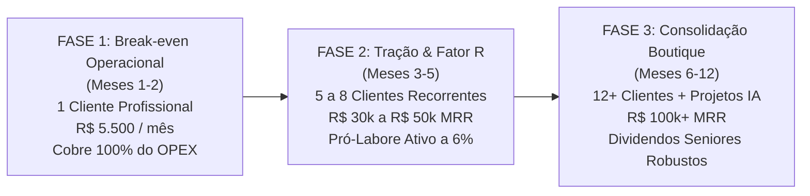
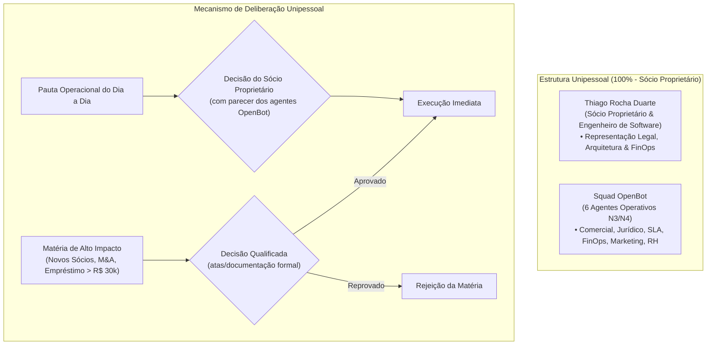
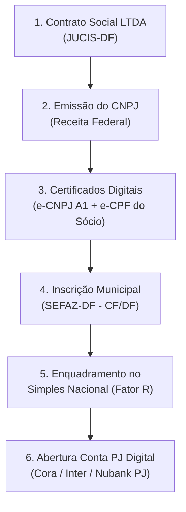
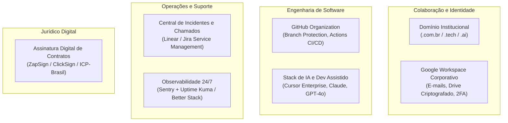
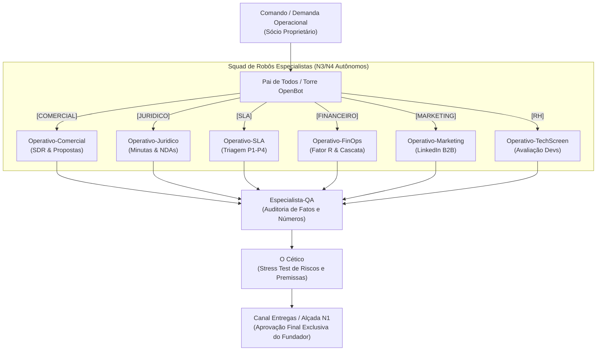
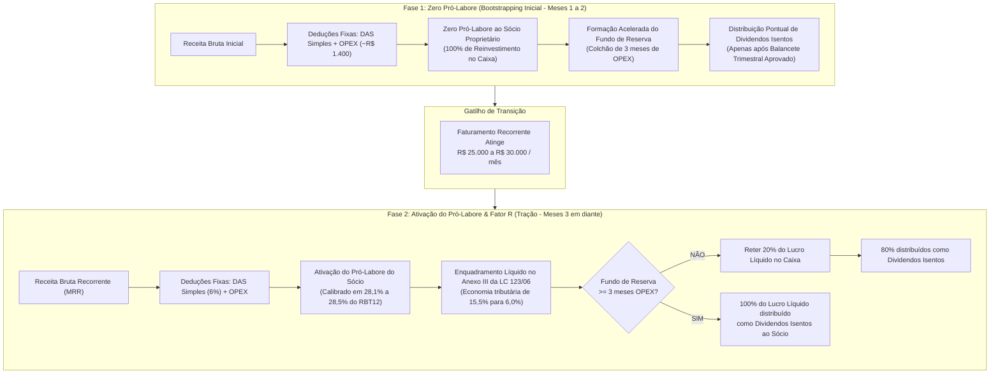
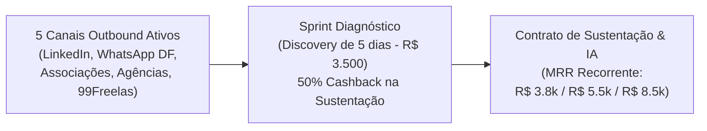
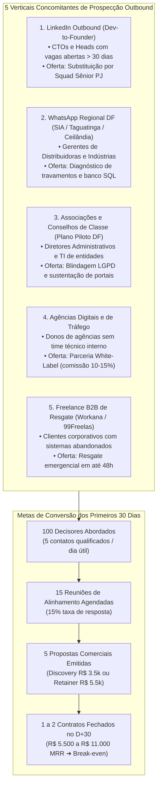
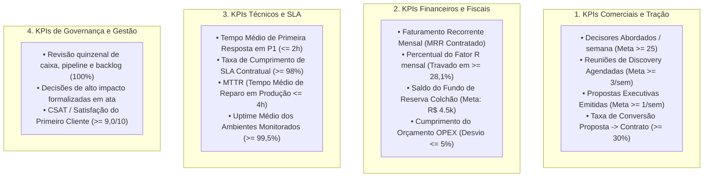

# PLANO MESTRE DE LANÇAMENTO EMPRESARIAL & GOVERNANÇA OPERACIONAL
### Fundação, Estruturação Societária, Engenharia Tributária e Go-to-Market (D-60 a D+30)
**Boutique de Engenharia de Software, Sustentação de Sistemas & Soluções de Inteligência Artificial**

---

| Metadado | Informação Oficial |
| :--- | :--- |
| **Versão do Documento** | `v1.0.0-PROD` |
| **Data de Emissão** | 12 de Novembro de 2026 |
| **Status Executivo** | **EM HOMOLOGAÇÃO SOCIETÁRIA (GitHub Pull Request #01)** |
| **Sede / Foro Eleito** | Brasília - Distrito Federal (DF), Brasil |
| **Formato Societário** | Sociedade Limitada Unipessoal (LTDA Unipessoal) |
| **Regime Tributário** | Simples Nacional (Anexo III - 6,00% via Fator R >= 28,1%) |
| **Quadro Societário** | Thiago Rocha Duarte (100%) |
| **Repositório Central** | `git@github.com:trd-consultoria-ti/startup.git` |

> [!IMPORTANT]
> **Documento Vinculante:** Este Plano Mestre consolida as deliberações de governança, infraestrutura, finanças e comercial definidas pelo Sócio Proprietário. Sua aprovação formal se dará mediante revisão e merge via Pull Request no repositório oficial, integrando-se e complementando o [Planejamento Tributário e Financeiro](operacoes/05_administracao/PLANEJAMENTO_TRIBUTARIO_E_FINANCEIRO.md). O repositório mantém também um [template de Acordo de Sócios](operacoes/01_juridico/ACORDO_DE_SOCIOS.md) para o caso de admissão futura de sócios.

---

## 📑 Navegador de Acesso Rápido ao Toolkit Operacional

Este Plano Mestre orquestra os 8 instrumentos executivos já desenhados no repositório da empresa:

```
operacoes/
├── 01_juridico/
│   ├── ACORDO_DE_SOCIOS.md             ──► Minuta contingencial: Admissão de Sócio com Vesting (4 anos) e Cliff (12 meses)
│   ├── CONTRATO_SUSTENTACAO_E_SLA.md   ──► Minuta jurídica B2B com Damage Cap (Código Civil, Marco Civil, LGPD)
│   └── ACORDO_CONFIDENCIALIDADE_NDA.md ──► Termo de sigilo bilateral com proteção de IP e segredos industriais
├── 02_comercial_marketing/
│   ├── PROPOSTA_COMERCIAL_EXECUTIVA.md ──► Tabela de precificação (R$ 3.8k, R$ 5.5k e R$ 8.5k/mês) e Discovery
│   └── SCRIPTS_PROSPECCAO_OUTBOUND.md  ──► Os 5 scripts de abordagem direta (LinkedIn, WhatsApp DF, Agências, Freelance)
├── 03_social_media/
│   └── PLAYBOOK_LINKEDIN_AUTORIDADE.md ──► Estratégia Dev-to-Founder para geração orgânica de autoridade B2B
├── 04_rh/
│   └── AVALIACAO_TECNICA_DEV.md        ──► Teste de nivelamento técnico (Java / Angular / SQL / IA) para contratações
└── 05_administracao/
    ├── MATRIZ_SEVERIDADE_E_SLA.md      ──► Protocolo de incidentes P1 a P4 com tempos de resposta de 2h a 12h
    └── PLANEJAMENTO_TRIBUTARIO_E_FINANCEIRO.md ──► Engenharia matemática do Fator R (LC 123/06) e Fundo de Reserva
```

---

## 1. Sumário Executivo & Tese de Negócio

### 1.1. O Vácuo Estrutural de Mercado
O mercado corporativo brasileiro atravessa uma crise silenciosa de sustentação tecnológica:
1. **O Abandono dos Sistemas Legados:** Centenas de médias empresas, distribuidoras, fintechs e entidades de classe possuem aplicações vitais (Java, Node, Angular, bancos SQL) desenvolvidas por terceiros ou freelancers que desapareceram, gerando medo constante de paradas indevidas e passivos operacionais.
2. **A Barreira das Grandes Consultorias:** As software houses tradicionais recusam contratos de sustentação ou exigem aportes proibitivos (acima de R$ 30.000,00 mensais), forçando o cliente a reconstruir o software do zero.
3. **A Falha de Adoção de Inteligência Artificial:** As empresas desejam automatizar rotinas, integrar LLMs e modernizar códigos legados, mas esbarram na carência de engenheiros seniores capazes de orquestrar IA com segurança cibernética e robustez arquitetural.

### 1.2. Nossa Proposta de Valor: Boutique Sênior AI-Augmented
Posicionamo-nos como a **Boutique de Engenharia de Software e IA** de referência no Centro-Oeste e no Brasil:
* **Liderança Técnica com 20 Anos de Bagagem:** Arquitetura corporativa resiliente, blindagem de dados, modernização de legados e integrações críticas.
* **Esteira AI-Native com Supervisão Sênior Direta:** Agilidade de entrega exponencial viabilizada por agentes de IA e IDEs de nova geração (Cursor Enterprise, Claude 3.5 Sonnet, GPT-4o), com cada linha de código auditada e homologada diretamente pelo fundador sênior (Thiago Rocha Duarte) e validada por suíte de testes automatizados e agentes de QA.
* **Segurança Jurídica & Previsibilidade Financeira:** Contratos formais com SLA garantido, limitação de responsabilidade civil (*Damage Cap*), emissão regular de NFS-e e total transferência da Propriedade Intelectual mediante quitação.

### 1.3. Tese Financeira e Metas de Crescimento em 3 Fases



* **Fase 1 – Break-even Operacional (Meses 1 a 2):**
  * Meta: **1 Contrato Pagante no Plano Profissional (R$ 5.500,00/mês)** ou 1 Discovery Técnico (R$ 3.500,00) convertido.
  * Resultado: O faturamento cobre integralmente todos os custos operacionais (OPEX inicial de ~R$ 950,00/mês), impostos e contabilidade, assegurando sobrevivência e lucro desde o primeiro mês.
* **Fase 2 – Tração & Fator R Otimizado (Meses 3 a 5):**
  * Meta: **R$ 30.000,00 a R$ 50.000,00 de MRR** (5 a 8 clientes recorrentes).
  * Resultado: Pró-Labore formalizado para o fundador, garantia do Fator R no Anexo III (alíquota progressiva de 6% a 10,56% em vez de 15,5% a 17,85% do Anexo V, economizando até R$ 43.740,00/ano no DAS), formação da reserva de contingência e distribuição trimestral de lucros isentos.
* **Fase 3 – Consolidação e Escala de Alta Rentabilidade (Meses 6 a 12):**
  * Meta: **R$ 100.000,00 a R$ 120.000,00 de MRR** (sustentação contínua combinada com 2 squads de modernização com agentes autônomos de IA sob medida).
  * Resultado: Retiradas de alto nível para o sócio proprietário, com reinvestimento programado em contratação e expansão do squad.

---

## 2. Quadro Societário e Matriz de Governança (RACI Executiva)

### 2.1. Estrutura Unipessoal e Distribuição de Quotas
A sociedade é uma **LTDA Unipessoal**: um único sócio detém 100% do capital social e concentra a representação legal, a direção técnica e a gestão administrativa, com a execução operacional ampliada por um squad de agentes de IA (OpenBot):

| Sócio Proprietário | Atuação Técnica & Estratégica | Quota | Dedicação | Perfil Profissional | Foco Operacional |
| :--- | :--- | :---: | :---: | :---: | :--- |
| **Thiago Rocha Duarte** | Sócio Proprietário & Engenheiro de Software | 100,00% | Integral | [LinkedIn](https://www.linkedin.com/in/thiago-duarte-a6597721/) | Representação Legal, Arquitetura, Engenharia, Finanças, Comercial, Jurídico e SLA |



### 2.2. Matriz de Responsabilidades Executivas
Empresa unipessoal: todos os domínios respondem ao Sócio Proprietário, com execução distribuída ao squad de agentes OpenBot conforme a tag operacional:

| Domínio de Gestão / Atividade Estratégica | Responsável | Apoio Operacional (OpenBot) |
| :--- | :---: | :--- |
| **Representação Institucional & Assinatura de Contratos** | Thiago | Operativo-Juridico (minutas) |
| **Gestão Financeira, Contabilidade, Tributos & Fator R** | Thiago | Operativo-FinOps |
| **Prospecção Outbound, Qualificação e Vendas B2B** | Thiago | Operativo-Comercial (SDR) |
| **Diretrizes de Arquitetura, Escolha de Stack & Soluções de IA** | Thiago | Consultores de camada (Java/Angular/SQL/IA) |
| **Padrões de Qualidade de Código, Code Review e PR Approvals** | Thiago | Especialista-QA + O Cético |
| **Esteira de CI/CD, Automação de Deploys e Segurança de Repositórios** | Thiago | Consultor Git |
| **Triagem Inicial de Chamados e Cumprimento de SLA (P1 a P4)** | Thiago | Operativo-SLA |
| **Onboarding Técnico de Novos Clientes & Setup de Ambientes** | Thiago | Operativo-SLA |
| **Infraestrutura Cloud, Monitoramento (Sentry/Kuma) & Observabilidade** | Thiago | Operativo-SLA |
| **Avaliação e Contratação de Desenvolvedores** | Thiago | Operativo-TechScreen |

### 2.3. Governança Deliberativa (Empresa Unipessoal)
1. **Decisões Ordinárias e Extraordinárias:** Por se tratar de sociedade unipessoal, todas as deliberações — ordinárias ou de alto impacto — são tomadas pelo Sócio Proprietário e formalizadas em atas/decisões arquivadas no repositório institucional.
2. **Admissão Futura de Sócio:** Caso a empresa venha a admitir um sócio no futuro, aplicar-se-á a [minuta de Acordo de Quotistas](operacoes/01_juridico/ACORDO_DE_SOCIOS.md) mantida neste repositório, com regras de Vesting (4 anos), Cliff (12 meses), Good/Bad Leaver e governança com poder decisório preservado ao sócio fundador.
3. **Proteção de Continuidade:** Processos, credenciais operacionais e governança documentados neste repositório mitigam o risco de conhecimento concentrado em uma única pessoa.

---

## 3. Fase 1: Estruturação Jurídica, Societária e Burocrática (D-60 a D-30)

Esta etapa consolida o nascimento formal da pessoa jurídica no Distrito Federal, com foco em segurança regulatória e eficiência tributária máxima.



### 3.1. Elaboração e Registro do Contrato Social (JUCIS-DF)
* **Natureza Jurídica:** Sociedade Empresária Limitada (Código 206-2).
* **Órgão Registrador:** Junta Comercial, Industrial e Serviços do Distrito Federal (JUCIS-DF).
* **Administração:** Thiago Rocha Duarte nomeado Administrador no corpo do contrato, com poderes expressos para transacionar, movimentar contas bancárias, assinar contratos e representar perante órgãos públicos.
* **Capital Social Inicial:** R$ 10.000,00 (dez mil reais), dividido em 10.000 quotas no valor nominal de R$ 1,00 cada, totalmente subscritas pelo sócio único Thiago Rocha Duarte.
* **Natureza Unipessoal:** Sociedade limitada constituída por uma única pessoa (Art. 1.052 do Código Civil), dispensando acordo de sócios; regras internas de governança documentadas neste repositório.

### 3.2. Quadro Estratégico de CNAEs (Classificação Nacional de Atividades Econômicas)
A seleção cirúrgica de CNAEs permite cobrir todas as verticais da boutique de software e inteligência artificial, habilitando o uso do Simples Nacional:

| CNAE | Descrição Oficial da Atividade | Anexo Origem | Fator R Aplicável? | Finalidade no Nosso Negócio |
| :---: | :--- | :---: | :---: | :--- |
| **62.01-5-01** *(Principal)* | Desenvolvimento de programas de computador sob encomenda | Anexo V (15,5%) | **Sim ➔ Anexo III (6%)** | Criação de novos módulos, automações com IA e softwares customizados |
| **62.02-3-00** | Desenvolvimento e licenciamento de programas customizáveis | Anexo V (15,5%) | **Sim ➔ Anexo III (6%)** | Adaptação e licenciamento de esteiras proprietárias de IA |
| **62.03-1-00** | Desenvolvimento e licenciamento de programas não customizáveis | Anexo V (15,5%) | **Sim ➔ Anexo III (6%)** | Distribuição de micro-SaaS ou produtos plug-and-play da boutique |
| **62.09-1-00** | Suporte técnico, manutenção e outros serviços em TI | Anexo III (6%) | **Direto Anexo III** | **Contratos recorrentes de sustentação, SLA, suporte N1/N2/N3 e bugs** |
| **63.11-9-00** | Tratamento de dados, provedores de aplicação e hospedagem | Anexo V (15,5%) | **Sim ➔ Anexo III (6%)** | Pipelines de engenharia de dados, hospedagem de LLMs e RAGs de clientes |

### 3.3. Certificação Digital ICP-Brasil
* **e-CNPJ A1 (Pessoa Jurídica):** Certificado em arquivo digital (software) ou nuvem, com validade de 1 ano. Ficará sob custódia operacional do Sócio Administrador e compartilhado com o escritório contábil credenciado para emissão de NFS-e, DCTFWeb, e-CAC e obrigações previdenciárias.
* **e-CPF A1 (Pessoa Física):** Emissão de certificado digital padrão ICP-Brasil para o sócio proprietário, garantindo agilidade na assinatura digital de contratos, atas e procurações eletrônicas sem necessidade de deslocamento a cartórios.

### 3.4. Inscrição Municipal e Habilitação na NFS-e (SEFAZ-DF)
* Obtenção do Cadastro Fiscal do Distrito Federal (CF/DF).
* Homologação junto ao portal de emissão de Nota Fiscal de Serviços Eletrônica (NFS-e) do Governo do Distrito Federal.
* Configuração do código de tributação de ISS compatível com as atividades de informática (alíquota padrão contemplada dentro da guia única do Simples Nacional).

### 3.5. Adesão ao Simples Nacional e Parametrização do Fator R
* Solicitação de enquadramento protocolada no portal do Simples Nacional no prazo improrrogável de até 30 dias contados do deferimento da última inscrição (municipal/estadual) e 180 dias da abertura do CNPJ.
* **Regra de Ouro Tributária:** Parametrização junto à assessoria contábil para que o Pró-Labore e os encargos previdenciários do sócio proprietário perfaçam **mensalmente entre 28,1% e 28,5% da Receita Bruta Acumulada dos últimos 12 meses (RBT12)**, assegurando o recolhimento pelo **Anexo III (alíquota a partir de 6,00%)** e afastando a tributação punitiva do Anexo V (15,50%).

### 3.6. Abertura de Conta Bancária PJ Digital e Governança de Caixa
* **Instituição Financeira Eleita:** Banco digital empresarial sem tarifas abusivas e com API para automação financeira (ex: Cora PJ, Banco Inter Empresas ou Nubank PJ).
* **Instrumentos de Movimentação:** Cartões corporativos virtuais com limites pré-definidos para faturamento de despesas operacionais de software (GitHub, Google Workspace, APIs de IA).
* **Controle de Acesso:** Usuário do Administrador com poderes de movimentação e pagamento; acesso de consulta liberado ao escritório contábil credenciado para transparência fiscal e auditoria.

---

## 4. Fase 2: Infraestrutura Operacional, Tooling e Stack Tecnológico (D-30 a D-15)

Uma boutique sênior de software deve refletir excelência de engenharia em sua própria infraestrutura interna.



### 4.1. Domínio Corporativo & Identidade Digital
* Registro do domínio principal no `Registro.br` com proteção de privacidade DNS e redundância Cloudflare.
* Implantação do **Google Workspace Business Starter** com caixas de correio institucionais:
  * `thiago@[dominio].com.br` (Direção / Comercial / Institucional)
  * `contato@[dominio].com.br` / `suporte@[dominio].com.br` (Caixas compartilhadas de atendimento)
* Configuração estrita de registros de autenticação de e-mail: **SPF, DKIM e DMARC** para garantir entregabilidade em campanhas de prospecção fria e blindagem contra phishing.
* Autenticação de Dois Fatores (2FA) mandatória em todas as contas com chaves de segurança (TOTP / Google Authenticator).

### 4.2. Governança de Código e GitHub Organization
Criação da organização corporativa no GitHub com padrões corporativos de desenvolvimento:
* **Branch Protection Rules Obrigatórias:**
  * Proteção estrita nas branches `main` e `develop`.
  * Proibição de pushes diretos (`Force Push` e deleção de branch desabilitados).
  * Exigência de Pull Requests (PR) com revisão obrigatória antes de qualquer merge em produção — pipeline de qualidade com revisão assistida pelos agentes OpenBot (Especialista-QA e O Cético) e aprovação final do proprietário.
  * *Status Checks* obrigatórios via GitHub Actions (execução de linter, testes unitários automatizados e verificação de vulnerabilidades no código).
* **Templates Padronizados:**
  * `P1_CRITICAL_INCIDENT_TEMPLATE.md` (Abertura de chamados emergenciais)
  * `BUG_FIX_TEMPLATE.md` (Detalhamento de causa raiz e testes de regressão)
  * `FEATURE_PR_TEMPLATE.md` (Checklist de homologação e impactos de arquitetura)

### 4.3. Central de Suporte, SLA e Gestão de Incidentes
Integração do fluxo de atendimento ao cliente com a [MATRIZ_SEVERIDADE_E_SLA.md](operacoes/05_administracao/MATRIZ_SEVERIDADE_E_SLA.md):
* **Ferramenta de Ticketing:** Implantação do Jira Service Management ou Linear estruturado com 4 filas de severidade (P1 a P4).
* **Canal Executivo de WhatsApp Corporativo:** Número centralizado da empresa com atendimento supervisionado por Thiago para recepção imediata de demandas emergenciais de clientes.
* **Acordo de Nível de Serviço (SLA Contratual):**

| Severidade | Definição | Primeira Resposta | Início da Atuação Técnica | Meta de Resolução / Workaround |
| :---: | :--- | :---: | :---: | :---: |
| **P1 - Crítico** | Sistema inoperante, faturamento paralisado | **Até 2 horas úteis** | **Imediato** | Até 6 horas úteis |
| **P2 - Alto** | Módulo central com falha sem contorno | **Até 4 horas úteis** | **Até 6 horas úteis** | Até 12 horas úteis |
| **P3 - Médio** | Falha secundária com plano de contorno | **Até 8 horas úteis** | **Até 24 horas úteis** | Até 48 horas úteis |
| **P4 - Baixo** | Melhorias cosméticas, novos campos, dúvidas | **Até 12 horas úteis** | Alocado no Backlog | Conforme sprint quinzenal |

### 4.4. Observabilidade e Monitoramento Proativo
Para atuar antes que o cliente perceba a lentidão ou instabilidade:
* **Monitoramento de Aplicação & Runtime:** Sentry corporativo integrado aos backends (Spring Boot, Node, Python) e frontends (Angular, React) dos clientes sob sustentação, capturando exceções e gargalos de performance em tempo real.
* **Monitoramento de Uptime & Disponibilidade:** Uptime Kuma (hospedado em VPS segura) ou Better Stack verificando a cada 60 segundos o status code e tempo de resposta dos endpoints, certificados SSL e bancos de dados dos clientes.
* **Webhooks de Alertas:** Disparo automatizado de alertas de queda de serviço diretamente para o canal privado de engenharia do fundador.

### 4.5. Plataforma de Assinatura Digital de Contratos
* Implantação de conta empresarial no **ZapSign** ou **ClickSign**.
* Total conformidade com a **Lei Federal nº 14.063/2020** e o Art. 10 da Medida Provisória nº 2.200-2/2001.
* Todas as contratações (NDA, Proposta Comercial e Contrato de Sustentação) exigirão coleta de IP, geolocalização, carimbo de tempo (*timestamp*) e confirmação de e-mail/WhatsApp dos signatários antes da liberação de acessos operacionais.

### 4.6. Stack de Engenharia Assistida por Inteligência Artificial
Para garantir a velocidade e precisão da boutique:
* **IDE & Dev Tools:** Licença corporativa do **Cursor Enterprise** para o fundador, configurada com arquivos corporativos de contexto (`.cursorrules`).
* **Modelos de Linguagem de Fronteira:** Contas corporativas e chaves de API centralizadas na Anthropic (**Claude 3.5 Sonnet / Claude 3 Opus**), OpenAI (**GPT-4o**) e Google (**Gemini 1.5 Pro**).
* **Prompts e Frameworks Proprietários:** Repositório interno com agentes especializados em:
  * Auditoria estática de código legado;
  * Otimização de consultas SQL lentas (*EXPLAIN ANALYZE*);
  * Criação automática de testes unitários de regressão para sistemas legados sem cobertura.

### 4.7. Orquestração Multi-Agente com OpenBot
Para ampliar a capacidade de entrega do fundador, a empresa opera integrada à plataforma **OpenBot** ([operacoes/openbot_integracao/README.md](operacoes/openbot_integracao/README.md)), disponibilizando 6 robôs especialistas com divisão de responsabilidades:



---

## 5. Fase 3: Políticas Financeiras, Fundo de Reserva e Capital Seed (D-15 a D-0)

A disciplina de caixa nos primeiros 90 dias determina a longevidade da boutique. Esta fase estrutura o colchão de segurança e o controle orçamentário.

### 5.1. Aporte de Capital Seed pelo Fundador
Para cobrir os custos de legalização e manter uma folga operacional até o recebimento das primeiras faturas:

| Sócio Proprietário | Percentual Societário | Aporte Financeiro Inicial | Forma de Pagamento |
| :--- | :---: | :---: | :--- |
| **Thiago Rocha Duarte** | 100,00% | R$ 10.000,00 | Depósito via PIX na Conta PJ da Empresa |
| **TOTAL DO CAPITAL DE GIRO INICIAL** | **100,00%** | **R$ 10.000,00** | **Disponível no D-10 para operação** |

### 5.2. Orçamento Operacional Mensal Projetado (OPEX Enxuto)
Estimativa de despesas fixas recorrentes para manter a infraestrutura nos primeiros 3 meses de fundação:

| Centro de Custo / Serviço | Descrição Operacional | Provedor Estimado | Custo Mensal (R$) |
| :--- | :--- | :--- | :---: |
| **Assessoria Contábil PJ** | Gestão de folha, Fator R, apuração do DAS e balancetes | Contabilizei / Agilize / Contador DF | R$ 380,00 |
| **Google Workspace Corporativo** | 1 licença Business Starter (e-mail, Meet, Drive Seguro) | Google Cloud Brasil | R$ 36,00 |
| **Tooling de IA (Cursor Enterprise)** | 1 licença profissional de desenvolvimento assistido | Cursor.sh | R$ 120,00 |
| **Infraestrutura Cloud & Monitoramento** | VPS para Uptime Kuma + Sentry básico + APIs de IA | Hetzner / AWS / Anthropic | R$ 280,00 |
| **Assinatura Eletrônica & Automações** | ZapSign (plano 50 documentos) + domínio / DNS | ZapSign / Registro.br | R$ 90,00 |
| **Taxas de Emissão & Manutenção Bancária** | Emissão de boletos, transferências PJ e certificados | Banco Digital PJ | R$ 40,00 |
| **TOTAL DO OPEX FIXO MENSAL** | — | — | **R$ 946,00 / mês** |

> [!TIP]
> **Autossuficiência Imediata:** Com um OPEX fixo rigorosamente controlado em ~R$ 950/mês, o Capital Seed de R$ 10.000,00 confere mais de **10 meses de sobrevivência operacional bruta (*Runway*)** mesmo com receita zero. A conquista de um único cliente no Plano Essencial (R$ 3.800/mês) ou Profissional (R$ 5.500/mês) elimina qualquer risco de caixa desde o primeiro mês.

### 5.3. A Estratégia Financeira em Duas Fases & Cascata de Caixa

Conforme definido no [Planejamento Tributário e Financeiro](operacoes/05_administracao/PLANEJAMENTO_TRIBUTARIO_E_FINANCEIRO.md), a política de remuneração adota uma transição estruturada em dois momentos:



* **Fase 1 – Zero Pró-Labore (Bootstrapping Inicial):** Nos primeiros meses de vida da empresa, o fundador não fará retirada mensal de Pró-Labore. Toda a receita líquida gerada será blindada no caixa PJ para cobrir os custos operacionais (contador, licenças de IA e servidores) e acelerar a formação da reserva de segurança.
* **Fase 2 – Ativação do Fator R (Tração Comercial):** A partir do momento em que a carteira recorrente atingir o patamar de estabilidade (R$ 25.000 a R$ 30.000/mês), a assessoria contábil emitirá o Pró-Labore do fundador fixado em **28,1% a 28,5% da Receita Bruta Acumulada (RBT12)**. Isso garante o enquadramento das atividades no **Anexo III (alíquota efetiva progressiva a partir de 6,00%, chegando a 10,56% a R$ 50k/mês)**, gerando economia líquida de até R$ 43.740,00 anuais no DAS em relação ao Anexo V.
* **Regra de Retenção do Colchão de Segurança:** Todo mês, 20% do lucro líquido contábil apurado será compulsoriamente retido na conta PJ da empresa até que se atinja a meta mínima de **3 (três) meses de OPEX fixo (aproximadamente R$ 4.500,00 a R$ 6.000,00)**.
* **Distribuição de Dividendos Isentos:** A distribuição ao fundador será formalizada em balancetes contábeis trimestrais com base no Art. 10 da Lei nº 9.249/1995, garantindo isenção total de IRPF sobre os lucros distribuídos.

---

## 6. Fase 4: Go-to-Market (GTM) e Operação Inicial (D-Day a D+30)

O objetivo dos primeiros 30 dias após a abertura formal é converter o primeiro cliente corporativo pagante, validando o produto e atingindo o *Break-even*.



### 6.1. O Catálogo de Ofertas de Entrada
Nossa estratégia de vendas evita a fricção de contratos longos logo na primeira reunião, utilizando a abordagem de *Discovery Técnico*:
1. **Oferta Front-End (O Pé na Porta): Sprint Diagnóstico de Arquitetura (Discovery de 5 Dias)**
   * **Objetivo:** Assumir o sistema do cliente em caráter de auditoria rápida sem risco para ele.
   * **Entregáveis:** Varredura em 5 dias de lentidão de banco de dados SQL, vulnerabilidades de segurança, análise de acoplamento de código e plano de ação priorizado.
   * **Valor:** **R$ 3.500,00 à vista (pagamento único)**.
   * **O Fechamento Irrecusável (*Cashback da Sustentação*):** Ao contratar o plano de manutenção semestral da nossa empresa, **50% do valor da auditoria (R$ 1.750,00) é abatido como crédito financeiro na primeira fatura**.
2. **Oferta Core (Receita Recorrente - MRR): Contratos de Sustentação & Evolução com IA**
   * **Plano Essencial (R$ 3.800,00/mês):** 20 horas mensais, primeira resposta em até 8h úteis, suporte corretivo e banco de dados.
   * **Plano Profissional - O Mais Vendido (R$ 5.500,00/mês):** 35 horas mensais, primeira resposta em até 4h úteis, reuniões quinzenais, monitoramento avançado e evoluções contínuas.
   * **Plano Enterprise (R$ 8.500,00/mês):** 60 horas mensais, primeira resposta em até 2h úteis, suporte prioritário, observabilidade 24/7 e deploys de módulos de IA.

### 6.2. Ativação do Funil Outbound em 5 Verticais Concomitantes
Utilizando integralmente o playbook validado em [SCRIPTS_PROSPECCAO_OUTBOUND.md](operacoes/02_comercial_marketing/SCRIPTS_PROSPECCAO_OUTBOUND.md):



### 6.3. Metas de Tração e Conversão dos Primeiros 30 Dias (D-Day a D+30)
Para alcançar o primeiro cliente pagante com precisão estatística:
* **Abordagens Qualificadas:** 100 decisores contatados (média de 5 contatos por dia útil executados por Thiago com apoio do Operativo-Comercial).
* **Taxa de Resposta Positiva (15%):** 15 reuniões de alinhamento executivo de 15 minutos agendadas no Google Meet.
* **Diagnósticos Apresentados (33% de conversão):** 5 propostas comerciais de Discovery ou Sustentação emitidas.
* **Fechamentos Efetivos (20% a 40% de conversão):** **1 a 2 contratos formalizados**, gerando faturamento imediato entre R$ 5.500,00 e R$ 11.000,00 de MRR.

---

## 7. Roadmap Tático Integrado (Semana a Semana: D-60 a D+30)

Cronograma tático detalhado que atribui responsabilidade individual a cada etapa crítica do lançamento:

| Semana | Período Tático | Marco / Atividade Crítica | Entregável Concreto | Owner Responsável |
| :---: | :---: | :--- | :--- | :---: |
| **S-08** | D-60 a D-54 | Redação final do Contrato Social (LTDA Unipessoal) | Minuta aprovada pelo sócio proprietário | **Thiago** |
| **S-07** | D-53 a D-47 | Protocolo de abertura na JUCIS-DF e emissão de e-CNPJ e e-CPF | CNPJ ativo e certificados digitais A1 emitidos | **Thiago** |
| **S-06** | D-46 a D-40 | Obtenção da Inscrição Municipal SEFAZ-DF e liberação de NFS-e | Cadastro Fiscal DF e portal da NFS-e liberado | **Thiago** |
| **S-05** | D-39 a D-33 | Protocolo do Simples Nacional (Fator R) e abertura de Conta PJ | Conta digital aprovada e parametrização fiscal | **Thiago** |
| **S-04** | D-32 a D-26 | Registro de Domínio, setup do Google Workspace e GitHub Org | E-mails corporativos ativos e branch protection ok | **Thiago** |
| **S-03** | D-25 a D-19 | Setup de IDEs de IA (Cursor Enterprise), APIs de LLMs e CI/CD | Esteira de automação e templates de PR ativos | **Thiago** |
| **S-02** | D-18 a D-12 | Setup de Observabilidade (Sentry/Kuma) e Central de Chamados | Central Linear/Jira com matriz P1-P4 operacional | **Thiago** |
| **S-01** | D-11 a D-05 | Configuração do ZapSign, modelos contratuais e aporte Seed (R$ 10k) | R$ 10.000 integralizados e assinador validado | **Thiago** |
| **S-00** | D-04 a D-00 | **GO-LIVE OPERACIONAL:** Simulação de incidentes e teste geral | Empresa 100% pronta para receber clientes | **Thiago** |
| **S+01** | D+01 a D+07 | Disparo do Funil Outbound: Abordagens 1 e 2 (LinkedIn & WhatsApp DF)| 25 contatos qualificados e primeiras reuniões | **Thiago** |
| **S+02** | D+08 a D+15 | Reuniões de diagnóstico e execução dos primeiros Discoveries | Relatórios técnicos emitidos para clientes | **Thiago** |
| **S+03** | D+16 a D+22 | Envio das primeiras Propostas Executivas de Sustentação | Propostas no ZapSign aguardando assinatura | **Thiago** |
| **S+04** | D+23 a D+30 | **FECHAMENTO DO 1º CLIENTE:** Onboarding técnico e início do SLA | **1º Contrato Assinado (R$ 5.5k+) e Break-even** | **Thiago** |

---

## 8. Painel de Indicadores-Chave de Desempenho (KPIs de Lançamento)

O sucesso do lançamento será monitorado quinzenalmente em reunião de alinhamento com base nas seguintes métricas objetivas:



---

## 9. Matriz de Gestão de Riscos e Planos de Contingência

Nenhum plano executivo é completo sem o mapeamento prévio de gargalos operacionais e respectivas contra-medidas:

| Risco Potencial Identificado | Probabilidade | Impacto | Estratégia de Mitigação Preventiva | Ação de Contingência Imediata |
| :--- | :---: | :---: | :--- | :--- |
| **Atraso na tramitação da JUCIS-DF ou SEFAZ-DF** | Média | Médio | Protocolar documentação completa com auxílio de contador local experiente no DF. | Ativar prestação temporária de consultoria via recibo/contrato particular pré-aprovado com faturamento postergado. |
| **Desenquadramento do Fator R (< 28,0%)** | Baixa | Alto | Parametrização contábil com margem preventiva (Pró-Labore em 28,3% do RBT12). | Contador realiza ajuste complementar extraordinário de Pró-Labore antes do fechamento da competência mensal. |
| **Demora além de 30 dias para o 1º fechamento** | Média | Médio | Diversificação em 5 canais simultâneos (não depender apenas de 1 canal). | Intensificar a abordagem de emergência nas plataformas 99Freelas/Workana e oferecer Sprint Diagnóstico com 50% de desconto. |
| **Incidente Crítico P1 em cliente durante o dia útil** | Baixa | Alto | Protocolo de triagem imediata com papéis pré-definidos na Matriz de SLA. | Thiago assume imediatamente o alinhamento com o cliente e lidera a sala de guerra técnica com apoio dos agentes OpenBot até a resolução. |
| **Indisponibilidade do fundador (fator pessoa-chave)** | Média | Alto | Processos, credenciais e governança documentados neste repositório; agentes OpenBot mantêm rotinas operacionais. | Contingência via delegação documentada e continuidade operacional assistida pelo squad OpenBot. |

---

## 10. Termo de Consentimento, Compromisso e Homologação do Sócio Proprietário

O Sócio Proprietário abaixo identificado declara, para todos os efeitos de direito:
1. Haver examinado e aprovado em sua totalidade as cláusulas, cronogramas, metas financeiras e matrizes de responsabilidade fixadas neste **PLANO MESTRE DE LANÇAMENTO EMPRESARIAL**;
2. Comprometer-se a executar com dedicação profissional, lealdade e boa-fé os papéis definidos na Matriz de Responsabilidades, respeitando integralmente as políticas de Fundo de Reserva e Fator R definidas neste plano;
3. Homologar a aprovação definitiva deste documento através de sua assinatura e aprovação formal do **Pull Request #01** no repositório institucional do GitHub.

---

### Homologação do Sócio Proprietário:

| Sócio Proprietário | Cargo Executivo | GitHub Handle | Data de Aprovação | Assinatura Digital / Status do PR |
| :--- | :--- | :--- | :---: | :---: |
| **THIAGO ROCHA DUARTE** | Sócio Proprietário & Diretor | `@thiagorduarte1107` | [DD/MM/2026] | `[ ] APROVADO VIA GITHUB PR` |

---

> *Documento arquivado digitalmente na raiz do repositório sob versão auditável via Git Commit Hash. Brasília - Distrito Federal.*
