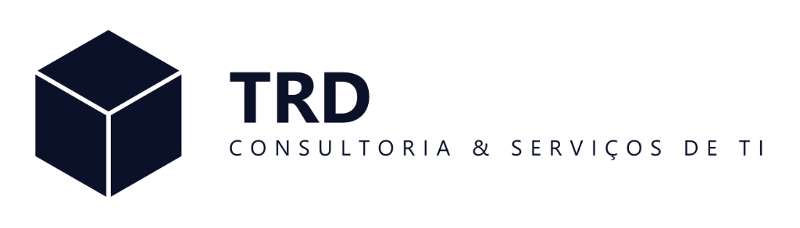

<p align="center">
  <picture>
    <source media="(prefers-color-scheme: dark)" srcset="assets/svg/logo_horizontal_dark.svg">
    <source media="(prefers-color-scheme: light)" srcset="assets/trd-lockup.png">
    
  </picture>
</p>

<p align="center">
  <a href="https://github.com/trd-consultoria-ti/startup"></a>
  <a href="operacoes/06_identidade_visual/MANUAL_DE_IDENTIDADE_VISUAL_TRD.md"></a>
  <a href="operacoes/05_administracao/PLANEJAMENTO_TRIBUTARIO_E_FINANCEIRO.md"></a>
  <a href="LICENSE"></a>
</p>

# TRD Consultoria e Serviços de TI LTDA
### Framework Operacional, Jurídico, Comercial & Identidade Visual para Boutiques de Software de Missão Crítica

> **O toolkit oficial de fundação, esteira operacional e governança da TRD Consultoria e Serviços de TI LTDA.**  
> 100% amparado na legislação brasileira: **Código Civil (Lei 10.406/02)**, **Lei do Software (Lei 9.609/98)**, **LGPD (Lei 13.709/18)**, **Marco Civil da Internet (Lei 12.965/14)** e **Assinatura Eletrônica (Lei 14.063/20)**.

---

> [!IMPORTANT]
> ### 🏛️ Documento Central de Lançamento & Governança
> Acesse o [**PLANO_DE_LANCAMENTO_EMPRESARIAL.md**](PLANO_DE_LANCAMENTO_EMPRESARIAL.md) ou faça o download da versão formatada para Word: [**PLANO_DE_LANCAMENTO_EMPRESARIAL.docx**](PLANO_DE_LANCAMENTO_EMPRESARIAL.docx) — O Plano Mestre oficial de governança da **TRD Consultoria e Serviços de TI LTDA** (empresa unipessoal fundada por **Thiago Rocha Duarte**), engenharia tributária (Simples Nacional / Fator R a 6%), infraestrutura tecnológica e estratégia Go-to-Market de D-60 a D+30.

---

## 🎨 Identidade Visual & Design System Oficial (Nota 9.8 Homologada)

A identidade visual da TRD foi concebida sob o arquétipo da **Soberania, Rigor Matemático e Estabilidade**, aprovada por banca integrada (Marketing B2B, UX Design, Auditoria Crítica e Colorimetria Industrial):

* 📐 **A Keystone Isométrica:** Cubo de dados monolítico 2D plano em proporção áurea 1:1, com fendas de espaço negativo a 6.5% imunes a empastamento gráfico.
* 🖋️ **Tipografia Oficial:** `TRD` em Neo-Grotesque Black (900) acompanhado do descritivo `CONSULTORIA & SERVIÇOS DE TI` com tracking expandido.
* 📖 **Manual de Marca:** [MANUAL_DE_IDENTIDADE_VISUAL_TRD.md](operacoes/06_identidade_visual/MANUAL_DE_IDENTIDADE_VISUAL_TRD.md)
* ⚛️ **Componente Web Oficial:** [LogoTRD.tsx](operacoes/06_identidade_visual/LogoTRD.tsx)

### Paleta Cromática Institucional

| Cor | HEX | CMYK (Rich Black) | Pantone (Papel / Têxtil) | Função |
| :--- | :---: | :---: | :---: | :--- |
| **Obsidian Navy** | `#080D1A` | **C:65 M:50 Y:30 K:100** | **532 C** / **19-4010 TCX** | Cor primária institucional, símbolo, sigla TRD |
| **Titanium Slate** | `#1E293B` | C:50 M:40 Y:25 K:80 | 432 C / 19-3908 TCX | Descritor `CONSULTORIA & SERVIÇOS DE TI` |
| **Pure White** | `#FFFFFF` | C:0 M:0 Y:0 K:0 | Opaque White | Fundo oficial para propostas e timbrados (WCAG AAA 19.77:1) |
| **Neural Cyan** | `#0EA5E9` | C:70 M:15 Y:0 K:0 | **3115 C** / **16-4535 TCX** | Acento de IA e telemetria (uso homeopático) |

---

## 📂 Estrutura do Toolkit Operacional

```
.
├── PLANO_DE_LANCAMENTO_EMPRESARIAL.md (.docx)   # [DESTAQUE] Plano Mestre de Lançamento (D-60 a D+30)
├── assets/
│   ├── trd-lockup.png                           # Logo oficial horizontal master
│   ├── trd-avatar.png                           # Avatar quadrado 512x512 para redes/perfil
│   ├── trd-org-avatar.png                       # Avatar institucional para GitHub Org (Light & Dark)
│   ├── trd-favicon.png                          # Favicon de sistema
│   ├── trd-mark.png                             # Símbolo Keystone isolado
│   ├── trd-mono.png                             # Versão 1-bit monocromática
│   └── svg/                                     # Suíte completa com 10 arquivos vetoriais SVG
└── operacoes/
    ├── 01_juridico/
    │   ├── CONTRATO_SUSTENTACAO_E_SLA.md (.docx)   # Contrato B2B com Damage Cap e retenção de IP
    │   ├── ACORDO_CONFIDENCIALIDADE_NDA.md (.docx) # NDA bilateral com conformidade LGPD
    │   └── ACORDO_DE_SOCIOS.md (.docx)             # Minuta contingencial: Admissão futura com Vesting (4 anos)
    ├── 02_comercial_marketing/
    │   ├── PROPOSTA_COMERCIAL_EXECUTIVA.md (.docx) # Proposta de alto valor (Piso R$ 3.800 a R$ 8.500/mês)
    │   ├── CASES_DE_SUCESSO_E_AUTORIDADE.md        # 3 estudos de caso estruturais (SQL, Legado Java e LGPD)
    │   └── SCRIPTS_PROSPECCAO_OUTBOUND.md          # 5 scripts de abordagem (LinkedIn, WhatsApp DF, Agências)
    ├── 03_social_media/
    │   └── PLAYBOOK_LINKEDIN_AUTORIDADE.md         # Framework Dev-to-Founder para atração B2B
    ├── 04_rh/
    │   └── AVALIACAO_TECNICA_DEV.md                # Desafio de código real para suporte/devs (Java/Angular/SQL)
    ├── 05_administracao/
    │   ├── MATRIZ_SEVERIDADE_E_SLA.md              # Gestão de incidentes P1 a P4 e fluxo de suporte
    │   └── PLANEJAMENTO_TRIBUTARIO_E_FINANCEIRO.md (.docx) # Manual CFO: Simples Nacional a 6% via Fator R
    ├── 06_identidade_visual/
    │   ├── MANUAL_DE_IDENTIDADE_VISUAL_TRD.md      # Manual de Marca, Pantone, Rich Black e WCAG AAA
    │   ├── tokens.json / tokens.css                # Design tokens oficiais W3C e variáveis CSS
    │   ├── tailwind.config.js                      # Configuração oficial para Tailwind CSS
    │   ├── LogoTRD.tsx                             # Componente oficial React / Next.js
    │   ├── assinatura_email.html                   # Assinatura executiva de e-mail corporativo
    │   └── papel_timbrado_template.md              # Template de timbrado para propostas comerciais
    └── openbot_integracao/                         # Squad de 6 agentes especialistas autônomos (OpenBot)
        ├── README.md                               # Arquitetura de orquestração multiagente
        └── agentes/                                # Prompts operacionais (Comercial, Jurídico, SLA, FinOps, RH)
```

---

### 📥 Documentos Executivos em Word (.docx) para Download
Para agilizar fechamentos comerciais, assinaturas digitais (Gov.br / ZapSign / ClickSign) e reuniões societárias/contábeis, todos os instrumentos burocráticos possuem versão editável `.docx`:
- 🏛️ **Plano Mestre de Lançamento:** [`PLANO_DE_LANCAMENTO_EMPRESARIAL.docx`](PLANO_DE_LANCAMENTO_EMPRESARIAL.docx)
- 🤝 **Acordo de Quotistas — Minuta para Futura Admissão (Vesting):** [`ACORDO_DE_SOCIOS.docx`](operacoes/01_juridico/ACORDO_DE_SOCIOS.docx)
- 📜 **Contrato de Sustentação & SLA:** [`CONTRATO_SUSTENTACAO_E_SLA.docx`](operacoes/01_juridico/CONTRATO_SUSTENTACAO_E_SLA.docx)
- 🔒 **Acordo de Confidencialidade (NDA):** [`ACORDO_CONFIDENCIALIDADE_NDA.docx`](operacoes/01_juridico/ACORDO_CONFIDENCIALIDADE_NDA.docx)
- 💼 **Proposta Comercial Executiva:** [`PROPOSTA_COMERCIAL_EXECUTIVA.docx`](operacoes/02_comercial_marketing/PROPOSTA_COMERCIAL_EXECUTIVA.docx)
- 💰 **Planejamento Tributário & Financeiro:** [`PLANEJAMENTO_TRIBUTARIO_E_FINANCEIRO.docx`](operacoes/05_administracao/PLANEJAMENTO_TRIBUTARIO_E_FINANCEIRO.docx)

---

## 👤 Fundador & Governança

> **Sociedade Unipessoal:** A **TRD Consultoria e Serviços de TI LTDA** é uma sociedade limitada unipessoal fundada e operada por engenheiro de software sênior, com esteira de entrega técnica ampliada por squad de agentes de IA ([OpenBot](operacoes/openbot_integracao/README.md)).

| Fundador | Atuação Técnica & Estratégica | LinkedIn | GitHub |
| :--- | :--- | :---: | :---: |
| **Thiago Rocha Duarte** | Sócio Proprietário & Engenheiro de Software Sênior (Operações, Arquitetura, Comercial e Governança) | [](https://www.linkedin.com/in/thiago-duarte-a6597721/) | [](https://github.com/thiagorduarte1107) |

---

## ⚖️ Conformidade Legal Brasileira

* **Lei do Software (Lei nº 9.609/1998):** Propriedade intelectual do código vinculada à quitação financeira integral.
* **Código Civil Brasileiro (Lei nº 10.406/2002):** Prestação de serviços PJ, regras de horas não cumulativas, mora e rescisão com aviso prévio.
* **Lei Geral de Proteção de Dados (Lei nº 13.709/2018 - LGPD):** Contratada atuando estritamente como **Operadora** e o cliente como **Controlador**.
* **Marco Civil da Internet (Lei nº 12.965/2014):** Padrões de guarda de registros de acesso a aplicações (Art. 15).
* **Assinatura Eletrônica (Lei nº 14.063/2020):** Validade jurídica para assinaturas digitais (Gov.br, ZapSign, ClickSign).

---

## 🚀 Como Utilizar

1. Faça o clone do repositório:
   ```bash
   git clone https://github.com/trd-consultoria-ti/startup.git
   ```
2. Leia e execute o [**PLANO_DE_LANCAMENTO_EMPRESARIAL.md**](PLANO_DE_LANCAMENTO_EMPRESARIAL.md) para alinhar a governança e o cronograma D-60 a D+30;
3. Consulte o [**MANUAL_DE_IDENTIDADE_VISUAL_TRD.md**](operacoes/06_identidade_visual/MANUAL_DE_IDENTIDADE_VISUAL_TRD.md) para aplicar os padrões cromáticos e vetores da marca;
4. Utilize a [PROPOSTA_COMERCIAL_EXECUTIVA.md](operacoes/02_comercial_marketing/PROPOSTA_COMERCIAL_EXECUTIVA.md) e o [CONTRATO_SUSTENTACAO_E_SLA.md](operacoes/01_juridico/CONTRATO_SUSTENTACAO_E_SLA.md) para fechar seus primeiros contratos corporativos com total segurança jurídica.

---

## 📄 Licença

Distribuído sob a licença **MIT**. Veja [`LICENSE`](LICENSE) para mais detalhes.
