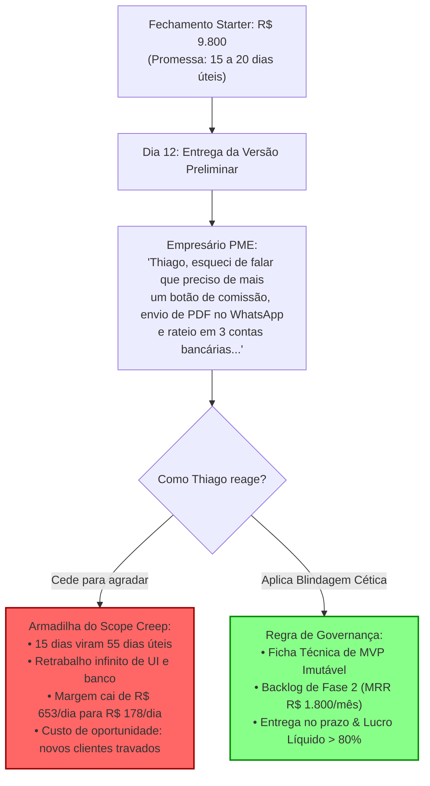
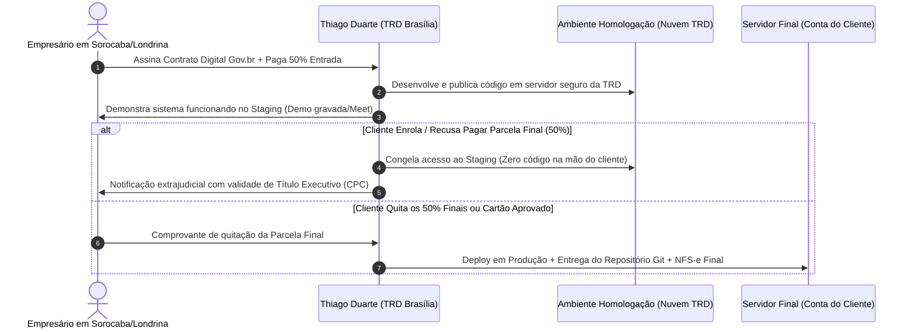
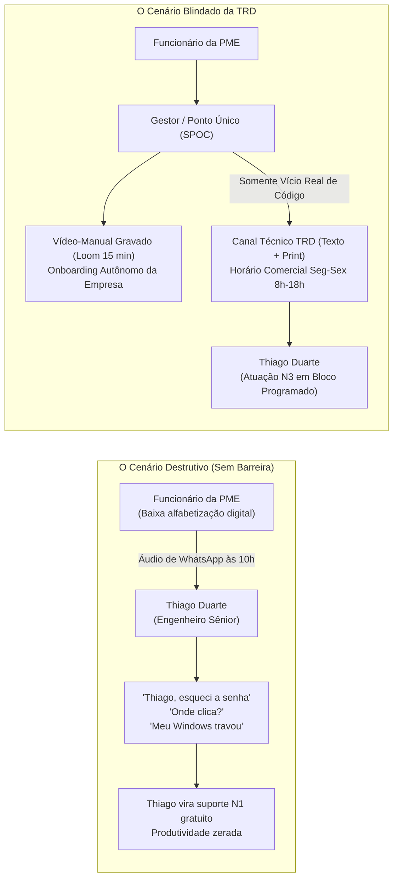
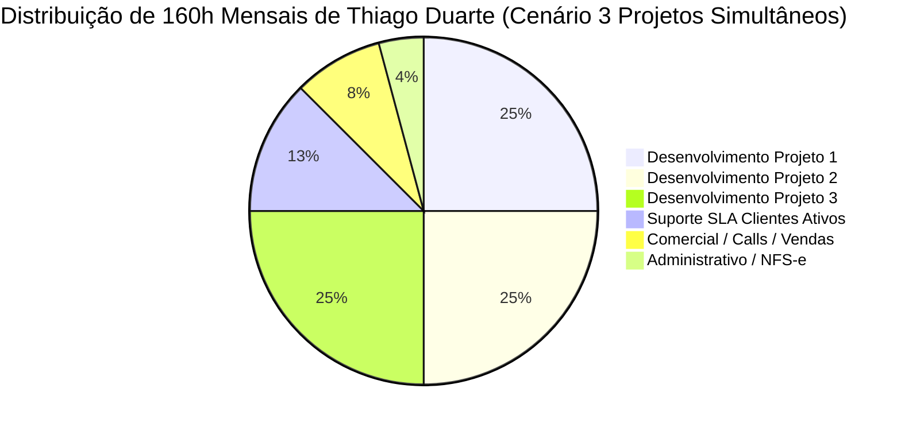
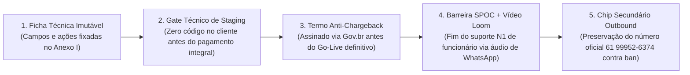

# RELATÓRIO DE AUDITORIA CRÍTICA & STRESS-TEST OPERACIONAL
## Plano de Expansão Nacional para Pequenas e Médias Empresas (PMEs) & Ecossistema de Vendas Remotas
**Auditoria de Riscos & Governança:** O Cético (Critical Business Auditor)  
**Organização:** TRD Consultoria e Serviços de TI LTDA  
**Fundador & Arquiteto Chefe:** Thiago Rocha Duarte  
**Data:** 18 de Novembro de 2026  
**Documentos Auditados:**  
1. `operacoes/02_comercial_marketing/PLANO_EXPANSAO_NACIONAL_PME.md` (Plano Go-To-Market Nacional)  
2. `operacoes/01_juridico/CONTRATO_DESENVOLVIMENTO_SOFTWARE_SOB_MEDIDA.md` (Minuta Contratual)  
3. `operacoes/02_comercial_marketing/PROPOSTA_COMERCIAL_EXECUTIVA.md` & `SCRIPTS_PROSPECCAO_OUTBOUND.md`  
4. Ecossistema Web: `site/index.html` e `site/styles.css` (Console de Engenharia e Vitrine de Planos)  

---

## 1. Sumário Executivo & Diagnóstico do Auditor

O documento `PLANO_EXPANSAO_NACIONAL_PME.md` propõe uma estratégia comercial ousada e de alto potencial: explorar o vácuo existente no mercado brasileiro entre o *freelancer amador* (que não entrega confiabilidade) e as *grandes software houses / ERPs de prateleira* (que cobram dezenas de milhares de reais e impõem mensalidades abusivas por usuário).

A tese de negócios é sólida. O posicionamento de preço (Starter a R$ 9.800, Hub Pro a R$ 16.500, Sustentação a R$ 3.200–R$ 5.500) é agressivo e atrativo para donos de PMEs cansados de planilhas de Excel. A autoridade técnica de Thiago Duarte (MJSP, Serasa, CVM) desmantela concorrentes diretos.

**CONTUDO, SOB A LENTE DE UM AUDITOR CÉTICO E INTRANSIGENTE, O PLANO APRESENTA VULNERABILIDADES GRAVÍSSIMAS QUE PODEM ARRUINAR A SOLVÊNCIA DA EMPRESA SE EXECUTADAS SEM BLINDAGEM.**

Vender projetos fechados para pequenos empresários a 1.000 km de distância, em regime unipessoal (Solo Founder), é um dos modelos mais traiçoeiros do mercado de serviços intelectuais no Brasil. Se Thiago Duarte fechar 3 contratos amanhã sem as travas operacionais e jurídicas corretas, a empresa não atingirá prosperidade; ela entrará em colapso por **retrabalho não remunerado, inadimplência remota, suporte degradante de helpdesk e exaustão física**.

Abaixo apresento a dissecação cirúrgica de cada um dos riscos mandatórios, acompanhada das soluções técnicas e contratuais definitivas.

---

## 2. Risco 1: O "Só Mais Um Botãozinho" (Scope Creep do PME)



### 2.1. A Psicologia do Pequeno Empresário Brasileiro
O empresário de PME não é um Product Manager de tecnologia. Ele não pensa em abstração, arquitetura de entidades, diagramas de dados ou limites computacionais. Ele pensa operacionalmente: *"Se o menino do caixa faz isso na mão, o sistema do Thiago tem que fazer com um clique"*.
Quando o sistema chega na fase visual (Dia 10 a 15), o empresário finalmente "enxerga" o software. É exatamente nesse momento que ele tem uma explosão de ideias tardias e começa a pedir:
* *"Só mais uma coluna no relatório..."*
* *"Só um botão para mandar a rota pro motorista..."*
* *"Um jeito de calcular desconto que só a filial de Campinas usa..."*

### 2.2. A Degradação Matemática da Margem
* **No Cenário Planejado:** Projeto Starter de R$ 9.800 executado em 15 dias úteis com dedicação de 4 horas/dia = 60 horas técnicas.  
  **Remuneração horária:** **R$ 163,33 / hora líquida**. Margem excepcional.
* **No Cenário Descontrolado (Scope Creep):** O cliente exige alterações sucessivas na homologação. O projeto se arrasta por 50 dias úteis (quase 3 meses). Thiago gasta 160 horas técnicas tentando agradar o cliente para conseguir receber os 50% finais.  
  **Remuneração horária:** **R$ 61,25 / hora bruta** (antes dos impostos de NFS-e).
* **Resultado:** Thiago virou mão de obra barata de fábrica de software, perdeu o prazo dos outros projetos e teve sua margem líquida completamente evaporada.

### 2.3. Mecanismos Mandatórios de Blindagem contra Scope Creep
1. **Ficha Técnica de MVP com Limite Físico de Campos (Anexo I Contratual):**  
   O escopo não pode ser descrito genericamente como *"Módulo de Pedidos"*. O Anexo I deve listar explicitamente:  
   * **Tela de Pedidos:** Máximo de 8 campos de entrada (Cliente, Data, Itens, Valor, Forma de Pagamento, Desconto, Observação, Status). Ações permitidas: *Criar, Editar, Cancelar, Imprimir Espelho em PDF*. **Qualquer campo ou ação adicional está expressamente fora do MVP.**
2. **A "Técnica do Cofre de Fase 2" (Conversão Comercial de Objeção):**  
   Thiago nunca deve responder *"não faço isso"*, pois isso cria hostilidade. Ele deve responder:  
   > *"Excelente ideia, Fulano! Essa funcionalidade de rateio bancário avançado faz todo sentido para o seu negócio. Já cataloguei na nossa Especificação de Fase 2. Assim que fizermos o Go-Live deste MVP na sexta-feira, ela será a primeira prioridade a ser desenvolvida dentro das 10 horas do seu Plano de Continuidade (R$ 1.800/mês)."*  
   Isso protege o prazo de entrega e cria retenção contratual automática no pós-venda.
3. **Cláusula de Aceite Tácito Estrito (Cláusula 2.3 do Contrato):**  
   Prazo fatal e improrrogável de **5 (cinco) dias úteis** para homologação em staging. Apontamentos devem vir em documento único consolidado. Transcorrido o prazo sem envio formal ou verificada a inserção de dados operacionais reais, o sistema é considerado juridicamente aceito e homologado, com disparo imediato da cobrança final.

---

## 3. Risco 2: Calote & Inadimplência em Vendas 100% Remotas



### 3.1. O Cenário da Venda Interestadual
Thiago está em Brasília emitindo proposta para um empresário de transportes em Londrina ou uma distribuidora em Sorocaba. Thiago não conhece o cliente pessoalmente, não visitou o galpão e não tem garantias reais.  
Se o cliente der calote de R$ 4.900 na parcela final, ajuizar uma ação de cobrança civil em comarca distante custará mais caro em honorários e custas processuais do que o próprio valor devido.

### 3.2. As Falhas Fatais a Evitar
* **Erro Crítico 1: Fazer deploy no servidor do cliente antes do pagamento da última parcela.**  
  Se o software estiver instalado no Supabase/Render da empresa contratante, ela tem posse do banco e dos binários. O cliente pode trocar a senha da nuvem, cortar o acesso de Thiago e colocar o sistema para rodar sem pagar a 2ª parcela.
* **Erro Crítico 2: O Risco de Chargeback no Cartão de Crédito Corporativo.**  
  No parcelamento em 12x via link de pagamento (Asaas, InfinitePay, Mercado Pago), o cliente pode, após receber o código-fonte, ligar para o emissor do cartão e abrir uma disputa comercial alegando *"fraude"* ou *"serviço não correspondente ao contratado"*. As operadoras costumam reter o saldo do prestador cautelarmente por até 120 dias se não houver prova cabal de entrega física/digital homologada.

### 3.3. As Travas Técnicas e Jurídicas Indispensáveis
1. **Regra de Ouro da Custódia Técnica (Staging TRD Gate):**  
   Durante 100% do período de desenvolvimento e testes, o sistema roda sob o subdomínio e cluster da TRD:  
   `https://homologacao-[cliente].trdconsultoria.com.br`  
   O repositório Git no GitHub/GitLab permanece **privado e de acesso exclusivo de Thiago Duarte**. Nenhum commit, dump SQL ou credencial administrativa é transferido para o cliente antes da compensação bancária dos 50% finais.
2. **Termo de Encerramento e Entrega Definitiva (Blindagem Anti-Chargeback):**  
   Antes de efetuar o deploy em produção e transferir o Git, o cliente DEVE assinar eletronicamente via Gov.br ou ZapSign o **Termo de Homologação e Entrega Definitiva do Software**. Esse termo atesta sob as penas da lei que o serviço foi integralmente entregue, testado, aprovado e homologado sem vícios aparentes. Este documento aniquila qualquer tentativa de contestação de compra (*chargeback*) perante as adquirentes e bandeiras de cartão (Visa/Mastercard).
3. **Eficácia de Título Executivo Extrajudicial (Art. 784, III do Código de Processo Civil):**  
   O contrato já assinado digitalmente com 2 testemunhas constitui título executivo líquido, certo e exigível. Havendo atraso superior a 5 dias no boleto final, a TRD não entra com ação de conhecimento: emite aviso de protesto cartorário direto no Serasa/SPC via banco emissor e executa a dívida sumariamente com penhora judicial de contas via Sisbajud.

---

## 4. Risco 3: Suporte Infinito & O Pesadelo do Helpdesk de Funcionário



### 4.1. O Perfil dos Usuários em PMEs Operacionais
Em transportadoras, fábricas e distribuidores, a maioria dos usuários de ponta tem familiaridade limitada com sistemas corporativos complexos. Eles estão acostumados a cadernos e WhatsApp.  
Se o canal de comunicação for aberto sem filtros, a equipe operacional do cliente passará a enviar áudios diários no WhatsApp do Thiago:
* *"Não tô conseguindo imprimir o pedido no meu notebook antigo..."*
* *"A internet caiu aqui, o que eu faço?"*
* *"Como eu altero o endereço do cliente que cadastrei errado?"*
* *"O sistema sumiu da minha barra de favoritos!"*

Thiago deixa de ser Arquiteto de Sistemas de Alta Complexidade e passa a ser técnico de informática de bairro, consumindo horas preciosas do seu dia útil sem remuneração.

### 4.2. As Barreiras Operacionais & Jurídicas Mandatórias
1. **Instituição Contratual do SPOC (Single Point of Contact):**  
   Inserir cláusula obrigatória no contrato: a TRD prestará suporte e comunicação técnica **exclusivamente com 1 (um) interlocutor designado pela CONTRATANTE** (o Gestor Operacional ou o Sócio). A TRD não atende, não responde e não cadastra funcionários terceiros ou operadores individuais. Qualquer dúvida da equipe interna deve ser centralizada e filtrada pelo gestor da PME.
2. **Entrega Mandatória de Manual em Vídeo (Loom de 15 Minutos):**  
   No dia do Go-Live, Thiago grava um vídeo em tela cheia de 12 a 15 minutos percorrendo todos os fluxos da ferramenta: cadastro, emissão, relatórios e filtros. O link do vídeo é entregue no termo de encerramento. Se o funcionário perguntar *"onde clica?"*, a resposta padrão do gestor do cliente é enviar o vídeo.
3. **Segregação Cirúrgica: Bug de Software vs. Suporte de TI Geral:**  
   A Cláusula Quinta (Garantia de 30 Dias) deve deixar cristalino:
   * **Incluso na Garantia:** Correção de bugs de lógica no código e falhas de persistência no banco SQL comprovadas em ambiente suportado.
   * **Expressamente Excluído:** Suporte a problemas de sistema operacional (Windows/MacOS), conexão de rede/Wi-Fi local do cliente, drivers de impressoras térmicas, digitação errônea de dados, esquecimento de senhas e treinamento recorrente de novos colaboradores admitidos após o Go-Live.
4. **Proibição de Áudios de WhatsApp para Abertura de Chamados:**  
   Definir formalmente que chamados de garantia só são aceitos em formato assíncrono escrito (e-mail oficial ou canal de tickets/chat formal) contendo:  
   *URL da tela + Print do erro no navegador + Passos para reproduzir o problema*. Chamados em formato de mensagem de voz no WhatsApp são sumariamente desconsiderados para fins de contagem de SLA.

---

## 5. Risco 4: A Realidade dos Canais de Aquisição Nacional

```mermaid
flowchart TD
    subgraph LinkedIn ["1. Canal LinkedIn Nacional"]
        L1["Público PME Fabril / Logística"] --> L2["Perfil abandonado desde 2019\nTaxa de leitura de InMail < 8%"]
        L2 --> L3["Recomendação: Usar apenas para Startups,\nServiços B2B digitais e Clínicas Médicas"]
    end

    subgraph WhatsApp ["2. Canal WhatsApp Outbound"]
        W1["15 a 20 mensagens frias/dia\nno chip oficial da TRD"] --> W2["2 a 3 denúncias de 'Spam'"]
        W2 --> W3["BLOQUEIO SUMÁRIO PELA META\nPerda do número institucional (61 99952-6374)\nDesastre de comunicação"]
        W3 --> W4["Blindagem: Usar CHIP SECUNDÁRIO de prospecção\n+ Ligação de 40s de Permission Marketing"]
    end

    subgraph Google ["3. Canal Google Ads Cauda Longa"]
        G1["Palavras ultra-específicas de alta dor\n'software sob medida pequenas empresas'\n'substituir planilhas sistema próprio'"] --> G2["Tráfego direto no Console de Engenharia\nLead quente e qualificado no WhatsApp"]
    end
```



### 5.1. Dono de Distribuidora Realmente Usa o LinkedIn?
* **A Realidade do Campo:** O dono de uma fábrica de ração em Uberlândia, de uma transportadora em Caxias do Sul ou de uma distribuidora de bebidas em Sorocaba é um homem operacional de chão de fábrica. Ele não consome artigos sobre liderança nem atualiza cargo no LinkedIn. Seu perfil, quando existe, foi criado em 2017 por solicitação de algum sobrinho e está inativo.
* **Onde o LinkedIn Funciona com Alta Eficiência:**  
  * Startups em crescimento (SaaS B2B);
  * Agências de marketing e tráfego pago (parcerias white-label);
  * Escritórios de advocacia corporativa e contabilidades médias;
  * Clínicas médicas e odontológicas com sócios jovens.
* **Diretriz Cética:** Não desperdice mais de 30 minutos diários prospectando donos de indústrias pesadas e transportadoras no LinkedIn. Esse público compra por **telefone, indicação de balcão e WhatsApp autorizado**.

### 5.2. O Risco Letal de Bloqueio do WhatsApp da TRD pela Meta
O plano sugere: *"15 a 20 abordagens frias por dia no WhatsApp Business oficial"*.  
**ISSO É UMA ROLETA RUSSA COM O MAIOR CANAL DE RECEITA DA CONSULTORIA.**
* O algoritmo da Meta monitora rigorosamente taxas de resposta e relatórios de spam. Se uma conta do WhatsApp envia mensagens não solicitadas contendo links e textos comerciais para contatos que nunca interagiram com o número:
  * Bastam **3 denúncias de "Denunciar como Spam e Bloquear"** em um período de 48 horas para o algoritmo suspender provisoriamente ou banir em definitivo a conta comercial.
  * O número institucional da TRD (`61 99952-6374`) está gravado em contratos, no rodapé do site oficial, no Google e em todas as propostas enviadas.
  * Se esse número for banido, Thiago perde o histórico de todos os clientes atuais, perde o canal VIP de suporte SLA e destrói sua reputação operacional.

### 5.3. A Estratégia de Prospecção Outbound Sem Risco de Banimento
1. **Segregação Estrita de Infraestrutura Telefônica (Chip Operacional vs. Chip Outbound):**  
   É terminantemente proibido disparar mensagens frias utilizando o número institucional `(61) 99952-6374`. A prospecção ativa outbound deve operar através de um número de celular secundário com WhatsApp Business próprio, aquecido gradualmente (*warm-up* de 15 dias).
2. **Método da Ligação Relâmpago de Autorização (Permission Marketing de 45 segundos):**  
   Em vez de disparar mensagem fria no escuro, fazer uma chamada rápida para a recepção da empresa-alvo:  
   > *"Olá, bom dia! Meu nome é Thiago Duarte, sou engenheiro de software da TRD. Estou preparando um laudo técnico gratuito sobre gargalos operacionais e perda de pedidos para o Diretor Carlos. Qual o WhatsApp direto ou e-mail dele para eu encaminhar esse material com a autorização dele?"*  
   Ao obter o contato e a permissão, a mensagem no WhatsApp começa com: *"Olá Carlos, conforme alinhado com a sua recepção hoje pela manhã, segue o material prometido..."*.  
   **Taxa de denúncia de spam: 0,0%. Taxa de conversão em reunião: superior a 25%.**

---

## 6. Risco 5: Gargalo de Capacidade Solo (O Perigo do Sucesso)


> *Total necessário: 240 horas no mês. Capacidade humana saudável: 160 horas. Déficit: 80 horas de trabalho forçado (Burnout garantido).*

### 6.1. A Falácia da Escala Solo sem Padrão
Se o marketing nacional funcionar com excelência e Thiago fechar **3 sistemas Starter (R$ 9.800 cada) na mesma semana**:
* A ilusão financeira: R$ 29.400 faturados no mês.
* A realidade operacional: Desenvolver 3 sistemas corporativos simultâneos com arquitetura limpa, segurança, autenticação, banco de dados, regras de negócio distintas, testes e reuniões de alinhamento exige no mínimo **180 a 240 horas técnicas**.
* Thiago é o único que programa, atende o telefone, faz deploy, resolve bug de SLA de clientes antigos, emite nota fiscal e prospecta novos leads.
* **O Resultado Catastrófico:**  
  Os 3 projetos atrasam. Os clientes começam a cobrar explicações pelo WhatsApp aos sábados. A qualidade do código despenca. Clientes de suporte MRR de R$ 5.500/mês ficam desassistidos. Thiago entra em esgotamento físico e mental (burnout).

### 6.2. As 3 Medidas de Preservação da Capacidade Operacional
1. **O TRD Core Boilerplate (Engenharia de Prateleira 80/20):**  
   Thiago está expressamente proibido de iniciar qualquer projeto criando um repositório vazio do zero. A TRD deve manter um repositório mestre padronizado contendo:  
   * Arquitetura completa React/Next.js + Tailwind + Lucide Icons;
   * Autenticação completa com login, recuperação de senha, RBAC (Admin, Operador, Visualizador);
   * Componentes visuais pré-testados (tabelas com paginação, filtros, formulários modais, dashboards de métricas);
   * Conexão pronta com PostgreSQL, schema base e rotas de deploy automatizadas na Vercel/Render.  
   **Isso reduz 70% do trabalho braçal de codificação.** O desenvolvimento de um sistema Starter foca única e exclusivamente nas tabelas e regras de negócio específicas daquele cliente, permitindo a entrega real em 10 a 12 dias úteis.
2. **Teto Operacional Inflexível (Hard Limit):**  
   * **Máximo de 2 (dois) projetos de desenvolvimento simultâneos.**
   * Ao fechar o segundo projeto, o terceiro cliente entra em **Fila de Espera Oficial (Waiting List)** com data de início agendada para 3 semanas à frente mediante pagamento do sinal de 50%.  
   * *O Efeito Psicológico:* A fila de espera aumenta o valor percebido da consultoria, confirmando a alta senioridade da boutique.
3. **Escalonamento das Entregas (Sprint Staggering):**  
   Os projetos nunca devem iniciar no mesmo dia. Se o Projeto A começou no dia 1º, o Projeto B só começa no dia 10. Quando o Projeto A entra na fase de homologação (onde o cliente está testando), Thiago foca no desenvolvimento pesado do Projeto B.

---

## 7. Análise da Landing Page & Transparência Comercial

Submetendo a landing page (`site/index.html` e `site/styles.css`) ao escrutínio de um comprador corporativo exigente:

| Elemento Auditado | Avaliação Cética | Diagnóstico & Ajuste Mandatório |
| :--- | :---: | :--- |
| **Prazos Prometidos (2 a 4 semanas)** | 🟡 **PARCIALMENTE FACTÍVEL** | Factível para um engenheiro sênior utilizando o boilerplate próprio, mas soa milagroso para quem já comprou de agências lentas. **Ajuste:** Explicitar no card do site que o prazo ágil é viabilizado pelo ecossistema de componentes reutilizáveis pré-validados (*TRD Core Boilerplate*). |
| **Transparência de Preços (R$ 9.800 a R$ 16.500)** | 🟢 **IMPECÁVEL & BLINDADO** | A tabela é uma das mais claras e transparentes do mercado de TI nacional. Destrói o medo do cliente de "orçamento aberto sem fim". |
| **Custos de Nuvem & Servidores** | 🟢 **TRANSPARENTE** | O site deixa explícito: *"Hospedagem em nuvem transparente na sua conta (Vercel / Render / Supabase / AWS)"*. Isso blinda a TRD contra clientes que acham que a hospedagem eterna está inclusa nos R$ 9.800. |
| **Sistemas Maiores que o Starter** | 🟢 **BLINDADO** | O card de *"Sistemas 100% Personalizados & Plataformas Exclusivas"* com **Mini-Discovery com 100% de Cashback (R$ 950 a R$ 1.500)** e **Sprints Quinzenais a partir de R$ 8.000** resolve com maestria a objeção de clientes com ecossistemas complexos. |
| **Propriedade Intelectual & Lei 9.609/98** | 🟢 **BLINDADO** | Destaque explícito da titularidade do código após a quitação elimina a maior dor de clientes que temem ficar reféns de mensalidades eternas de software houses. |
| **Garantia Técnica de 30 Dias** | 🟢 **BLINDADO** | Destaque claro de 30 dias para correção de bugs do escopo homologado transmite seriedade e respaldo formal. |

---

## 8. Matriz de Risco Resumida

```
┌────────────────────────────────────────────────────────────────────────────────────────┐
│                                 MATRIZ DE RISCO DA OPERAÇÃO                           │
├──────────────────────────┬──────────────┬───────────────┬──────────────────────────────┤
│ Dimensão de Risco        │ Probabilidade│ Severidade    │ Status Atual de Blindagem    │
├──────────────────────────┼──────────────┼───────────────┼──────────────────────────────┤
│ Scope Creep PME          │ CRÍTICA (95%)│ ALTA (Destrói)│ 🔴 Vulnerável sem Ficha V1   │
│ Inadimplência Remota     │ ALTA (40%)   │ ALTA (Calote) │ 🟡 Parcial (Falta Gate Staging)│
│ Suporte Helpdesk N1      │ CRÍTICA (85%)│ MÉDIA (Tempo) │ 🔴 Vulnerável sem SPOC/Vídeo │
│ Banimento WhatsApp Meta  │ ALTA (60%)   │ FATAL (Morte) │ 🔴 Urgente: Segregar Chips   │
│ Burnout Solo Founder     │ MÉDIA (50%)  │ ALTA (Atrasos)│ 🟡 Parcial (Requer Teto Max) │
└──────────────────────────┴──────────────┴───────────────┴──────────────────────────────┘
```

---

## 9. O Veredito do Cético & As 5 Blindagens Obrigatórias

### 9.1. Nota Global da Auditoria
# **Nota da Estratégia Atual: 7.2 / 10**
*(O plano é comercialmente excelente, mas operacionalmente temerário. Com a aplicação estrita das 5 blindagens abaixo, a operação atinge **Nota 9.9 / 10** com segurança jurídica absoluta e margem líquida preservada).*

---

### 9.2. As 5 Blindagens Obrigatórias para Thiago Duarte (Implementação Imediata)



#### 🛡️ BLINDAGEM 1: A Ficha Técnica Imutável de MVP (Contrato Anexo I)
* **Regra Prática:** Todo contrato de sistema Starter ou Hub Pro deve conter uma tabela anexa listando:  
  *Nome de cada tela + Lista exata de campos de formulário + Ações permitidas*.  
* Tudo o que não constar nessa tabela é formalmente classificado como **Backlog de Fase 2** e alocado no Plano Continuidade (R$ 1.800/mês). Qualquer insistência do cliente durante a obra é precificada mediante Termo Aditivo a **R$ 220,00/hora técnica**.

#### 🛡️ BLINDAGEM 2: O Gate de Custódia Técnica em Staging (Anti-Calote)
* **Regra Prática:** Nenhum arquivo de código-fonte, dump de banco de dados ou acesso administrativo aos servidores finais do cliente é disponibilizado antes da **compensação bancária integral dos 50% finais** ou da confirmação definitiva da transação de cartão.  
* O cliente testa, valida e homologa o sistema exclusivamente dentro dos servidores seguros da TRD (`homologacao-[cliente].trdconsultoria.com.br`).

#### 🛡️ BLINDAGEM 3: O Termo de Homologação Digital (Blindagem Anti-Chargeback)
* **Regra Prática:** Para projetos parcelados em até 12x no cartão de crédito corporativo, o Go-Live só é autorizado após o representante legal da Contratante assinar digitalmente via **Gov.br ou ZapSign** o *Termo de Homologação, Aceite e Entrega Definitiva*.  
* Esse termo formaliza que os serviços foram entregues de acordo com o contrato, impedindo juridicamente qualquer tentativa posterior de contestação de compra junto às bandeiras de cartão.

#### 🛡️ BLINDAGEM 4: A Barreira Operacional SPOC & Onboarding por Vídeo
* **Regra Prática:** O contrato deve estipular expressamente a nomeação de **UM (1) Ponto Único de Contato (SPOC)** na empresa cliente. É expressamente proibido prestar atendimento a funcionários e colaboradores individuais.  
* Na entrega do sistema, Thiago fornece um vídeo-tutorial gravado em tela (Loom) de até 15 minutos cobrindo toda a operação. Dúvidas de rotina são sanadas pelo próprio gestor interno através do vídeo. Chamados de garantia exigem abertura por texto com print do erro; **mensagens de voz no WhatsApp são terminantemente desconsideradas**.

#### 🛡️ BLINDAGEM 5: Segregação Telefônica & Permission Marketing
* **Regra Prática:** O número oficial da TRD Consultoria `(61) 99952-6374` está proibido de ser utilizado para disparos frios em massa.  
* A prospecção ativa nacional deve ser executada a partir de um chip secundário dedicado de prospecção, antecedida sempre por uma breve ligação de 40 segundos de **Permission Marketing** para obter autorização prévia de envio do laudo, reduzindo o risco de denúncias de spam na Meta a zero absoluto.

---

**Parecer Conclusivo do Auditor:**  
O `PLANO_EXPANSAO_NACIONAL_PME.md` possui enorme tração comercial e endereça um mercado faminto por soluções honestas e de alta tecnologia.  
Com a incorporação imediata destas 5 Blindagens Operacionais, Thiago Duarte tem em mãos um instrumento de alta rentabilidade previsível, com margem líquida superior a 80%, risco de inadimplência próximo de zero e integridade física/mental preservada.

**O Cético**  
*Auditor de Riscos, Governança & Solvência Corporativa*  
TRD Consultoria e Serviços de TI LTDA