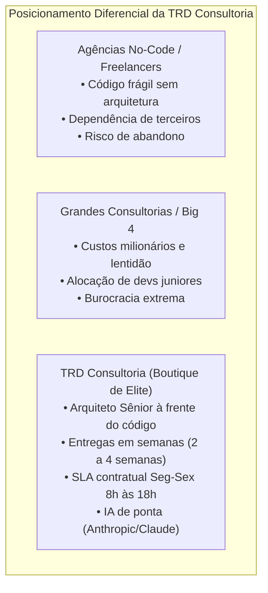
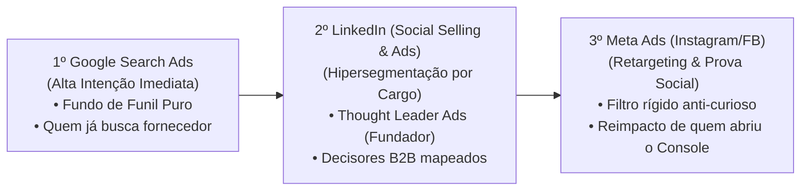
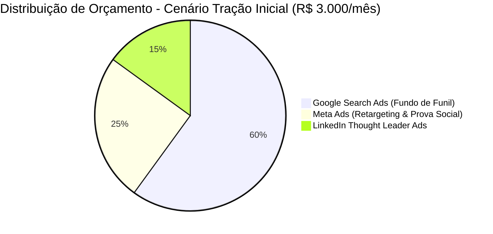
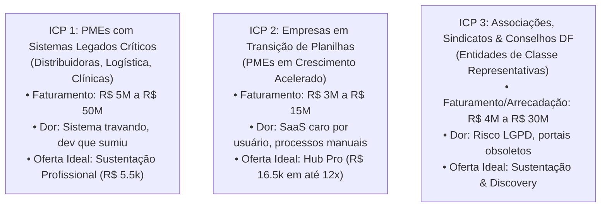
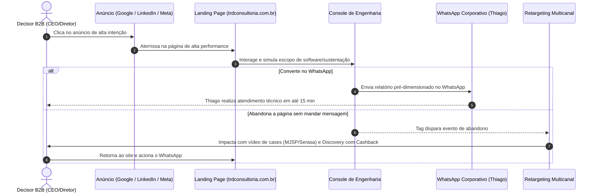
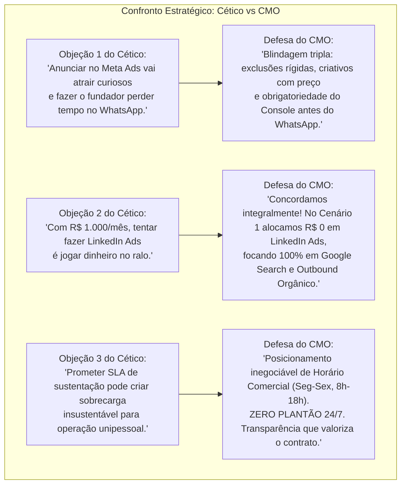

# PLANO ESTRATÉGICO DE MARKETING & DISTRIBUIÇÃO B2B (TRÁFEGO & AQUISIÇÃO)
### Diretoria de Marketing (CMO) — TRD Consultoria e Serviços de TI LTDA
**Versão:** 1.0 — Oficial  
**Data:** Novembro de 2026  
**Liderança Técnica & Fundador:** Thiago Rocha Duarte  
**Canal Central:** `trdconsultoria.com.br` | WhatsApp Corporativo: (61) 99952-6374  

---

## 1. Sumário Executivo & Posicionamento Estratégico

### 1.1. Tese Central de Go-To-Market
A **TRD Consultoria** não é uma software house genérica de volume, nem uma agência amadora de soluções no-code frágeis, nem uma grande consultoria de TI corporativa engessada com custos de estrutura inflacionados.

Nossa posição única no mercado B2B brasileiro é a de **Boutique de Engenharia de Software de Missão Crítica e Inteligência Artificial**, operada com precisão de elite por arquiteto de software sênior com histórico auditável em operações de escala nacional (**Ministério da Justiça/SINESP, Serasa Experian, Comissão de Valores Mobiliários - CVM** e certificação oficial **Anthropic / Claude**).

### 1.2. As 3 Ofertas Âncora da Estrutura Comercial
Toda a arquitetura de tráfego e mídia paga está desenhada para converter leads nestas três ofertas de alto valor agregado:

1. **Criação de Novos Sistemas Sob Medida (TRD Core Boilerplate):**
   * **Starter (CRM/Painel Enxuto):** R$ 9.800,00 à vista (ou em até 12x no cartão corporativo).
   * **Hub Pro (OS, Financeiro, Estoque + WhatsApp):** R$ 16.500,00 à vista (ou em até 12x no cartão).
   * **Garantia:** 30 dias de suporte pleno inclusos + transição automática para Plano Continuidade (R$ 1.800/mês).
2. **Sustentação e Governança de Sistemas Existentes (Recorrência - MRR):**
   * **Essencial:** R$ 3.200,00/mês (20 horas/mês, sustentação corretiva e queries SQL).
   * **Profissional (O Mais Vendido):** R$ 5.500,00/mês (40 horas/mês, observabilidade proativa Sentry/Kuma e alinhamentos quinzenais).
   * **Enterprise:** R$ 8.000,00/mês (60 horas/mês, suporte de alta prioridade e deploys de IA).
   * **Diretriz Operacional Inegociável:** Atendimento estrito em **Horário Comercial (Segunda a Sexta, das 8h às 18h)**. **ZERO PLANTÃO 24/7**, assegurando saúde operacional e margem sustentável para a boutique.
3. **Oferta Front-End de Resgate & Quebra de Objeção:**
   * **Discovery Técnico de Arquitetura:** R$ 3.500,00 (auditoria estática, mapeamento de gargalos e plano de ação) com **100% de CASHBACK** deduzido do contrato se o cliente contratar o projeto ou plano de sustentação semestral.

---

## 2. Avaliação e Hierarquia de Canais de Distribuição

Para maximizar o Retorno sobre o Investimento Publicitário (ROAS) sem dispersão de capital, os canais de tração da TRD foram ranqueados por intenção de compra, assertividade e controle de desqualificação:

### 2.1. Canal 1: Google Search Ads (O Campeão de Fundo de Funil)
* **Função Estratégica:** Capturar a demanda reprimida de empresas que já estão no momento de compra e buscam urgentemente solucionar problemas de sistemas travando ou demandam desenvolvimento personalizado.
* **Por que é a prioridade #1:** O comprador que digita no Google *"empresa de desenvolvimento de software brasília"* ou *"sustentação de sistemas legados"* não precisa ser educado sobre a necessidade de software. Ele já tem o problema, tem orçamento e busca um fornecedor idôneo.
* **Estrutura de Campanhas Recomendada:**
  1. **Campanha Fundo de Funil - Sistemas Sob Medida (DF e Centro-Oeste):**
     * Palavras-chave de Correspondência de Frase e Exata: `"desenvolvimento de software brasília"`, `"empresa de software df"`, `"desenvolvimento de sistemas sob medida"`, `"fábrica de software brasília"`, `"sistema sob medida para empresas"`.
  2. **Campanha Fundo de Funil - Sustentação de Sistemas & Resgate:**
     * Palavras-chave: `"sustentação de sistemas"`, `"consultoria java corporativo"`, `"manutenção de software legado"`, `"consultor banco de dados sql df"`, `"auditoria de código fonte"`.
* **Negativação Rígida e Compulsória (Blindagem contra Desperdício):**
  * Termos a negativar compulsoriamente: *grátis, gratuito, curso, faculdade, estágio, emprego, salário, vagas, concurso, tutorial, apostilas, github, open source, pirata, crack, júnior, o que é, como fazer, freelance barato, freelancer 50 reais, download*.

### 2.2. Canal 2: LinkedIn (Orgânico Dev-to-Founder + LinkedIn Ads)
* **Função Estratégica:** Construção de reputação inabalável com decisores de alto escalão (CEOs, Diretores de Operações, CTOs e Gerentes de TI) e prospecção direta orientada a contas estratégicas (ABM).
* **Braço Orgânico (Perfil Pessoal de Thiago Duarte):**
  * O perfil corporativo de Company Page possui baixo engajamento orgânico no algoritmo do LinkedIn. A autoridade deve emanar do perfil pessoal do fundador Thiago Duarte ([Playbook de Autoridade no LinkedIn](file:///E:/projetos/TRD-%20CONSUTORIA%20DE%20TI/operacoes/03_social_media/PLAYBOOK_LINKEDIN_AUTORIDADE.md)).
  * Cadência: 1 post de alta densidade técnica/negócios por semana, focado nos 4 pilares: *Casos Reais e Desengasgos*, *Alertas de Risco para Decisores*, *IA Prática Corporativa* e *Arquitetura & Continuidade*.
  * Rotina Ativa de Social Selling: 15 minutos diários de comentários técnicos substanciais em publicações de diretores e decisores de PMEs do DF e Centro-Oeste.
* **Braço Pago: LinkedIn Thought Leader Ads (Impulsionamento de Post Pessoal):**
  * Em vez de rodar anúncios genéricos de Company Page (que geram CTR baixo e CPC de R$ 25 a R$ 40), o formato mais eficiente do LinkedIn é o **Thought Leader Ad**, onde impulsionamos as publicações do perfil pessoal de Thiago Duarte diretamente para o feed dos decisores-alvo.
  * Esse formato humaniza a boutique, gera até **60% mais engajamento** e um custo por clique significativamente mais eficiente.
* **LinkedIn Message Ads / InMail:**
  * **Veredito do CMO:** DESACONSELHADO para fases de validação com baixo orçamento devido ao alto custo por envio e taxa de rejeição quando parecer spam. Deve ser reservado unicamente na fase de escala para listas refinadas de até 200 contas-alvo (ABM).

### 2.3. Canal 3: Meta Ads (Instagram & Facebook) — Como Utilizar sem Atrair Curiosos
* **O Risco Clássico:** Anunciar serviços de tecnologia no Instagram costuma atrair estudantes querendo mentoria, programadores em busca de emprego ou pessoas querendo "criar o novo Uber por R$ 1.000".
* **A Estratégia de Filtragem em 3 Camadas TRD:**
  1. **Camada 1: Segmentação de Audiência Rígida:**
     * Interesses direcionados: Administradores de Páginas do Facebook Comerciais, Gestão Empresarial, ERP, Logística Corporativa, Diretores Comerciais.
     * Exclusões Obrigatórias: Estudantes universitários, pessoas interessadas em "Cursos de Programação", "Vagas de Emprego", "Estágio de TI", "Python do Zero", "Alura", "Rocketseat".
  2. **Camada 2: Criativo com Auto-Filtro de Porte e Preço:**
     * A copy e o design do criativo explicitam o público corporativo e a faixa de investimento para afugentar curiosos logo nos primeiros 3 segundos:
       * *"Para empresas com faturamento acima de R$ 3 milhões que dependem de sistemas internos próprios."*
       * *"Planos de sustentação técnica com SLA a partir de R$ 3.200/mês."*
       * *"Criação de software sob medida com entrega em até 4 semanas a partir de R$ 9.800 em até 12x."*
  3. **Camada 3: Destino Exclusivo para a Landing Page (Console Interativo):**
     * **PROIBIDO:** Criar anúncio com botão direto para o WhatsApp no Meta Ads em tráfego frio. Isso geraria centenas de mensagens de desqualificados que consumiriam as horas de engenharia do fundador.
     * **PERMITIDO E OBRIGATÓRIO:** O tráfego do Meta aterrissa na Landing Page (`trdconsultoria.com.br`) e direciona o usuário para o **Console Interativo de Dimensionamento e Diagnóstico de Engenharia**. O console funciona como um filtro cognitivo: apenas quem seleciona o escopo, vê as faixas de preço transparentes e confirma os dados corporativos avança para o WhatsApp com o relatório pré-preenchido.
  4. **O Verdadeiro Superpoder do Meta: Retargeting de Alta Frequência:**
     * 70% a 80% do budget de Meta Ads deve ser alocado em **Retargeting** de quem visitou o site nos últimos 30 a 60 dias e não iniciou contato no WhatsApp.
     * Criativos de Retargeting:
       * *Vídeo 1:* Thiago Duarte apresentando os bastidores e os cases corporativos (Ministério da Justiça, Serasa Experian, CVM).
       * *Carrossel 2:* A oferta de Discovery Técnico com 100% de Cashback (Risco Zero para o cliente).
       * *Depoimento/Técnico 3:* O perigo do código abandonado e por que o SLA de Horário Comercial protege a operação do cliente.

---

## 3. Proposta de Alocação de Orçamento (Budget) em 3 Cenários Realistas

### 3.1. Cenário 1: Teste e Validação (R$ 500,00 a R$ 1.000,00 / mês)
* **Objetivo:** Gerar as primeiras oportunidades de fundo de funil com custo controlado e validar as taxas de conversão da Landing Page e do Console Interativo.
* **Alocação de Verba:**
  * **100% Google Search Ads (Fundo de Funil Ultra-Localizado no DF):** R$ 500 a R$ 1.000/mês (cerca de R$ 25 a R$ 50 por dia útil).
  * **LinkedIn Orgânico + Outbound Ativo (Custo Mídia R$ 0,00):** Aplicação disciplinada dos scripts de prospecção via LinkedIn e WhatsApp local ([Scripts Outbound](file:///E:/projetos/TRD-%20CONSUTORIA%20DE%20TI/operacoes/02_comercial_marketing/SCRIPTS_PROSPECCAO_OUTBOUND.md)).
* **Racional Técnico do CMO:** No LinkedIn Ads, R$ 500 permitiria comprar míseros 15 a 20 cliques no mês, o que é estatisticamente insignificante. No Google Search, com CPC médio negociado entre R$ 5,00 e R$ 8,00 em termos exatos no DF, o budget entrega entre 80 e 150 visitantes altamente qualificados que estão procurando fornecedor agora.
* **Resultados Projetados:**
  * 80 a 140 cliques no site.
  * 15 a 25 simulações executadas no Console Interativo.
  * 3 a 6 contatos comerciais qualificados recebidos no WhatsApp.
  * Meta: Fechar 1 contrato de Criação Starter (R$ 9.800) ou 1 Discovery com Cashback (R$ 3.500) -> **ROAS imediato de 3,5x a 9,8x**.

---

### 3.2. Cenário 2: Tração Inicial e Construção de Pipeline (R$ 2.000,00 a R$ 3.500,00 / mês)
* **Objetivo:** Estabelecer um fluxo contínuo e previsível de leads corporativos, ativar retargeting multicanal e posicionar a autoridade do fundador.
* **Alocação de Verba (Exemplo para R$ 3.000,00/mês):**
  * **Google Search Ads (60% — R$ 1.800,00/mês):** Ampliação de termos de pesquisa para todo o Centro-Oeste (DF, Goiânia, Anápolis) cobrindo termos de sustentação de legado, APIs e desenvolvimento customizado.
  * **Meta Ads - Retargeting & Prova Social (25% — R$ 750,00/mês):** Campanha de Retargeting para todos os visitantes do site/Console nos últimos 60 dias com criativos em vídeo e oferta do Discovery com Cashback.
  * **LinkedIn Thought Leader Ads (15% — R$ 450,00/mês):** Impulsionamento dos 2 posts mais relevantes do perfil de Thiago Duarte para CEOs, Sócios-Diretores e Gerentes de TI de PMEs no DF e Goiás.
* **Resultados Projetados:**
  * 250 a 350 cliques altamente qualificados.
  * 40 a 60 simulações de arquitetura no Console.
  * 10 a 16 leads qualificados no WhatsApp.
  * 4 a 6 reuniões de diagnóstico executivo (Discovery).
  * Meta: 1 a 2 novos contratos fechados no mês (R$ 15.000 a R$ 25.000 em faturamento de setup e/ou adição de R$ 5.500 a R$ 11.000 em MRR).

---

### 3.3. Cenário 3: Escala & Aceleração B2B (R$ 5.000,00 a R$ 8.000,00+ / mês)
* **Objetivo:** Dominância regional em Brasília e Goiás, captura de contas nacionais de grande porte e geração massiva de pipeline recorrente de sustentação.
* **Alocação de Verba (Exemplo para R$ 6.000,00/mês):**
  * **Google Search Ads (45% — R$ 2.700,00/mês):** Cobertura nacional para termos de nicho de alta margem (*"modernização de sistemas legados Java"*, *"fábrica de software governança corporativa"*, *"arquitetura de software sênior sob demanda"*).
  * **LinkedIn Ads ABM & Thought Leader (35% — R$ 2.100,00/mês):** Campanhas estruturadas de ABM (Account-Based Marketing) impactando especificamente diretores de 300 empresas previamente mapeadas no setor de saúde, logística e finanças, combinadas com InMail focado e Thought Leader Ads.
  * **Meta Ads (20% — R$ 1.200,00/mês):** Retargeting avançado com múltiplos ângulos (Depoimentos técnicos, breakdown de arquitetura do CNPD/Ministério da Justiça, demonstração do Hub Pro).
* **Resultados Projetados:**
  * 500+ visitas qualificadas/mês.
  * 25 a 35 oportunidades comerciais no pipeline.
  * 8 a 12 propostas de Discovery e Sustentação apresentadas.
  * Meta: Adição de R$ 15.000 a R$ 25.000 em novos contratos de MRR por mês, escalando a carteira de sustentação de forma previsível.

---

## 4. Segmentação Cirúrgica do Público-Alvo e Matriz ICP

Para que o investimento em mídia não seja pulverizado, a TRD foca exclusivamente em 3 Perfis de Cliente Ideal (ICPs):

### 4.1. Detalhamento dos ICPs Prioritários

| Variável | ICP 1: PMEs com Legado em Risco | ICP 2: Transição de Planilhas para SaaS Próprio | ICP 3: Entidades e Associações de Classe |
| :--- | :--- | :--- | :--- |
| **Porte da Empresa** | 20 a 150 funcionários | 10 a 50 funcionários | 15 a 80 colaboradores |
| **Faturamento Anual** | R$ 5 Milhões a R$ 50 Milhões | R$ 3 Milhões a R$ 15 Milhões | Arrecadação de R$ 4M a R$ 30M |
| **Setores Típicos** | Distribuidoras de alimentos/peças, operadores logísticos, clínicas médicas, correspondentes bancários. | Empresas de serviços, pequenas indústrias locais, revendedoras, consultorias de engenharia. | Conselhos regionais, federações patronais, sindicatos estaduais, associações de classe no DF. |
| **Dor Primária** | O software interno foi feito por um freelancer que sumiu, trava nos horários de pico e a empresa vive em pânico de parar a operação. | A empresa cresceu no Excel, tentou usar SaaS de prateleira mas a mensalidade por usuário ficou abusiva e o sistema não adapta ao fluxo dela. | Portais antigos sem conformidade LGPD, controle de anuidades frágil e risco iminente de vazamento de dados de associados. |
| **Decisor Econômico** | Sócio-Proprietário ou Diretor de Operações. | CEO, Fundador ou Diretor Geral. | Secretário-Geral ou Diretor Administrativo/Financeiro. |
| **Validador Técnico** | Gerente de TI ou o próprio Diretor Operacional. | Gestor de Operações ou Diretor de TI. | Coordenador de TI da entidade. |
| **Oferta Central** | Sustentação Profissional (R$ 5.500/mês) ou Discovery (R$ 3.500 com cashback). | Criação Hub Pro (R$ 16.500) ou Starter (R$ 9.800) em até 12x no cartão. | Sustentação Essencial/Profissional com governança de dados e autenticação segura. |

### 4.2. Filtros Geográficos e Priorização Regional
1. **Fase 1 (Expansão Imediata - DF e Entorno):** Foco geográfico primário em polos empresariais consolidados: **SIA (Setor de Indústria e Abastecimento), SAAN, SOF Norte/Sul, Taguatinga, Ceilândia e Plano Piloto (Asa Sul/Norte)**. Brasília concentra centenas de distribuidoras, operadores e entidades com alta solvência financeira e proximidade institucional.
2. **Fase 2 (Raio de Tração - Centro-Oeste):** Expansão das campanhas para Goiânia, Anápolis (polo farmacêutico e logístico) e Rio Verde (agronegócio corporativo).
3. **Fase 3 (Expansão Nacional B2B):** Segmentação focada nas regiões corporativas de São Paulo (Faria Lima, Berrini, Barueri/Alphaville) e Rio de Janeiro exclusivamente para os termos de modernização de sistemas legados Java e consultoria de IA Anthropic.

---

## 5. Arquitetura do Funil de Conversão & Tráfego

O ecossistema digital da TRD foi desenhado para eliminar a fricção entre o clique publicitário e a decisão de contratação:

### 5.1. O Papel Estratégico do Console Interativo de Engenharia
Diferente de agências que forçam o cliente a "preencher um formulário cego e esperar 48 horas", a TRD disponibiliza o **Console Interativo de Dimensionamento**:
* **Geração de Valor Imediato:** O decisor simula o porte do seu software, a stack tecnológica, o nível de SLA e a complexidade de IA desejada.
* **Ancoragem de Preço e Transparência:** O console apresenta instantaneamente os valores de referência (Starter R$ 9.800, Pro R$ 16.500, Sustentação R$ 3.200 a R$ 8.000). Isso afasta decisores despreparados e consolida seriedade para empresas maduras.
* **Preparação da Reunião Comercial:** Quando o lead clica em "Enviar Proposta via WhatsApp", o link já abre com uma mensagem pré-formatada contendo todos os parâmetros técnicos selecionados. Thiago recebe o lead no WhatsApp já sabendo exatamente o que o cliente precisa, encurtando o ciclo de venda para menos de 48 horas.

### 5.2. Mecânica Avançada de Retargeting (Recuperação de Leads do Console)
* **Tag Setup:** Google Tag Manager com disparos configurados para os eventos:
  * `page_view_home`
  * `console_interaction_started` (o visitante mexeu nos seletores de tecnologia/escopo)
  * `console_estimate_calculated` (o visitante visualizou a estimativa de valor)
  * `lead_whatsapp_click` (conversão concluída)
* **Público de Retargeting Cirúrgico:** Usuários que dispararam `console_estimate_calculated` nos últimos 45 dias mas **NÃO** dispararam `lead_whatsapp_click`.
* **Sequência de Impacto de Retargeting (Meta Ads & Google Display/Discovery):**
  * **Dia 1 ao Dia 7 (Ângulo Risco Zero):** Anúncio em carrossel destacando: *"Fez a simulação no nosso console? Faça o diagnóstico completo da sua arquitetura por R$ 3.500 com 100% de cashback deduzido no seu projeto."*
  * **Dia 8 ao Dia 21 (Ângulo Autoridade Máxima):** Criativo em vídeo destacando o histórico do fundador: *"Sistemas que não podem cair. A mesma engenharia aplicada ao Ministério da Justiça e à Serasa protegendo a sua empresa."*
  * **Dia 22 ao Dia 45 (Ângulo Governança e SLA):** Anúncio institucional reforçando a estabilidade: *"Sem freelancers que somem. Sustentação formal com SLA contratual, código no seu repositório e atendimento em horário comercial."*

---

## 6. KPIs, Métricas de Eficiência e Metas de Desempenho

### 6.1. Tabela de Métricas-Chave de Mídia e Conversão B2B

| Indicador (KPI) | Meta Cenário Validação | Meta Cenário Tração | Meta Cenário Escala |
| :--- | :---: | :---: | :---: |
| **Custo por Clique (CPC Médio Google)** | R$ 4,50 a R$ 7,50 | R$ 5,00 a R$ 8,50 | R$ 6,00 a R$ 10,00 |
| **Custo por Clique (CPC Meta Retargeting)** | N/A | R$ 1,50 a R$ 2,80 | R$ 1,80 a R$ 3,20 |
| **Custo por Clique (CPC LinkedIn TL Ads)** | N/A | R$ 12,00 a R$ 18,00 | R$ 14,00 a R$ 22,00 |
| **Taxa de Conversão da LP (Visita ➔ Console)** | 25% a 35% | 30% a 40% | 35% a 45% |
| **Taxa de Conversão Final (Console ➔ WhatsApp)** | 8% a 15% | 12% a 18% | 15% a 22% |
| **Custo por Lead Qualificado (SQL no WhatsApp)** | R$ 80,00 a R$ 150,00 | R$ 100,00 a R$ 180,00 | R$ 120,00 a R$ 220,00 |
| **Taxa de Conversão (Lead WhatsApp ➔ Reunião)** | 40% a 50% | 45% a 55% | 50% a 60% |
| **Custo por Reunião de Discovery Agendada** | R$ 200,00 a R$ 350,00 | R$ 220,00 a R$ 380,00 | R$ 250,00 a R$ 450,00 |
| **Custo de Aquisição de Cliente (CAC Alvo)** | **< R$ 1.000,00** | **< R$ 1.800,00** | **< R$ 2.500,00** |

### 6.2. Análise de Retorno sobre Investimento (LTV / CAC)
* Em contratos de **Criação de Sistemas**:
  * Ticket Médio (Starter / Pro): R$ 9.800,00 a R$ 16.500,00.
  * Com CAC alvo de R$ 1.000 a R$ 1.800, a relação **LTV / CAC imediata é de 6x a 10x já no primeiro mês**, sem considerar a migração posterior para o Plano Continuidade (R$ 1.800/mês).
* Em contratos de **Sustentação de Sistemas (MRR)**:
  * Ticket Médio (Profissional): R$ 5.500,00/mês.
  * Tempo Médio de Retenção Contratual (Lifetime): 12 meses.
  * LTV Anual por Cliente: **R$ 66.000,00**.
  * Relação LTV / CAC: **> 26x**, comprovando que um CAC de até R$ 2.500,00 é extremamente saudável e lucrativo para a boutique.

---

## 7. Stress Test do Cético: Ponderações Críticas e Respostas do CMO

Para assegurar que este plano estratégico não seja baseado em otimismo infundado, confrontamos as principais objeções de risco levantadas pela governança crítica:

### Ponderação 1: "Investir em Meta Ads para B2B de software só gera leads desqualificados, estagiários e pedidos de desconto."
* **Avaliação do Cético:** O ambiente do Instagram e Facebook é predominantemente B2C e recreativo. Quem busca consultoria corporativa de TI de R$ 5.500/mês não clica em anúncio de rede social; os cliques recebidos serão de curiosos sem verba.
* **Contraposição Firme do CMO:** 
  1. O Meta Ads **NÃO** será utilizado como canal de prospecção de tráfego frio direto para WhatsApp.
  2. Sua principal função na TRD é **Retargeting de Alta Frequência**: o decisor pesquisou no Google no computador do trabalho, viu a Landing Page da TRD, foi embora para casa e, à noite, ao abrir o Instagram no celular, é impactado pelo vídeo do fundador demonstrando o case da Serasa e a oferta de Discovery com 100% de Cashback.
  3. Para o tráfego frio complementar no Meta, a ancoragem de preço explícita no anúncio (*"Planos a partir de R$ 3.200/mês"* e *"Para empresas que faturam acima de R$ 3M"*) cria uma barreira psicológica que desqualifica os curiosos antes mesmo do clique.

---

### Ponderação 2: "LinkedIn Ads tem um custo por clique proibitivo para orçamentos modestos."
* **Avaliação do Cético:** Com CPCs no LinkedIn frequentemente superando R$ 25 a R$ 35, uma verba mensal de R$ 1.000 ou R$ 2.000 é consumida em menos de duas semanas sem gerar volume estatístico para fechamento.
* **Contraposição Firme do CMO:**
  1. O Cético está correto quanto aos formatos tradicionais de Sponsored Content e Message Ads de Company Page, motivo pelo qual **eles foram expressamente vetados no Cenário de Validação (R$ 0,00 de LinkedIn Ads no Cenário 1)**.
  2. No Cenário 1, a tração no LinkedIn é **100% orgânica** via Social Selling ativo e publicações estratégicas do perfil de Thiago Duarte.
  3. Nos Cenários 2 e 3, a ativação do LinkedIn dá-se prioritariamente via **Thought Leader Ads (impulsionando os posts pessoais de Thiago)**, formato cujo custo por engajamento e clique é significativamente menor do que os banners institucionais convencionais, convertendo com muito mais autoridade humana.

---

### Ponderação 3: "O fundador Thiago Duarte é o único arquiteto e líder técnico. Campanhas de marketing agressivas podem gerar gargalo operacional ou comprometer o atendimento."
* **Avaliação do Cético:** Se o marketing gerar 20 leads por semana, Thiago passará o dia conversando no WhatsApp e em reuniões de diagnóstico, paralisando os deploys e a sustentação dos clientes já contratados.
* **Contraposição Firme do CMO:**
  1. O funil da TRD foi arquitetado sob o conceito de **Filtro Cognitivo Progressivo**:
     * O anúncio qualifica pelo texto e preço.
     * A Landing Page apresenta os diferenciais e a credibilidade técnica.
     * O Console Interativo obriga o cliente a definir seu escopo e ver a estimativa de preço.
  2. O lead que finalmente aterrissa no WhatsApp já está pré-qualificado, conhece o preço e tem urgência real. O tempo médio gasto por Thiago em um lead qualificado é de apenas 15 minutos em alinhamento objetivo.
  3. Além disso, a TRD opera com governança estrita de capacidade: assim que a carteira de sustentação atingir a capacidade operacional planejada (5 a 8 contratos ativos), as campanhas de tráfego de novos contratos são imediatamente pausadas ou redirecionadas para a criação de sistemas pontuais com squads homologados, preservando a excelência do SLA.

---

## 8. Cronograma Tático de Implementação (Primeiros 30 Dias)

| Semana | Ações Prioritárias de Mídia & Marketing | Responsável | Entregável / Meta |
| :---: | :--- | :---: | :--- |
| **Semana 1** | • Configuração das tags de conversão (GTM, Pixel Meta e Google Ads) no site. • Criação e negativação da lista de palavras-chave da Campanha Google Search. • Post inaugural de autoridade no perfil de Thiago no LinkedIn. | Thiago / CMO | Tags ativas e testadas; campanha do Google em rascunho aprovada. |
| **Semana 2** | • Ativação da Campanha Google Search Fundo de Funil (Cenário Teste: R$ 35/dia útil). • Início da rotina diária de 15 min de Social Selling no LinkedIn. • Disparo de abordagens outbound via WhatsApp regional para distribuidoras do DF. | Thiago / CMO | Primeiros 40 a 60 cliques capturados; início das simulações no Console. |
| **Semana 3** | • Análise dos termos de pesquisa reais do Google e negativação de novos termos irrelevantes. • Criação dos primeiros anúncios de Retargeting em vídeo e carrossel para o Meta Ads. • Segundo post técnico no LinkedIn (Pilar: Casos Reais / Desengasgo). | Thiago / CMO | CTR do Google ajustado acima de 6%; campanhas de retargeting prontas. |
| **Semana 4** | • Revisão de métricas e conversões de leads no WhatsApp. • Condução das primeiras reuniões de Discovery Técnico. • Fechamento do 1º cliente pagante e deliberação sobre migração para o Cenário Tração (R$ 2.500/mês). | Thiago / CMO | **1º Contrato Assinado (R$ 9.800 Starter ou R$ 5.500 MRR). Break-even atingido.** |

---

### Documento Complementar e Aprovação Executiva
* **Ativos de Marca:** [assets/social_media/](file:///E:/projetos/TRD-%20CONSUTORIA%20DE%20TI/assets/social_media/)
* **Playbook LinkedIn:** [PLAYBOOK_LINKEDIN_AUTORIDADE.md](file:///E:/projetos/TRD-%20CONSUTORIA%20DE%20TI/operacoes/03_social_media/PLAYBOOK_LINKEDIN_AUTORIDADE.md)
* **Scripts Outbound:** [SCRIPTS_PROSPECCAO_OUTBOUND.md](file:///E:/projetos/TRD-%20CONSUTORIA%20DE%20TI/operacoes/02_comercial_marketing/SCRIPTS_PROSPECCAO_OUTBOUND.md)
* **Aprovação Final:** Thiago Rocha Duarte — Sócio Proprietário & Engenheiro Chefe
