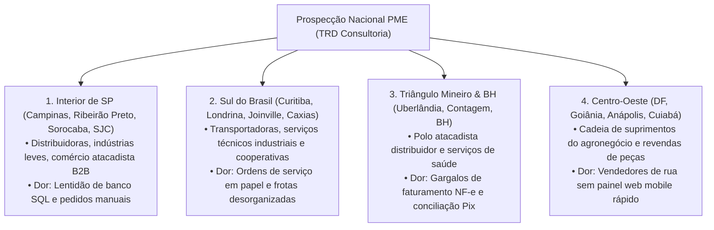

# PLANO DE EXPANSÃO NACIONAL PARA PEQUENAS E MÉDIAS EMPRESAS (PMEs)
### TRD Consultoria e Serviços de TI LTDA
**Autor:** Thiago Rocha Duarte (Sócio Proprietário & Engenheiro de Software)  
**Status:** Documento Homologado de Estratégia Comercial & Go-To-Market Nacional  
**Data:** 18 de Novembro de 2026  
**Versão:** `v1.0.0-NACIONAL`

---

## 1. Sumário Executivo & Tese do Mercado PME no Brasil

A **TRD Consultoria** estabelece como prioridade comercial a prospecção e conversão de **Pequenas e Médias Empresas (PMEs)** em todo o território nacional:
* **Universo Alvo:** Mais de 6,5 milhões de empresas no Brasil (EPPs e LTDAs com 5 a 50 funcionários e faturamento de R$ 500k a R$ 20M/ano).
* **Decisão Rápida (Zero Burocracia):** O interlocutor é o próprio dono, sócio-administrador ou diretor de operações. A tomada de decisão ocorre sem comitês burocráticos, com ciclo de fechamento médio de **3 a 15 dias**.
* **O Vácuo do Mercado:** A PME brasileira está presa entre o **freelancer amador** (que some no primeiro problema) e as **mega-consultorias / ERPs legados** (que cobram de R$ 30k a R$ 80k de implantação + R$ 150 a R$ 300 por usuário todo mês).
* **A Proposta de Valor TRD:** Engenharia de software sênior de missão crítica (histórico comprovado em Ministério da Justiça, Serasa Experian e CVM), entregando **sistemas próprios em até 20 dias, com código 100% do cliente, sem mensalidade por usuário e parcelamento corporativo em até 12x**.

---

## 2. A Linguagem de Vendas com o Empresário PME

O pequeno e médio empresário não compra termos técnicos acadêmicos (*Java 21, microsserviços, Docker, CI/CD*). Ele compra a **resolução imediata de gargalos operacionais e estancamento de prejuízos**:

```
┌────────────────────────────────────────────────────────────────────────────────┐
│                          A REGRA DE OURO DA COMUNICAÇÃO PME                    │
├────────────────────────────────────────────────────────────────────────────────┤
│ ❌ Falar de Tecnologia:                                                        │
│    "Desenvolvemos aplicações web modulares em arquitetura relacional SQL."    │
│                                                                                │
│ ✅ Falar de Resultado Operacional:                                             │
│    "Nós tiramos a sua empresa das planilhas de Excel e colocamos a sua          │
│     operação em um painel web próprio, onde você controla pedidos, estoque     │
│     e financeiro até pelo celular, sem pagar mensalidade por usuário."         │
└────────────────────────────────────────────────────────────────────────────────┘
```

---

## 3. Matriz de Ofertas Focada em PMEs (Preço Fixo & Transparente)

| Produto / Serviço | Preço Oficial | Prazo de Entrega | Para Quem É? | O que Entrega? |
| :--- | :---: | :---: | :--- | :--- |
| **CRM / Hub Starter Sob Medida** | **R$ 9.800**<br>*(ou até 12x no cartão)* | **15 a 20 dias úteis** | PMEs que estão saindo das planilhas e perdendo pedidos no WhatsApp. | 3 a 4 telas essenciais (Clientes, Pedidos/OS, Financeiro Pix/Boleto, Painel Mobile do Dono). Código 100% da empresa. |
| **Hub de Gestão Pro (Mini-ERP)** | **R$ 16.500**<br>*(ou até 12x no cartão)* | **3 a 5 semanas** | PMEs com 15 a 40 funcionários que precisam de controle integrado. | Controle multi-perfil, estoque automatizado, integração com WhatsApp API e conciliação bancária automática. |
| **Sustentação & Confiabilidade SLA** | **R$ 3.200 a R$ 5.500/mês** | Início imediato | Empresas com software próprio ou legado que vive caindo/lento. | Retaguarda técnica sênior em **Horário Comercial (Seg-Sex, 8h às 18h)**, resposta técnica P1 em até 4h úteis. |
| **Sprint Diagnóstico (Discovery)** | **R$ 3.500**<br>*(100% de Cashback)* | **5 dias úteis** | Empresas desconfiadas que precisam resolver um gargalo pontual. | Auditoria sob NDA de banco SQL e arquitetura. Se contratar a sustentação, 100% do valor é abatido. |

---

## 4. Polos Nacionais Prioritários de Prospecção

A prospecção nacional remota concentra-se nos 4 maiores polos de PMEs com alta circulação de caixa e dependência de logística/sistemas:



---

## 5. Os 3 Canais de Aquisição Nacional Remota

### Canal 1: Prospecção Ativa via LinkedIn Nacional (Outbound B2B)
* **Público:** *Proprietário, Sócio, Fundador, Diretor Geral* em empresas de 11 a 50 funcionários nos polos prioritários.
* **Volume:** 20 a 30 conexões com mensagem personalizada por dia útil (~500/mês).
* **Script de Abertura:**
  > *"Olá [Nome], tudo bem?  
  > Vi que você está à frente da [Empresa].  
  > Nós desenvolvemos sistemas corporativos sob medida para pequenas e médias empresas no Brasil que precisam substituir planilhas manuais por um painel próprio para gerenciar pedidos, estoque e cobranças — sem pagar mensalidades absurdas por usuário.  
  > Como vocês hoje controlam a entrada de pedidos e a operação na [Empresa]?"*

### Canal 2: Abordagem Direta via Base CNPJ + WhatsApp Consultivo
* **Público:** Extração de contatos públicos e enriquecidos de sócios de empresas ativas nos CNAEs de Comércio Atacadista, Transporte Rodoviário e Clínicas Especializadas.
* **Volume:** 15 a 20 abordagens respeitosas e cirúrgicas por dia no WhatsApp Business oficial.
* **Script de WhatsApp:**
  > *"Olá [Nome], bom dia!  
  > Sou Thiago, engenheiro de software e fundador da TRD Consultoria de TI.  
  > Atendemos médias empresas em todo o Brasil substituindo controles manuais por sistemas web sob medida (com histórico técnico em projetos da Serasa e do Governo Federal), entregues em até 20 dias com código 100% seu e parcelamento em até 12x.  
  > Temos um simulador aberto onde você pode dimensionar o escopo e orçamento do seu sistema em 60 segundos: trdconsultoria.com.br.  
  > Faz sentido conversarmos 10 minutos esta semana sobre a operação da [Empresa]?"*

### Canal 3: Google Search Ads Nacional (Cauda Longa de Baixo Custo)
* **Estratégia:** Foco estrito em termos de alta intenção com menor concorrência nacional (CPC médio de R$ 3,50 a R$ 6,00):
  * `"desenvolvimento de sistema web sob medida pequena empresa"`
  * `"software de gestão personalizado sem mensalidade"`
  * `"desenvolvimento crm sob medida brasil"`
  * `"sustentação de sistema legado java postgresql"`
* O tráfego aterrissa no **Console de Engenharia** do site (`trdconsultoria.com.br`), gerando briefings qualificados no WhatsApp.

---

## 6. A Esteira de Fechamento 100% Remota (Do WhatsApp ao Contrato)

```
1. Contato no WhatsApp / Simulação no Console
                       │
                       ▼
2. Vídeo-Chamada de 20 min no Google Meet (Demo da Arquitetura & Alinhamento de Escopo)
                       │
                       ▼
3. Envio da Proposta Executiva e Minuta Contratual
                       │
                       ▼
4. Assinatura Digital das Partes via Gov.br (Validade Jurídica Federal Plena em 2 min)
                       │
                       ▼
5. Faturamento (Boleto Bancário 50/50 ou Link de Cartão Corporativo em até 12x)
                       │
                       ▼
6. Início Imediato do Desenvolvimento (Sprint 1 em 5 dias com ambiente de homologação)
```

---

## 7. Operação Enxuta & Escala Solo (Thiago Duarte)

Para manter a alta margem de lucro (>80%) e a qualidade de engenharia sênior sem sobrecarga:

1. **Alinhamentos Semanais via Loom (Vídeo Gravado):**  
   Demos semanais gravadas em vídeo de 4 a 6 minutos enviadas no WhatsApp do cliente para aprovação assíncrona, eliminando horas de reuniões desnecessárias.
2. **Ambiente de Homologação em Nuvem:**  
   O cliente testa as telas e valida os botões diretamente no navegador em ambiente de testes antes da virada para produção.
3. **Travas Operacionais:**
   * **Horário Comercial Estrito:** Atendimento e SLA de Segunda a Sexta, das 8h às 18h. Sem regime de plantão 24/7.
   * **Teto Simultâneo:** Máximo de 2 desenvolvimentos de sistemas novos + 5 contratos de sustentação recorrente ativos simultaneamente.
4. **Metas Financeiras:**
   * **Meta de Curto Prazo (Meses 1-2):** 2 Projetos Starter (R$ 19.600 em caixa).
   * **Meta de Médio Prazo (Meses 3-6):** R$ 30.000 a R$ 45.000/mês (mix de novos sistemas e contratos recorrentes de sustentação MRR).

---

Este plano integra o repositório oficial da TRD Consultoria e orienta todas as ações comerciais a partir desta data.
