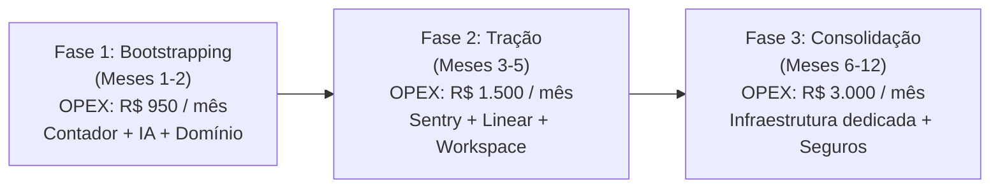

# MANUAL DE ENGENHARIA TRIBUTÁRIA, FINANCEIRA & FATOR R (LC 123/2006)
### Diretrizes Estratégicas de FinOps & Gestão Contábil (Simples Nacional)
**TRD Consultoria e Serviços de TI LTDA — Brasília/DF**

---

## 1. A Sistemática Legal do Fator R (Lei Complementar nº 123/2006)

As atividades de engenharia de software e desenvolvimento sob encomenda (CNAE 62.01-5-01) enquadram-se originariamente no **Anexo V da LC 123/2006**, cuja tributação inicial parte de pesados **15,50%**.

Contudo, o Art. 18, § 5º-J e § 5º-M da referida Lei Complementar estabelece que, se a razão entre a folha de salários/pró-labore dos últimos 12 meses e a receita bruta total do mesmo período for **igual ou superior a 28% (Fator R ≥ 0,28)**, as atividades passam a ser tributadas pelo **Anexo III**, com alíquota inicial a partir de **6,00%**:

$$\text{Fator R} = \frac{\text{Folha de Salários com Pró-Labore (últimos 12 meses)}}{\text{Receita Bruta Total Acumulada - RBT12 (últimos 12 meses)}} \ge 0,28 \ (28\%)$$

---

## 2. A Tributação Progressiva Real por Faixas de Faturamento (RBT12)

A alíquota do Simples Nacional não é estática. Conforme a receita bruta acumula, aplica-se a fórmula de alíquota efetiva da Receita Federal:

$$\text{Alíquota Efetiva} = \frac{(\text{RBT12} \times \text{Alíquota Nominal}) - \text{Parcela a Deduzir}}{\text{RBT12}}$$

### 📊 Comparativo Real por Cenários de Faturamento:

| Cenário de Negócio | Faturamento Mensal | RBT12 (Projetado) | Alíquota Anexo V (Sem Fator R) | Alíquota Efetiva Anexo III (Com Fator R) | Economia Mensal no DAS | Economia Anual no DAS |
| :--- | :---: | :---: | :---: | :---: | :---: | :---: |
| **Cenário 1: Entrada / Break-even** | R$ 4.000,00 | R$ 48.000,00 | **15,50%** (R$ 620,00) | **6,00%** (R$ 240,00) | **R$ 380,00** | **R$ 4.560,00** |
| **Cenário 2: Faixa 1 Limite** | R$ 15.000,00 | R$ 180.000,00 | **15,50%** (R$ 2.325,00) | **6,00%** (R$ 900,00) | **R$ 1.425,00** | **R$ 17.100,00** |
| **Cenário 3: Tração Média (Faixa 2)** | R$ 30.000,00 | R$ 360.000,00 | **16,68%** (R$ 5.004,00) | **8,21%** (R$ 2.463,00) | **R$ 2.541,00** | **R$ 30.492,00** |
| **Cenário 4: Consolidação (Faixa 3)**| R$ 50.000,00 | R$ 600.000,00 | **17,85%** (R$ 8.925,00) | **10,56%** (R$ 5.280,00) | **R$ 3.645,00** | **R$ 43.740,00** |

> **Nota Técnica de Auditoria:**  
> A alíquota de 6,00% aplica-se rigorosamente à **Faixa 1 (RBT12 até R$ 180.000,00)**. Ao atingir R$ 50.000,00/mês constantes (R$ 600k/ano), a empresa entra na **Faixa 3 do Anexo III**, pagando alíquota efetiva de **10,56%**. Mesmo nessa faixa, o Fator R gera uma economia direta de **R$ 3.645,00 por mês (R$ 43.740,00/ano)** apenas na guia do DAS comparado aos 17,85% do Anexo V.

---

## 3. Simulação Financeira Completa (Cenário Faturamento R$ 50.000 / mês)

Na fase consolidada a R$ 50.000,00/mês com Pró-Labore de 28,2% (R$ 14.100,00):

| Rubrica Financeira | Modelo Sem Fator R (Anexo V) | Modelo TRD com Fator R (Anexo III) |
| :--- | :---: | :---: |
| **Receita Bruta Faturada** | R$ 50.000,00 | R$ 50.000,00 |
| **Guia do DAS Simples Nacional** | R$ 8.925,00 (17,85%) | **R$ 5.280,00 (10,56%)** |
| **Pró-Labore do Fundador** | R$ 0,00 (Sem folha) | **R$ 14.100,00 (28,2%)** |
| **INSS do Fundador (Retido no Teto)** | R$ 0,00 | ~R$ 856,46 |
| **IRPF Retido na Fonte (com deduções)** | R$ 0,00 | ~R$ 2.450,00 |
| **Pró-Labore Líquido no Bolso do Fundador** | R$ 0,00 | **~R$ 10.793,54** |
| **OPEX Fixo de Sustentação** | ~R$ 1.500,00 | ~R$ 1.500,00 |
| **Lucro Líquido Remanescente no Caixa PJ** | R$ 39.575,00 | **R$ 29.120,00** |
| **Fundo de Reserva Retido (20%)** | R$ 7.915,00 | **R$ 5.824,00** |
| **Dividendos Isentos Distribuídos (80%)** | R$ 31.660,00 | **R$ 23.296,00** |
| **RENDA TOTAL LÍQUIDA DO FUNDADOR (MÊS)** | **R$ 31.660,00** | **R$ 34.089,54** *(Pró-Labore Líq. + Dividendos)* |

💡 **Conclusão:** O modelo com Fator R não apenas economiza **R$ 3.645,00/mês de tributo empresarial**, mas assegura renda total líquida superior ao fundador, garantindo contribuição previdenciária no teto do INSS e total respaldo patrimonial perante a Receita Federal.

---

## 4. O Orçamento Operacional (OPEX) em 3 Fases Evolutivas

Para eliminar discrepâncias orçamentárias, o custo operacional fixo (*OPEX*) segue três faixas estritas de maturidade:

1. **Fase 1 – Bootstrapping Inicial (R$ 950,00 / mês):**
   * Contabilidade Digital especializada em TI no DF: ~R$ 450,00
   * Licenças de IA e IDEs de Desenvolvimento (Cursor + Claude API): ~R$ 350,00
   * Servidores, Domínio e E-mail Corporativo: ~R$ 150,00
2. **Fase 2 – Tração Operacional (R$ 1.500,00 / mês):**
   * Ferramentas avançadas de observabilidade (Sentry SaaS, Uptime), Google Workspace corporativo com 2FA e plataforma de chamados (Linear).
3. **Fase 3 – Consolidação de Boutique (R$ 3.000,00 / mês):**
   * Ambientes de staging em nuvem dedicada, seguro de responsabilidade civil profissional (E&O) e reserva técnica.

---

## 5. Diretriz Prática para a Assessoria Contábil

No dia **25 de cada mês**, a contabilidade da TRD receberá o fechamento das NFS-e emitidas para aplicar a seguinte checagem:
1. Confirmar se a razão `Folha_12m / RBT12_12m` permanece em **28,2% a 28,5%**;
2. Emitir a folha de pró-labore calibrada exatamente para manter o Fator R acima de 0,28;
3. Gerar a guia única do DAS com o código de tributação do **Anexo III**.
