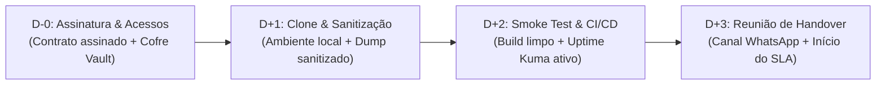

# RUNBOOK DE ONBOARDING TÉCNICO DE NOVOS CLIENTES EM 72 HORAS
### Protocolo Padronizado de Assunção de Sistemas Legados sem Quebra de SLA
**TRD Consultoria e Serviços de TI LTDA — Brasília/DF**

---

## 1. Princípio do Onboarding Seguro
Assumir a sustentação de um sistema corporativo já em produção é o momento de maior vulnerabilidade técnica: se o sistema falhar no 2º dia de contrato e a consultoria não tiver credenciais, cópias de segurança ou mapa de arquitetura, ela é injustamente culpabilizada.

Este Runbook padroniza a transição de responsabilidade técnica em **4 etapas consecutivas executadas nas primeiras 72 horas (D-0 a D+3)**:

---

## 2. Cronograma de Execução: 72 Horas

### 🚀 D-0: Assinatura Contratual, NDA & Vault de Credenciais (Primeiras 12h)
- [ ] **1. Instrumentos Jurídicos:** Contrato de Sustentação & SLA e Acordo de Confidencialidade (NDA) devidamente assinados via ZapSign/ClickSign.
- [ ] **2. Criação do Cofre no Bitwarden/1Password:**
  * Criação da pasta institucional `Cliente_[Nome]` no cofre de senhas da TRD.
  * Cadastro de chaves SSH, credenciais de VPN corporativa, logins de banco de dados (usuários com privilégios mínimos para leitura/escrita).
- [ ] **3. Matriz de Contatos de Emergência do Cliente:**
  * Nome, WhatsApp e e-mail do Decisor Comercial (Diretor/CEO).
  * Nome e WhatsApp do Ponto Focal Técnico ou de Operações do cliente (quem valida correções).

---

### 💻 D+1: Clonagem de Repositórios, Dump Sanitizado & Ambiente Local (24h a 36h)
- [ ] **4. Acesso ao Código-Fonte:**
  * Concessão de permissão de leitura/escrita no GitHub/GitLab do cliente.
  * Fork de segurança ou espelhamento do repositório em organização privada da TRD com branch protection.
- [ ] **5. Obtenção de Dump de Banco de Dados Sanitizado:**
  * Obtenção de cópia recente do esquema e dados do banco (PostgreSQL, MySQL, SQL Server ou Oracle).
  * Sanitização de dados pessoais sensíveis (anonimização de senhas, CPFs e dados de cartão conforme LGPD) para uso em ambiente de desenvolvimento local.
- [ ] **6. Build Local & Conteinerização:**
  * Subir a aplicação em ambiente local isolado (Docker) garantindo que `docker compose up` funcione sem erros de dependência.

---

### 🧪 D+2: Observabilidade 24/7, Smoke Tests & Esteira de Deploys (36h a 48h)
- [ ] **7. Setup de Monitoramento Externo:**
  * Cadastro das URLs públicas, endpoints de healthcheck (`/health`, `/actuator/health`) e páginas vitais do cliente no *Uptime Kuma* ou *Better Stack*.
  * Configuração de alerta em tempo real via Telegram/WhatsApp do fundador (latência > 3s ou HTTP != 200).
- [ ] **8. Validação da Esteira de Deploy (Smoke Test):**
  * Execução de um deploy controlado em ambiente de homologação (*Staging*) para homologar que a esteira de CI/CD está íntegra antes de qualquer incidente real.
- [ ] **9. Auditoria de Logs:**
  * Verificação de arquivos de log do servidor em busca de erros silenciosos (`NullPointerException`, locks de transação ou estouro de memória).

---

### 🤝 D+3: Go-Live Operacional & Início da Vigência do SLA (48h a 72h)
- [ ] **10. Criação do Canal Oficial de Chamados:**
  * Criação do grupo oficial de suporte no WhatsApp ou canal dedicado (Linear/Jira).
  * Fixação das regras de atendimento: Horário comercial (08:30 às 18:30), definição de P1 a P4 e canais de emergência.
- [ ] **11. Reunião Executiva de Handover (30 minutos via Google Meet):**
  * Alinhamento final com a diretoria do cliente confirmando que a TRD está oficialmente no comando da sustentação técnica.
  * Ativação do cronômetro de horas mensais contratadas.

---

## 3. Benefício Estratégico deste Runbook
* **Eliminação do Risco de Falso Culposo:** Se o sistema cair no 1º dia, a TRD já tem logs e histórico comprovando o estado em que o sistema foi recebido.
* **Profissionalismo Enterprise:** O cliente percebe imediatamente que não contratou um freelancer amador, mas sim uma consultoria com metodologia sênior de transição.
