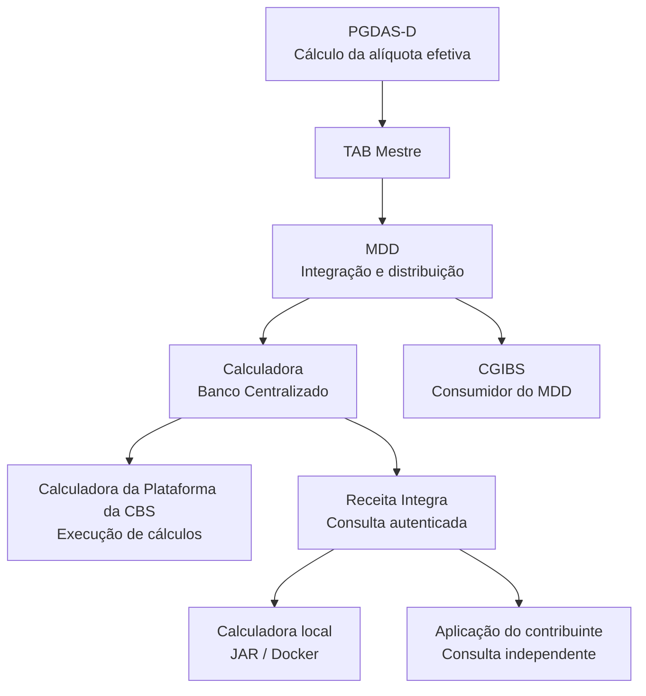

# Roadmap — Calculadora de Tributos: Simples Nacional

**Última atualização:** Outubro de 2026

Este documento apresenta as funcionalidades disponíveis e a evolução prevista para a **Calculadora de Tributos — Simples Nacional**, conforme o planejamento institucional da Receita Federal do Brasil e a regulamentação da Reforma Tributária sobre o Consumo, especialmente a Lei Complementar nº 214/2025.

A solução tem por finalidade aplicar as regras tributárias do IBS e da CBS às operações de contribuintes optantes pelo Simples Nacional, conforme os parâmetros e tratamentos implementados.

## Status Atual — Release 15 (Outubro/2026)

### Funcionalidades disponíveis

- [x] Tratamento das operações de contribuintes optantes pelo Simples Nacional nos documentos fiscais eletrônicos NFS-e, NF-e e NFC-e.
- [x] Tratamento das operações de contribuintes do Simples Nacional que optarem pelo regime regular do IBS e da CBS.
- [x] Disponibilização de percentuais pré-carregados de IBS e CBS, por anexo e ano, aplicáveis à primeira faixa do Simples Nacional.
- [x] Disponibilização de código-fonte, componentes executáveis (JAR e Docker) e serviços de integração por API.

### Entregas da Release 15

- [x] Implementação do banco de dados centralizado para armazenamento e disponibilização de parâmetros tributários aplicáveis aos contribuintes do Simples Nacional.

O banco centralizado permite que a Calculadora, quando executada no ambiente da Plataforma da CBS, acesse os parâmetros tributários necessários à determinação do IBS e da CBS.

A estrutura disponibilizada na Release 15 constitui a base para o recebimento das alíquotas efetivas calculadas pelo PGDAS-D, cuja integração está prevista para a Release 16.

### Limitações de escopo

A Calculadora de Tributos não substitui o **Programa Gerador do Documento de Arrecadação do Simples Nacional — Declaratório (PGDAS-D)**.

O cálculo da alíquota efetiva do Simples Nacional, com base na receita bruta acumulada nos 12 meses anteriores (RBT12), permanece sob responsabilidade do PGDAS-D.

A Calculadora utiliza as alíquotas e os parâmetros tributários disponibilizados pelas integrações correspondentes, sem executar o cálculo da alíquota efetiva do Simples Nacional.

## Próximos Passos

### Curto Prazo — Release 16

**Integração com NFS-e**

- [ ] Evolução da integração com a NFS-e para utilização dos parâmetros e das alíquotas efetivas do Simples Nacional disponibilizados à Calculadora. O cálculo e a validação das operações na NFS-e já estão implementados.

**Integração com o PGDAS-D e disponibilização de alíquotas efetivas**

- [ ] Integração das alíquotas efetivas calculadas pelo PGDAS-D, encaminhadas à TAB Mestre e distribuídas pelo MDD.
- [ ] Recebimento e armazenamento, no banco de dados centralizado da Calculadora, das alíquotas efetivas disponibilizadas pelo MDD.
O MDD também distribui as informações ao Comitê Gestor do IBS (CGIBS), de forma independente. A Calculadora e o CGIBS são consumidores dos dados distribuídos pelo MDD; a Calculadora não encaminha esses dados ao CGIBS.

**Consulta de alíquotas pelo Receita Integra**

- [ ] Disponibilização de endpoints no Receita Integra para consulta autenticada das alíquotas efetivas dos contribuintes.
- [ ] Integração dos componentes locais da Calculadora (JAR e Docker) com o Receita Integra, permitindo a consulta direta das alíquotas efetivas.
- [ ] Consulta independente das alíquotas efetivas pelas aplicações dos contribuintes, mediante autenticação no Receita Integra, sem injeção desses dados no motor de cálculo da Calculadora.

### Médio e Longo Prazo — 2027

- [ ] Evolução do tratamento dos atores das operações e de suas relações com os contribuintes optantes pelo Simples Nacional, conforme as definições normativas e o planejamento institucional.

## Arquitetura de Integração

A arquitetura do Simples Nacional estabelece a separação entre o cálculo da alíquota efetiva, a distribuição das informações tributárias e a utilização desses dados pela Calculadora.

### Fluxo de disponibilização das alíquotas

1. **PGDAS-D:** calcula as alíquotas efetivas do Simples Nacional para cada contribuinte.
2. **TAB Mestre:** recebe as informações de alíquotas efetivas encaminhadas pelo PGDAS-D.
3. **MDD:** realiza a integração e distribui as informações provenientes da TAB Mestre para a Calculadora de Tributos e para o CGIBS.
4. **Calculadora — Banco Centralizado:** recebe e armazena os parâmetros tributários e as alíquotas efetivas disponibilizadas pelo MDD.
5. **Calculadora da Plataforma da CBS:** utiliza o banco centralizado para execução de cálculos.

### Consulta das alíquotas em ambiente local

Para utilização da Calculadora fora da Plataforma da CBS, estão previstas duas modalidades independentes de consulta:

- **Consulta pelo componente local:** os componentes JAR e Docker poderão consultar diretamente os endpoints disponibilizados no Receita Integra.
- **Consulta pela aplicação do contribuinte:** os sistemas dos contribuintes poderão obter as alíquotas efetivas diretamente pelo Receita Integra, independentemente da utilização da Calculadora. Esses dados não são fornecidos como entrada à Calculadora para substituir sua própria consulta, pois o componente local realiza a busca diretamente no Receita Integra.

O acesso às informações individualizadas dos contribuintes exigirá autenticação no Receita Integra.

### Diagrama de integração

## Formas de Acesso

A Calculadora disponibiliza diferentes modalidades de utilização e integração:

- **Simulador online:** interface web para execução de cálculos e simulação de operações.
- **Componente local:** execução da Calculadora por meio dos componentes JAR e Docker, com possibilidade de integração aos sistemas dos contribuintes.
- **APIs de integração:** serviços destinados à utilização das funcionalidades da Calculadora por sistemas externos em ambiente offline.
- **Receita Integra (previsto para a Release 16):** consulta autenticada das alíquotas efetivas do Simples Nacional em ambiente online.

A disponibilização dos serviços de consulta não altera a responsabilidade do PGDAS-D pelo cálculo da alíquota efetiva.

## Compatibilidade com a Regulamentação

O roadmap será atualizado conforme as alterações normativas da Reforma Tributária sobre o Consumo, inclusive aquelas decorrentes da Lei Complementar nº 214/2025, bem como as atualizações dos documentos fiscais eletrônicos e dos parâmetros tributários aplicáveis ao Simples Nacional.

## Contribuições

Sugestões de funcionalidades, melhorias e correções poderão ser encaminhadas pelos canais de contribuição disponibilizados no repositório.

## Observações sobre o Planejamento

Este roadmap apresenta as funcionalidades disponíveis e as entregas previstas, conforme o planejamento de desenvolvimento e as prioridades institucionais.

As funcionalidades, os prazos e a ordem de implementação poderão ser revistos em decorrência de alterações normativas, necessidades técnicas e reavaliação de prioridades.

A inclusão de uma funcionalidade em etapas futuras não constitui compromisso de disponibilização em data específica, salvo quando expressamente informado.
