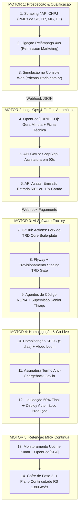

# ARQUITETURA DA ESTEIRA AUTÔNOMA END-TO-END (TRD AI-NATIVE FACTORY)
### A Máquina Autônoma de Prospecção, Fechamento, Engenharia e Sustentação via OpenBot
**TRD Consultoria e Serviços de TI LTDA**  
**Arquiteto:** Thiago Rocha Duarte (Sócio Proprietário & Engenheiro Chefe)  
**Status:** Blueprint de Automação dos Robôs Especialistas (N0 a N4)  
**Data:** 18 de Novembro de 2026 | **Versão:** `v1.0.0-AI-ENTERPRISE`

---

## 1. Visão Geral da Fábrica Autônoma (The AI-Native Boutique)

A tese da **TRD Consultoria** não é contratar exércitos de funcionários CLT para vender e codificar; é orquestrar uma **esteira 100% automatizada por agentes de IA e webhooks integrados**, onde **Thiago Duarte atua exclusivamente como o Arquiteto Humano no Loop (N1)** nos pontos críticos de decisão:
* A prospecção busca e enriquece os dados de PMEs sozinha;
* O Console do site qualifica e pré-dimensiona o escopo automaticamente;
* O OpenBot preenche os contratos, emite cobranças e colhe assinaturas no Gov.br via API;
* O pipeline de CI/CD provisiona o banco e sobe o Staging sozinho;
* Agentes de código aceleram a implementação dos 20% específicos sob o TRD Core Boilerplate;
* O faturamento da parcela final dispara o deploy em produção sem fricção.



---

## 2. Detalhamento dos 5 Motores Automatizados

### MOTOR 1: Captação, Enriquecimento & Inbound do Console
1. **Disparo do Console Web:** Quando o empresário preenche o modal em `trdconsultoria.com.br/#console-engenharia` e clica no botão, o formulário dispara um evento assíncrono para o endpoint webhook da TRD:
   ```json
   {
     "referencia": "TRD-ENG-8402",
     "timestamp": "2026-11-18T20:15:00Z",
     "solicitante": "Carlos Silva",
     "empresa": "Distribuidora Alvorada LTDA",
     "cidade_uf": "Campinas - SP",
     "modalidade": "criacao",
     "escala": "agil",
     "valor_estimado": 9800.00,
     "prazo_estimado": "15 a 20 dias úteis",
     "infraestrutura": ["Banco SQL Dedicado", "APIs/Webhooks/Pix", "Monitoramento Proativo"]
   }
   ```
2. **Ação do Robô `[COMERCIAL]` no OpenBot:**
   - Consulta a API da Receita Federal (CNPJ) para enriquecer o capital social, quadro societário (QSA) e CNAE da empresa;
   - Gera automaticamente o **Laudo Técnico Executivo em PDF** timbrado;
   - Dispara mensagem automática pelo WhatsApp secundário com o laudo em anexo e o link direto da agenda do Google Meet (bloqueada para terças e quintas, das 14h às 17h).

---

### MOTOR 2: LegalOps & FinOps Automatizado (Contrato & Cobrança)
1. **Geração Instantânea da Minuta:**
   - O robô `[JURIDICO]` recebe o sinal de fechamento e executa o template `CONTRATO_DESENVOLVIMENTO_SOFTWARE_SOB_MEDIDA.md`.
   - Preenche automaticamente as cláusulas de Staging Gate (2.4), Anti-Chargeback (3.5), Interlocutor Único (5.4) e Título Executivo (10.3).
   - Anexa o `ANEXO_I_FICHA_TECNICA_STARTER_9800.md` com as 4 telas e regras imutáveis.
2. **Disparo de Assinatura Digital via API:**
   - Envio da requisição para a API de assinatura eletrônica (Gov.br / ZapSign).
   - O cliente recebe o link no WhatsApp e assina pelo celular com reconhecimento facial em 90 segundos.
3. **Emissão de Faturamento via API de Pagamento (Asaas / InfinitePay):**
   - Criação automática da cobrança:
     - *Opção Boleto:* Boleto de entrada de 50% (R$ 4.900,00) com vencimento em 48h;
     - *Opção Cartão:* Link de pagamento em até 12x com acréscimo operacional repassado.
   - Assim que o webhook bancário confirma a liquidação: o status do projeto muda para `APROVADO_INICIAR_ENGENHARIA`.

---

### MOTOR 3: Fábrica de Software AI-Augmented (Tech Delivery)
1. **Provisionamento Automático via GitHub Actions:**
   - O webhook financeiro aciona a esteira de DevOps:
     - Cria o repositório privado `trd-consultoria-ti/prj-[cliente]` clonando o `trd-core-boilerplate`;
     - Cria o banco de dados PostgreSQL 16 isolado na nuvem (Railway/Supabase) no projeto faturado no cartão do cliente;
     - Executa o Flyway Migration inicial criando as tabelas de sessão, auditoria, clientes e pedidos;
     - Realiza o deploy do ambiente Staging: `homologacao-[cliente].trdconsultoria.com.br`.
2. **Geração de Código Assistida por IA (OpenBot + Claude API):**
   - O robô técnico lê a Ficha Técnica Anexo I;
   - Gera os Java Records (DTOs), Entities Jakarta, Spring Data Repositories e Services com Bean Validation;
   - Gera os componentes Angular 18+ com Standalone Components, Signals e tabela `<trd-data-table>`;
   - Thiago Duarte revisa o Pull Request, executa a suíte de testes unitários (JaCoCo > 80%) e faz o merge para Staging.

---

### MOTOR 4: Homologação Blindada & Go-Live Automático
1. **Acesso do SPOC:** O robô envia no WhatsApp do SPOC as credenciais temporárias do ambiente de testes e o vídeo demo preliminar (Loom 5 min).
2. **Cronômetro do Aceite Tácito (5 Dias Úteis):** O sistema inicia a contagem regressiva protocolar.
3. **Liquidação e Liberação do Staging Gate:**
   - O robô dispara o `TERMO_HOMOLOGACAO_E_ENTREGA_DEFINITIVA.md` para assinatura no Gov.br;
   - O webhook bancário emite e cobra a parcela final de 50% (R$ 4.900,00);
   - **Gatilho de Produção:** Com o termo assinado e o dinheiro na conta, o GitHub Actions promove o build de Staging para Produção, aponta o domínio oficial (`app.empresa.com.br`) e envia o vídeo de Onboarding (Loom 15 min).

---

### MOTOR 5: Retenção MRR & Suporte Automatizado
1. **Sentinela Uptime Kuma:** Monitoramento a cada 60s do endpoint `/actuator/health` de cada cliente. Se houver falha de memória, disco ou conexão de banco, Thiago recebe alerta com log filtrado no Telegram antes do cliente perceber.
2. **Triagem de Chamados via OpenBot `[SLA]`:**
   - Mensagens recebidas no canal de suporte são filtradas: áudios são rejeitados com aviso amigável; mensagens de funcionários avulsos são barradas exigindo contato pelo SPOC.
   - Chamados válidos são classificados (P1 a P4) e o cronômetro do SLA (até 4h úteis) é ativado.
3. **Conversão Orgânica para o Plano Continuidade (R$ 1.800/mês):**
   - No 25º dia da garantia de 30 dias, o robô comercial compila as ideias salvas no **"Cofre de Fase 2"** e envia a proposta de continuidade para o dono da PME em 1 clique.

---

## 3. Matriz de Autonomia dos Robôs na Esteira (N0 a N4)

| Processo da Esteira | Nível de Autonomia | O que o Robô Faz Sozinho | Onde Thiago Intervém (Human-in-the-Loop) |
| :--- | :---: | :--- | :--- |
| **Prospecção & Scraping** | **N4 (Total)** | Busca CNPJs, enriquece dados e dispara mensagem autorizada. | Zero intervenção. |
| **Qualificação do Console** | **N4 (Total)** | Lê parâmetros, emite laudo em PDF e sugere horário de Meet. | Zero intervenção. |
| **Reunião de Fechamento** | **N1 (Humano)** | Nenhuma ação na call. | **Thiago conduz a call de 20 min no Meet.** |
| **Geração de Contrato Gov.br**| **N3 (Supervisionado)**| Preenche minuta e sobe no assinador digital. | Thiago clica para assinar com seu certificado. |
| **Emissão de Cobrança / Pix** | **N4 (Total)** | Emite boletos/links e processa webhooks de baixa bancária. | Zero intervenção. |
| **Provisionamento de Staging** | **N4 (Total)** | Cria banco, roda migrations Flyway e sobe URL de teste. | Zero intervenção. |
| **Codificação dos 20%** | **N3 (Acelerado)**| Agente gera entidades, CRUDs e telas Angular base. | **Thiago audita, refina a regra e aprova o PR.** |
| **Homologação & Go-Live** | **N2 (Aprovação)**| Cobra a 2ª parcela e colhe o Termo Anti-Chargeback. | Thiago autoriza a virada para produção com 1 clique. |

---

Este blueprint consolida a estratégia de automação integral da TRD Consultoria, unindo o repositório de governança aos robôs especialistas do OpenBot.
