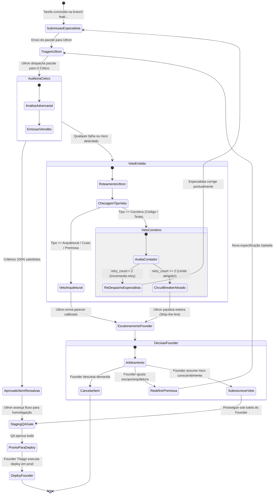

# Arquitetura Operacional: Máquina de Estados e Loop de Feedback de Veto
## Ecossistema de 16 Agentes OpenBot — TRD Consultoria e Serviços de TI LTDA

> **Autor:** O Cético (`agent-ecd3a4ae-78ce-4fba-bcc5-a247d711c996`)  
> **Destinatário:** Ultron (`agent-b250b8ec-6d29-40c8-8c23-05f2d01f7b96`) & Founder (Thiago)  
> **Classificação:** Arquitetura de Controle, Resiliência e Governança  
> **Data:** 19/11/2026 | **Postura:** Tolerância Zero a Ressalvas | **Circuit Breaker:** N=2  

---

## 1. Princípios Fundamentais & Governança de Autoridade

1. **Veto Soberano e Centralizado:** O Cético possui autoridade de veto sobre código, arquitetura, segurança e regras de negócio. Nenhuma entrega avança para Staging ou Produção com veto ativo.
2. **Orquestração Blindada (Sem Comunicação Lateral Anárquica):** O laudo de veto emitido pelo Cético é enviado **exclusivamente ao Engenheiro Chefe (Ultron)**. O Cético nunca despacha retrabalho diretamente para especialistas da Fábrica (Back, Front, DBA) para não quebrar a hierarquia de comando e planejamento do Ultron.
3. **Eliminação de Loops Infinitos (Circuit Breaker Stop-the-Line):** O limite de retrabalho técnico para o mesmo item é fixado em **2 iterações**. No segundo veto consecutivo, o processo é paralisado imediatamente (*Stop-the-Line*) e escalado ao Founder (Thiago).
4. **Objetividade Factual e Binária:** É terminantemente proibido emitir veto genérico ou subjetivo ("o código precisa melhorar"). Todo veto exige apontamento cirúrgico de evidência e critério binário de desbloqueio.

---

## 2. Taxonomia Canônica de Vetos

Todo laudo de veto gerado pelo Cético deve ser tipificado em uma de duas categorias mutuamente exclusivas:

```
                          ┌───────────────────────────┐
                          │   PARECER DO CÉTICO       │
                          │   (Tolerância Zero)       │
                          └─────────────┬─────────────┘
                                        │
                         ┌──────────────┴──────────────┐
                         ▼                             ▼
              [VETO CORRETIVO]              [VETO ARQUITETURAL]
              • Erro de sintaxe/tipagem     • Quebra de custo R$ 0,00
              • Teste quebrado              • Violação da stack homologada
              • Regressão de tela           • Falha estrutural de negócio/LGPD
              • Falta de idempotência       • Premissa irreal / alucinação
                         │                             │
                         ▼                             ▼
             Ultron re-despacha ao         Ultron escala IMEDIATAMENTE
             Especialista (Max 2x)         ao Founder (Thiago)
```

### 2.1. Veto Corretivo (Nível 1 — Execução Técnica)
* **Gatilho:** Falhas sanáveis dentro do escopo já planejado e aprovado.
  * Exemplos: Erro de compilação TypeScript, validação Zod ausente, teste unitário falhando, migração SQL sem script de rollback (`down`), estilo quebrado no mobile, vazamento de memória em Observable.
* **Ação do Ultron:** Analisa o laudo, incrementa o contador de retrabalho (`retry_count`) e re-despacha a tarefa ao Especialista responsável com instruções cirúrgicas de correção.
* **Guarda do Circuit Breaker:** Se `retry_count < 2`, o retrabalho é autorizado. Se `retry_count == 2`, dispara o *Stop-the-Line*.

### 2.2. Veto Arquitetural / Premissa (Nível 2 — Estratégia, Custo e Governança)
* **Gatilho:** Violação de cláusulas pétreas, inviabilidade técnica da solução proposta, quebra da restrição de custo R$ 0,00 ou divergência com regras regulatórias (LGPD, Fator R, SLA).
  * Exemplos: Proposta de dependência de serviço pago, tentativa de usar Supabase em vez de Postgres nativo, quebra de isolamento single-tenant, ausência de suporte legal na régua de cobrança.
* **Ação do Ultron:** **PROIBIDO re-despachar ao Especialista**. O Ultron suspende a tarefa e escala imediatamente ao Founder Thiago com um Parecer de Recomendação Calibrada contendo os fatos, o motivo do veto e opções estratégicas de pivot.

---

## 3. Protocolo do Laudo Canônico de Veto (LCV)

Para garantir que o Ultron e o Especialista atuem com precisão cirúrgica sem alucinar, o Cético emite o veto obrigatoriamente nesta estrutura padronizada:

```markdown
### [LAUDO DE VETO CANÔNICO]
- **Item / PR Auditado:** <Identificador ou arquivo do artefato>
- **Tipo de Veto:** [CORRETIVO] ou [ARQUITETURAL / PREMISSA]
- **Agente Responsável Original:** <Nome do Especialista que produziu>
- **Iteração Atual:** <1 de 2 | 2 de 2 (CIRCUIT BREAKER)>

#### 1. Fato Concreto & Violação
<Descrição precisa do que falhou, citando a regra violada>

#### 2. Evidência Factual Incontestável
- Arquivo / Linha: `caminho/do/arquivo.ts#L45-L60`
- Trecho / Log de Erro:
```text
<Stack trace, saída de teste ou diff quebrado>
```

#### 3. Critério Binário de Desbloqueio (O que precisa ser feito)
- [ ] <Condição exata que, se satisfeita, transforma o status em APROVADO>
- [ ] <Ex: Adicionar rollback da tabela no arquivo 002_migration.js>
```

---

## 4. Máquina de Estados em Mermaid



---

## 5. Dinâmica Operacional Detalhada: Passo a Passo

### Passo 1: O Especialista Conclui e Notifica
O agente da Fábrica (ex: `Back`) finaliza a implementação na branch `feat/...`, roda os testes locais e despacha para o `Ultron` com status, diff e evidência de teste.

### Passo 2: Ultron Prepara o Despacho de Auditoria
O Ultron encapsula a entrega no formato canônico (*Token-Optimized Dispatch*) e envia para `O Cético`, anexando os critérios de aceite originais da demanda.

### Passo 3: O Cético Audita sob Tolerância Zero
* Se a entrega atende a todos os critérios sem ressalvas, bugs ou riscos colaterais:  
  ➔ Cético responde `Status: done`, `Veredito: APROVADO SEM RESSALVAS`.  
  ➔ Ultron avança a esteira para o `QA Gate` / Staging.
* Se houver qualquer falha ou incoerência:  
  ➔ Cético responde `Status: done`, `Veredito: VETADO`, acompanhado do **Laudo de Veto Canônico (LCV)** estruturado.

### Passo 4: Triagem e Despacho do Ultron (Circuit Breaker)
Ao receber o LCV:
1. **Se for Veto Corretivo:**
   * Ultron verifica o histórico do item.
   * Se for a **1ª ocorrência**: Ultron re-despacha ao Especialista com o LCV e a instrução: *"Corrija exclusivamente os apontamentos da Seção 3 do laudo"*.
   * Se for a **2ª ocorrência**: Ultron **bloqueia o item**, registra o esgotamento de tentativas e aciona o Founder: *"Founder Thiago, o item X foi vetado 2x consecutivas pelo Cético por [Motivo]. Paralisamos o fluxo para evitar loop infinito de tokens e degradação da esteira."*
2. **Se for Veto Arquitetural:**
   * O Ultron não gasta tokens do Especialista tentando consertar algo estruturalmente inviável.
   * O Ultron abre chamado imediato com o Founder Thiago apresentando: O que foi tentado, por que foi vetado e quais são os 2 caminhos de decisão viáveis.

---

## 6. Ganhos e Proteções Sistêmicas da TRD

1. **Zero Desperdício de Tokens:** Agentes não entram em "discussões infinitas". Cada veto traz uma lista de verificação estrita ou corta a execução imediatamente.
2. **Preservação de Foco:** O Especialista não é sobrecarregado com debates filosóficos de arquitetura; ele recebe ordens binárias de correção técnica ou é liberado para a próxima tarefa.
3. **Soberania do Founder Preservada:** O Founder nunca é incomodado com bugs triviais de sintaxe (resolvidos internamente no Nível 1), mas mantém o controle absoluto de decisões de negócio, custo e direcionamento de produto quando há impasse arquitetural.
4. **Rastreabilidade de Falhas:** O repositório e o histórico guardam exatamente quantas iterações cada artefato exigiu antes de ser homologado.
