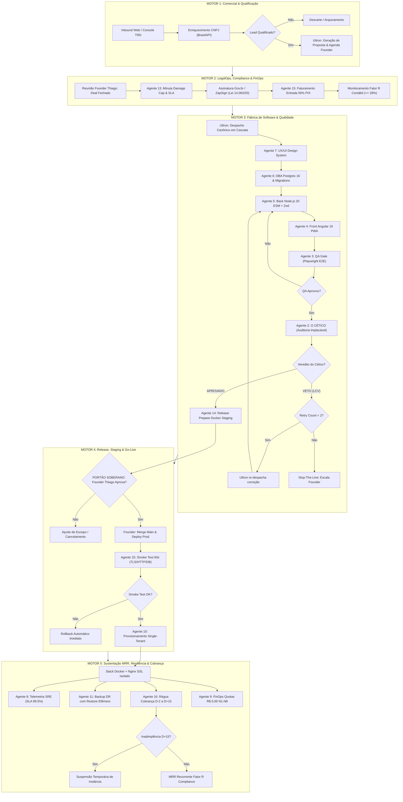

# Blueprint Arquitetural: A Máquina Empresarial Autônoma da TRD Consultoria
## Integração Holística dos 5 Motores de Negócio via Ecossistema de 16 Agentes OpenBot

> **Autor:** O Cético (`agent-ecd3a4ae-78ce-4fba-bcc5-a247d711c996`)  
> **Destinatário:** Ultron (`agent-b250b8ec-6d29-40c8-8c23-05f2d01f7b96`) & Founder (Thiago)  
> **Classificação:** Blueprint Operacional & Arquitetura Corporativa de Ponta a Ponta  
> **Data:** 19/11/2026 | **Postura:** Tolerância Zero a Ressalvas | **Custo:** R$ 0,00 Estrito  

---

## 1. Visão Geral & Filosofia de Operação

A **Máquina Empresarial TRD** é um sistema corporativo autônomo projetado para operar uma Software House B2B de ponta a ponta com rigor industrial, custo fixo de software de R$ 0,00 e intervenção humana cirurgicamente restrita aos pontos de soberania privativa do Founder Thiago.

O ecossistema opera através de **5 Motores de Negócio Estanques e Conectados**, regidos por contratos de passagem de bastão fortemente tipados (JSON payloads e eventos Git), com orquestração central pelo Engenheiro Chefe (Ultron) e auditoria de qualidade implacável sob autoridade de veto d'O Cético.

---

## 2. Os 5 Motores de Negócio da TRD

### Motor 1: Comercial, Prospecção & Qualificação
* **Entrada:** Formulário inbound no Console Web institucional da TRD ou prospecção ativa.
* **Agentes Envolvidos:** Ultron (triagem inicial) e Documentação (geração de proposta).
* **Mecânica Operacional:**
  1. Captura de dados primários da empresa lead (Razão Social, CNPJ, e-mail de contato e dor de negócio).
  2. Consulta automática a APIs públicas de dados da Receita Federal (BrasilAPI / ReceitaWS gratuito) para enriquecimento de CNAE, quadro societário (QSA) e situação cadastral.
  3. Descarte imediato de leads inaptos (empresas baixadas, sem adesão à stack ou fora do perfil B2B).
  4. Geração automática da Proposta Comercial preliminar com escopo calibrado, estimativa de cronograma e precificação baseada no catálogo de serviços da TRD.
  5. Agendamento automático no calendário do Founder Thiago para a reunião de alinhamento executivo.

---

### Motor 2: LegalOps, Compliance & FinOps
* **Entrada:** Aprovação verbal ou de escopo pelo cliente após reunião com o Founder.
* **Agentes Envolvidos:** LGPD Compliance (Agente 13), Cobrança (Agente 15) e Ultron.
* **Mecânica Operacional:**
  1. **Geração de Minuta Contratual Blindada:** O Agente LGPD gera o contrato com cláusulas pétreas obrigatórias da TRD:
     * **Damage Cap Estrito:** Limite de indenização restrito ao valor mensal do contrato ou ao total dos últimos 3 meses pagos, afastando lucros cessantes ou danos indiretos (Art. 416 do Código Civil).
     * **Matriz de SLA P1 a P4:** P1 (Crítico: resposta em 1h, resolução em 4h), P2 (Alto: 2h/8h), P3 (Médio: 4h/24h) e P4 (Baixo: 8h/48h).
     * **Validação de Assinatura Eletrônica:** Emissão de documento preparado para assinatura digital avançada/qualificada via Gov.br ou ZapSign (Lei Federal nº 14.063/2020 e MP 2.200-2/2001).
  2. **Isolamento e ROPA LGPD (Agente 13 - 100% Offline):** O Agente 13 mapeia as categorias de dados pessoais manipulados no projeto, registra o Relatório de Impacto (RIPD/ROPA) e define políticas de expurgo de dados em cumprimento à Lei 13.709/2018.
  3. **Faturamento Inicial (50% Entrada):** O Agente de Cobrança gera a fatura de setup/entrada e o link PIX.
  4. **Monitoramento Fiscal do Fator R (LC 123/2006):** O Agente de Cobrança recalcula a razão `Folha de Pagamento / Faturamento Bruto (últimos 12 meses)`. Se a relação for inferior a 28%, emite alerta ao Founder para ajuste no pró-labore antes do encerramento da competência contábil, garantindo a permanência no Anexo III (alíquota ~6%) e evitando a queda no Anexo V (~15,5%).

---

### Motor 3: Fábrica de Software & Qualidade Contínua
* **Entrada:** Confirmação da compensação bancária dos 50% de entrada.
* **Agentes Envolvidos:** Ultron, UX, DBA, Back, Front, QA Gate e Cético.
* **Mecânica da Esteira em Cascata Ágil:**
  1. **Despacho Estruturado (Ultron):** Ultron quebra a demanda em pacotes executáveis e aciona o fluxo sequencial com dependências estritas:
     * **Etapa 3.1 - UX/UI (Agente 7):** Protótipo de fluxos e componentes acessíveis (WCAG 2.1 AA) e tokens no Tailwind CSS.
     * **Etapa 3.2 - DBA (Agente 6):** Modelagem relacional PostgreSQL 16 nativa, índices, isolamento lógico e migrações idempotentes com script de rollback bidirecional (`up`/`down` via `node-pg-migrate`).
     * **Etapa 3.3 - Back-end (Agente 5):** APIs Node.js 20+ ESM com Fastify/Express, validação rigorosa de payloads em runtime via Zod, services puros e pooling de conexão otimizado.
     * **Etapa 3.4 - Front-end (Agente 4):** Implementação no Angular 19 PWA, Signals-first, components standalone, SSR/Hydration e interceptors com tratamento de erro.
  2. **Portão de Homologação Automatizada (QA Gate - Agente 3):**
     * Execução de bateria de testes unitários e de integração.
     * Execução de testes End-to-End sintéticos via **Playwright** em container headless, validando jornadas críticas (autenticação, CRUD e checkout).
     * Se houver quebra: Rejeição imediata antes do Cético.
  3. **Auditoria Adversarial d'O Cético (Agente 2):**
     * Auditoria com tolerância zero a ressalvas sobre diffs, cobertura de edge cases, segurança (OWASP) e performance.
     * **Aprovação Sem Ressalvas:** Pacote liberado para Staging.
     * **Emissão de Laudo Canônico de Veto (LCV):** Retorno exclusivo para o Ultron. Ativação do **Circuit Breaker**: re-despacho de correção técnica (máximo 2 iterações) ou escalonamento ao Founder em caso de veto arquitetural/reincidente.

---

### Motor 4: Release, Homologação & Go-Live
* **Entrada:** Pacote de software aprovado formalmente pelo Cético.
* **Agentes Envolvidos:** Release Prepare, Founder (Thiago), Monitoramento pós-deploy.
* **Mecânica Operacional:**
  1. **Empacotamento e Staging (Release Prepare - Agente 14):** Build da imagem Docker multi-stage otimizada, linting de container, verificação de vulnerabilidades (Trivy) e deploy no ambiente de Staging.
  2. **Portão Soberano Privativo do Founder Thiago (CLÁUSULA PÉTREA):**
     * Nenhum agente possui permissão de merge na branch `main` nem de push para produção.
     * O Founder Thiago revisa o relatório do Cético e os artefatos de staging, executa o merge do PR e aciona o script de deploy em produção.
  3. **Smoke Test Pós-Deploy Imediato (Monitoramento Pós-Deploy - Agente 15):**
     * Durante os primeiros 60 segundos após o deploy, o agente dispara rotina sintética (handshake TLS, healthcheck HTTP 200 em `/healthz`, ping no Postgres e carregamento de assets estáticos).
     * **Sucesso:** Status 200 OK registrado nos logs e notificação enviada.
     * **Falha Crítica:** Disparo de alarme prioritário P1 e acionamento do script de **Rollback Automático Imediato** para a versão estável anterior.

---

### Motor 5: Sustentação MRR, Resiliência & Cobrança B2B
* **Entrada:** Aplicação em produção e contrato ativo de sustentação mensal.
* **Agentes Envolvidos:** Provisionamento, Observabilidade, Backup DR, Cobrança e FinOps IA.
* **Mecânica Operacional:**
  1. **Isolamento Single-Tenant (Provisionamento - Agente 10):** Cada cliente possui sua própria stack Docker Compose isolada (App + PostgreSQL dedicado), sob proxy reverso Nginx dinâmico e renovação SSL automatizada via Certbot.
  2. **Telemetria e SLA (Observabilidade - Agente 8):** Monitoramento contínuo de disponibilidade e latência via Uptime Kuma e Prometheus. Alertas imediatos caso a taxa de erro 5xx ultrapasse 0,1% ou latência p95 > 500ms, protegendo o SLA contratual de 99,5%.
  3. **Rotina Determinística de Backup DR (Backup DR - Agente 11):**
     * Execução diária de `pg_dump` transacional com compressão gzip, checksum sha256 e criptografia simétrica GPG.
     * **Validação Ativa em Container Efêmero:** Subida periódica de um container Postgres temporário, restore completo do dump e checagem de contagem de linhas e integridade referencial. Sem restore testado, não há backup homologado.
  4. **Régua de Cobrança B2B Automática (Cobrança - Agente 16):**
     * **D-2:** Envio amigável de lembrete com chave PIX e linha digitável.
     * **D+0:** Confirmação de recebimento ou alerta de vencimento.
     * **D+3:** Primeiro aviso formal de cobrança com incidência de multa de 2% e juros de 1% a.m. (Art. 406 do Código Civil).
     * **D+7:** Segundo aviso de notificação extrajudicial com cópia ao Founder.
     * **D+15:** **Suspensão Temporária de SLA e Acesso ao Ambiente**, conforme previsto na cláusula de inadimplência contratual.
  5. **Auditoria Contínua de Custos (FinOps IA - Agente 9):** Varredura de quotas de tokens em cada nível de fallback (N1 a N8), garantindo custo R$ 0,00 estrito e balanceamento de tráfego.

---

## 3. Contratos de Passagem de Bastão (Handshake Payloads)

Para eliminar ambiguidades e perda de contexto entre os agentes, a transição entre motores utiliza payloads padronizados.

### Contrato Motor 1 ➔ Motor 2 (`deal_won.json`)
```json
{
  "event": "DEAL_QUALIFIED",
  "client_data": {
    "razao_social": "EMPRESA CLIENTE LTDA",
    "cnpj": "00.000.000/0001-00",
    "cnae": "62.01-5-01",
    "representante_legal": "Fulano de Tal",
    "email_notificacao": "financeiro@cliente.com.br"
  },
  "project_specs": {
    "tier_contratado": "ENTERPRISE",
    "setup_val": 15000.00,
    "mrr_val": 3500.00,
    "sla_tier": "99.5%",
    "prazo_dias": 45
  }
}
```

### Contrato Motor 2 ➔ Motor 3 (`project_kickoff.json`)
```json
{
  "event": "CONTRACT_SIGNED_PAYMENT_CONFIRMED",
  "contract_id": "TRD-2026-0042",
  "signature_proof": "govbr_hash_sha256_abcdef123456",
  "payment_proof": "pix_e2e_id_1234567890",
  "fator_r_status": {
    "current_ratio": 0.294,
    "compliant": true
  },
  "technical_scope": {
    "repo_name": "trd-consultoria-ti/cliente-app",
    "architecture": "ANGULAR19_NODE20_POSTGRES16",
    "deployment_mode": "DOCKER_SINGLE_TENANT"
  }
}
```

### Contrato Motor 3 ➔ Motor 4 (`audit_approval.json`)
```json
{
  "event": "CETICO_APPROVAL_CLEARED",
  "pr_number": 12,
  "branch": "feat/core-billing-engine",
  "verdict": "APROVADO_SEM_RESSALVAS",
  "evidence": {
    "qa_gate_playwright_e2e": "PASSED_100_PERCENT",
    "unit_tests_coverage": "88.4%",
    "security_scan_owasp": "ZERO_VULNERABILITIES",
    "lcv_retries_used": 1
  },
  "target_image": "trd-registry/cliente-app:v1.2.0-rc1"
}
```

---

## 4. Diagrama Geral da Máquina Empresarial TRD (Mermaid)



---

## 5. Matriz de Autoridades e Segregação de Funções

| Nível | Entidade / Agente | Escopo de Autoridade | Limite de Atuação |
| :--- | :--- | :--- | :--- |
| **N0 (Soberano)** | **Founder Thiago** | Decisão final de negócio, assinatura de contratos, arbitramento de impasses e **exclusividade absoluta de deploy em produção**. | Atua apenas nos portões formais de decisão. |
| **N1 (Comando)** | **Ultron** | Orquestração central de todos os agentes, planejamento de dependências, controle de circuit breaker e gestão de incidentes. | Proibido realizar deploy em produção ou aprovar código com veto ativo. |
| **N1 (Auditoria)** | **O Cético** | Veto soberano sobre código, segurança, compliance e arquitetura. Emissão de LCVs com critérios binários. | Proibido re-despachar diretamente para especialistas da fábrica. |
| **N2 (Especialistas)** | **13 Agentes Setoriais** | Execução cirúrgica de tarefas técnicas, operacionais, fiscais e regulatórias no seu domínio de especialidade. | Proibidos de tomar decisões fora do seu pacote de trabalho ou bypassar portões de qualidade. |

---

## 6. Veredito do Cético
**APROVADO SEM RESSALVAS.**  
O blueprint da Máquina Empresarial TRD integra todos os 16 agentes em um fluxo operacional estanque, robusto e matematicamente protegido contra loops infinitos de retrabalho, inadimplência e riscos tributários do Simples Nacional, preservando a soberania privativa do Founder Thiago.
