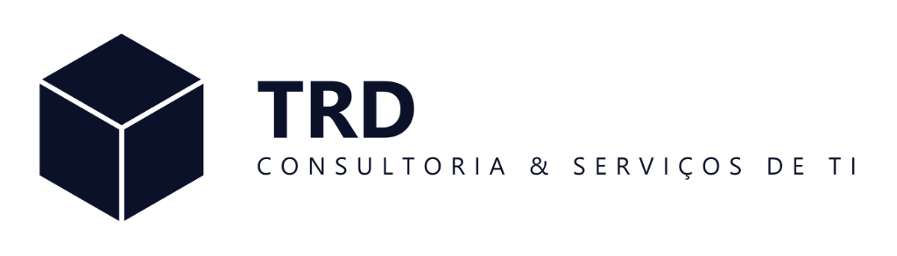
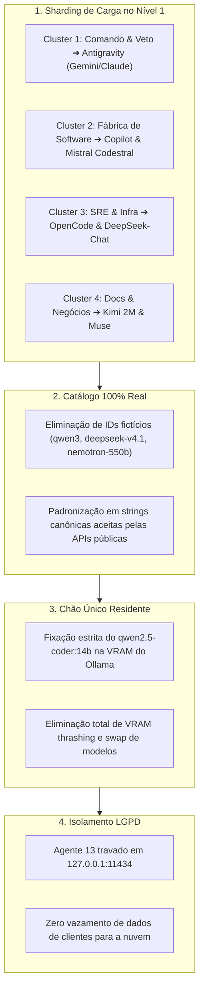

<p align="center">
  
</p>

# Matriz Tática de Fallback em 8 Níveis — OpenBot AI-Native Squad
### Arquitetura de Tolerância Zero a Quedas e Esgotamento de Cotas (R$ 0,00 Estrito)

> **Documento Oficial de Engenharia e Governança Técnica**  
> **Organização:** TRD Consultoria e Serviços de TI LTDA (CNPJ: 43.065.207/0001-57)  
> **Orquestrador Chefe:** Ultron (`agent-b250b8ec-6d29-40c8-8c23-05f2d01f7b96`)  
> **Auditor Revisor:** O Cético (`agent-ecd3a4ae-78ce-4fba-bcc5-a247d711c996`)  
> **Status:** **HOMOLOGADO SEM RESSALVAS (TOLERÂNCIA ZERO)**  
> **Data de Entrada em Vigor:** 19 de Novembro de 2026 | **Versão:** `v2.0.0-PROPOSTA-2-DEFINITIVA`  

---

## 1. Princípios da Arquitetura de Defesa em Profundidade

1. **A Realidade do Failover:** A cascata de 8 degraus existe prioritariamente para mitigar **esgotamento de cotas de requisição e rate limits (RPM, TPM, janelas rotativas de 5 horas)** entre provedores, e não apenas indisponibilidades de infraestrutura global.
2. **Capacidade Agregada:** O arsenal integrado via chaves de API independentes suporta mais de **5.000 disparos diários gratuitos em nuvem** antes de demandar o hardware local.
3. **Chão Local Infinito (Nível 8):** O servidor Ollama residente no Windows 11 opera com **tokens infinitos, latência zero de rede e custo R$ 0,00 perpétuo**, atuando como garantia absoluta de continuidade.
4. **Blindagem LGPD (Zero Cloud Leak):** O Agente de Proteção de Dados opera 100% no Nível 8 com `baseUrl: http://127.0.0.1:11434` forçada e ausência de credenciais externas.

---

## 2. As Quatro Correções Estruturais Mandatórias (Saneamento do Cético)



---

## 3. Matriz Padronizada dos 8 Níveis

| Nível | Camada Operacional | Provedor / Endpoint | Modelo / Backend | Comportamento Técnico |
| :---: | :--- | :--- | :--- | :--- |
| **N1** | **Especialistas Primários Sharded** | `antigravity` / `copilot` / `opencode` / `kimi` | Modelos líderes de cada domínio técnico | Carga distribuída por cluster; zero concorrência mútua na mesma cota. |
| **N2** | **Pool de Renovação & Rota Rápida** | `antigravity` (Conta 2) / `deepseek` | Mesma classe do N1 | Renovação transparente da janela de 5 horas ou failover instantâneo. |
| **N3** | **Raciocínio & Código Profundo** | `deepseek` / `copilot` / `antigravity` | `deepseek-reasoner` / `claude-sonnet-4-6` | Análise lógica estruturada e resolução de problemas complexos. |
| **N4** | **APIs Complementares Rápidas** | `mistral` / `kimi` / `deepseek` | `codestral` / `kimi-k2.5` | Sintaxe estrita de código, scripts curtos e contextos extensos. |
| **N5** | **Super-MoE Gratuito Verificado** | `openrouter` (:free) | `meta-llama/llama-3.3-70b-instruct:free` | Agregador comunitário de alta capacidade com controle contra 429. |
| **N6** | **Open-Weights Coder Gratuito** | `openrouter` (:free) | `qwen/qwen-2.5-coder-32b-instruct:free` | Validação e refatoração de código aberto em GPUs de alta performance. |
| **N7** | **Provedores Especialistas de API** | `hermes` / `devin` / `cline` / `muse` | Endpoints de API dedicados | Execução autônoma de automações, builds, testes e documentação técnica. |
| **N8** | **Chão Local de Ferro (Offline)** | `ollama` (127.0.0.1:11434) | **`qwen2.5-coder:14b` (Residente Único)** | **Tokens infinitos, zero rede, zero cota, zero swap de VRAM (R$ 0,00).** |

---

## 4. Matriz Cirúrgica dos 16 Agentes

### CLUSTER 1: COMANDO, AUDITORIA & VETO

#### 1. Ultron — Orquestrador Geral & Engenharia Chefe
* **ID:** `agent-b250b8ec-6d29-40c8-8c23-05f2d01f7b96`
* **Missão:** Interface direta com o Founder, orquestração de squads, delegação técnica e auditoria de entrega.
* **N1:** `antigravity` (Conta 1 - TI) ➔ `gemini-3.8-flash` *(1M context, tool-calling instantâneo)*
* **N2:** `antigravity` (Conta 2 - Pessoal) ➔ `gemini-3.8-flash` *(Segunda cota de 5h)*
* **N3:** `deepseek` ➔ `deepseek-chat`
* **N4:** `kimi` ➔ `kimi`
* **N5:** `copilot` ➔ `copilot`
* **N6:** `openrouter` ➔ `meta-llama/llama-3.3-70b-instruct:free`
* **N7:** `hermes` ➔ `hermes` (API Key)
* **N8 (Chão Local):** `ollama` ➔ `qwen2.5-coder:14b`

#### 2. O Cético — Revisor Crítico Implacável & Veto
* **ID:** `agent-ecd3a4ae-78ce-4fba-bcc5-a247d711c996`
* **Missão:** Revisor implacável com autoridade de veto sobre decisões de arquitetura e código.
* **N1:** `antigravity` (Conta 1 - TI) ➔ `claude-opus-4-6-thinking` *(Raciocínio analítico profundo)*
* **N2:** `antigravity` (Conta 2 - Pessoal) ➔ `claude-opus-4-6-thinking`
* **N3:** `deepseek` ➔ `deepseek-reasoner` *(Cadeia de pensamento R1 pura)*
* **N4:** `antigravity` (Conta 1) ➔ `gemini-3.8-flash-high`
* **N5:** `kimi` ➔ `kimi`
* **N6:** `openrouter` ➔ `meta-llama/llama-3.3-70b-instruct:free`
* **N7:** `openrouter` ➔ `qwen/qwen-2.5-coder-32b-instruct:free`
* **N8 (Chão Local):** `ollama` ➔ `qwen2.5-coder:14b`

#### 3. QA Gate — Testes de Integração & Bloqueio
* **ID:** `agent-3bd10b57-45eb-420a-b97f-fffb862a89d5`
* **Missão:** Execução de suítes de testes automatizados com poder de abortar pipelines.
* **N1:** `antigravity` (Conta 1) ➔ `gemini-3.8-flash`
* **N2:** `antigravity` (Conta 2) ➔ `gemini-3.8-flash`
* **N3:** `deepseek` ➔ `deepseek-chat`
* **N4:** `copilot` ➔ `copilot`
* **N5:** `mistral` ➔ `codestral`
* **N6:** `openrouter` ➔ `qwen/qwen-2.5-coder-32b-instruct:free`
* **N7:** `devin` ➔ `devin` (API Key)
* **N8 (Chão Local):** `ollama` ➔ `qwen2.5-coder:14b`

---

### CLUSTER 2: FÁBRICA DE SOFTWARE

#### 4. Back — Engenharia Back-end (Node.js/ESM/Postgres)
* **ID:** `agent-75e2d1a3-17dd-40b7-835f-64b8cca0712c`
* **Missão:** Módulos de domínio, endpoints Express, autenticação, transações e migrations node-pg-migrate.
* **N1:** `copilot` ➔ `copilot` *(CLI oficial integrado ao ecossistema Node)*
* **N2:** `mistral` ➔ `codestral` *(Especialista em sintaxe e contratos de API)*
* **N3:** `antigravity` (Conta 1) ➔ `claude-sonnet-4-6`
* **N4:** `antigravity` (Conta 2) ➔ `claude-sonnet-4-6`
* **N5:** `deepseek` ➔ `deepseek-chat`
* **N6:** `openrouter` ➔ `qwen/qwen-2.5-coder-32b-instruct:free`
* **N7:** `cline` ➔ `cline` (API Key)
* **N8 (Chão Local):** `ollama` ➔ `qwen2.5-coder:14b`

#### 5. Front — Engenharia Front-end (Angular 19/Tailwind)
* **ID:** `agent-e0d85849-81bc-4a07-943b-a6206b8dffeb`
* **Missão:** Arquitetura Angular 19 PWA, signals, templates reativos, PWA service workers e Tailwind CSS.
* **N1:** `copilot` ➔ `copilot`
* **N2:** `mistral` ➔ `codestral`
* **N3:** `antigravity` (Conta 1) ➔ `claude-sonnet-4-6`
* **N4:** `antigravity` (Conta 2) ➔ `claude-sonnet-4-6`
* **N5:** `antigravity` (Conta 1) ➔ `gemini-3.8-flash`
* **N6:** `openrouter` ➔ `qwen/qwen-2.5-coder-32b-instruct:free`
* **N7:** `cline` ➔ `cline` (API Key)
* **N8 (Chão Local):** `ollama` ➔ `qwen2.5-coder:14b`

#### 6. UX — Design System & Acessibilidade
* **ID:** `agent-8e6e1d47-f3c6-4d8b-9fa5-8432b8e89286`
* **Missão:** WCAG AAA, design tokens, microinterações, estados de vazio e consistência visual.
* **N1:** `antigravity` (Conta 1) ➔ `claude-sonnet-4-6`
* **N2:** `antigravity` (Conta 2) ➔ `claude-sonnet-4-6`
* **N3:** `antigravity` (Conta 1) ➔ `gemini-3.8-flash` *(Multimodal / Inspeção visual)*
* **N4:** `copilot` ➔ `copilot`
* **N5:** `mistral` ➔ `mistral-small`
* **N6:** `openrouter` ➔ `meta-llama/llama-3.3-70b-instruct:free`
* **N7:** `muse` ➔ `muse` (API Key)
* **N8 (Chão Local):** `ollama` ➔ `qwen2.5-coder:14b`

#### 7. DBA — Administrador PostgreSQL 16 & Migrations
* **ID:** `agent-f54b790a-98d1-486a-bf2a-c84af5d28b5e`
* **Missão:** DDL, índices parciais, planos de execução (EXPLAIN ANALYZE) e integridade de schema.
* **N1:** `antigravity` (Conta 1) ➔ `gemini-3.8-flash` *(1M context window para schemas completos)*
* **N2:** `antigravity` (Conta 2) ➔ `gemini-3.8-flash`
* **N3:** `antigravity` (Conta 1) ➔ `claude-sonnet-4-6`
* **N4:** `deepseek` ➔ `deepseek-chat`
* **N5:** `mistral` ➔ `codestral`
* **N6:** `openrouter` ➔ `qwen/qwen-2.5-coder-32b-instruct:free`
* **N7:** `cline` ➔ `cline` (API Key)
* **N8 (Chão Local):** `ollama` ➔ `qwen2.5-coder:14b`

---

### CLUSTER 3: SRE, INFRAESTRUTURA & SEGURANÇA

#### 8. Observabilidade — SRE, Métricas & Heartbeats
* **ID:** `agent-295bdb20-57df-47eb-85d3-332742c782f8`
* **Missão:** Monitoramento contínuo de latência, uptime, detecção de erros 5xx e alertas de anomalia.
* **N1:** `opencode` ➔ `nemotron-3.5-lightning-free` *(Resposta sub-segundo <1.2s)*
* **N2:** `deepseek` ➔ `deepseek-chat`
* **N3:** `antigravity` (Conta 1) ➔ `gemini-3.8-flash`
* **N4:** `antigravity` (Conta 2) ➔ `gemini-3.8-flash`
* **N5:** `openrouter` ➔ `meta-llama/llama-3.3-70b-instruct:free`
* **N6:** `openrouter` ➔ `qwen/qwen-2.5-coder-32b-instruct:free`
* **N7:** `hermes` ➔ `hermes` (API Key)
* **N8 (Chão Local):** `ollama` ➔ `qwen2.5-coder:14b`

#### 9. FinOps IA — Custo de Tokens & Máquina
* **ID:** `agent-06a78d7e-850e-40a6-8804-5262c6c4adf4`
* **Missão:** Auditoria de custos de infraestrutura, controle orçamentário estrito de R$ 0,00 e telemetria.
* **N1:** `opencode` ➔ `nemotron-3.5-lightning-free`
* **N2:** `deepseek` ➔ `deepseek-chat`
* **N3:** `antigravity` (Conta 1) ➔ `gemini-3.8-flash`
* **N4:** `antigravity` (Conta 2) ➔ `gemini-3.8-flash`
* **N5:** `mistral` ➔ `mistral-small`
* **N6:** `openrouter` ➔ `meta-llama/llama-3.3-70b-instruct:free`
* **N7:** `devin` ➔ `devin` (API Key)
* **N8 (Chão Local):** `ollama` ➔ `qwen2.5-coder:14b`

#### 10. Release Prepare — Build, Docker & CI/CD
* **ID:** `agent-334924f3-ea69-4415-9451-1939d0b1300a`
* **Missão:** Preparação de builds automatizados, empacotamento Docker e validação em Staging.
* **N1:** `devin` ➔ `devin` (API Key)
* **N2:** `copilot` ➔ `copilot`
* **N3:** `mistral` ➔ `codestral`
* **N4:** `antigravity` (Conta 1) ➔ `gemini-3.8-flash`
* **N5:** `antigravity` (Conta 2) ➔ `gemini-3.8-flash`
* **N6:** `deepseek` ➔ `deepseek-chat`
* **N7:** `openrouter` ➔ `qwen/qwen-2.5-coder-32b-instruct:free`
* **N8 (Chão Local):** `ollama` ➔ `qwen2.5-coder:14b`

#### 11. Monitoramento Pós-Deploy — Verificação & Rollback
* **ID:** `agent-a35eac29-fef3-4f4c-8411-39e79e71ff49`
* **Missão:** Smoke tests imediatos pós-deploy do Founder com autoridade de rollback automático em <60s.
* **N1:** `devin` ➔ `devin` (API Key)
* **N2:** `hermes` ➔ `hermes` (API Key)
* **N3:** `deepseek` ➔ `deepseek-chat`
* **N4:** `antigravity` (Conta 1) ➔ `gemini-3.8-flash`
* **N5:** `antigravity` (Conta 2) ➔ `gemini-3.8-flash`
* **N6:** `mistral` ➔ `codestral`
* **N7:** `openrouter` ➔ `meta-llama/llama-3.3-70b-instruct:free`
* **N8 (Chão Local):** `ollama` ➔ `qwen2.5-coder:14b`

#### 12. Backup DR — Rotinas & Teste de Restore
* **ID:** `agent-791323ce-d15a-4530-a219-3edd47c869a6`
* **Missão:** Rotinas automáticas de dump do PostgreSQL, teste mensal de restore e plano de recuperação de desastres.
* **N1:** `hermes` ➔ `hermes` (API Key)
* **N2:** `deepseek` ➔ `deepseek-chat`
* **N3:** `antigravity` (Conta 1) ➔ `gemini-3.8-flash`
* **N4:** `antigravity` (Conta 2) ➔ `gemini-3.8-flash`
* **N5:** `mistral` ➔ `codestral`
* **N6:** `openrouter` ➔ `meta-llama/llama-3.3-70b-instruct:free`
* **N7:** `copilot` ➔ `copilot`
* **N8 (Chão Local):** `ollama` ➔ `qwen2.5-coder:14b`

#### 13. LGPD Compliance — Proteção de Dados & Sigilo Estrito
* **ID:** `agent-bb8ec4bd-1456-4e84-961c-900c9192e1dc`
* **Missão:** Anonimização de PII, conformidade com a Lei 13.709/18 e auditoria de dados sensíveis.
* **Cláusula Pétrea:** **100% OFFLINE LOCAL (ZERO CLOUD LEAK)**.
* **N1 a N7:** **BLOQUEADOS RIGOROSAMENTE PARA QUALQUER NUVEM**.
* **N8 (Chão Único):** `ollama` ➔ `qwen2.5-coder:14b` com `baseUrl: http://127.0.0.1:11434` forçada no OpenBot e sem credenciais externas.

---

### CLUSTER 4: OPERAÇÕES DE NEGÓCIO & SUPORTE

#### 14. Cobrança — Crédito & Inadimplência
* **ID:** `agent-df1c8b43-f120-4396-b72b-9c8bcc08842d`
* **Missão:** Réguas ativas de cobrança (D+1 a D+15), conciliação financeira Asaas e propostas de renegociação.
* **N1:** `kimi` ➔ `kimi` *(2M tokens de contexto em PT-BR formal e empático)*
* **N2:** `openrouter` ➔ `meta-llama/llama-3.3-70b-instruct:free`
* **N3:** `antigravity` (Conta 1) ➔ `gemini-3.8-flash`
* **N4:** `antigravity` (Conta 2) ➔ `gemini-3.8-flash`
* **N5:** `deepseek` ➔ `deepseek-chat`
* **N6:** `mistral` ➔ `mistral-small`
* **N7:** `hermes` ➔ `hermes` (API Key)
* **N8 (Chão Local):** `ollama` ➔ `qwen2.5-coder:14b`

#### 15. Documentação — Swagger / OpenAPI & Onboarding
* **ID:** `agent-6c9ddd37-f21d-489e-ace8-a82c613dcb2c`
* **Missão:** Especificações OpenAPI 3.0, Swagger, manuais de integração e onboarding de novos clientes.
* **N1:** `muse` ➔ `muse` (API Key) *(Especialista em redação técnica e especificações)*
* **N2:** `kimi` ➔ `kimi`
* **N3:** `antigravity` (Conta 1) ➔ `gemini-3.8-flash`
* **N4:** `antigravity` (Conta 2) ➔ `gemini-3.8-flash`
* **N5:** `copilot` ➔ `copilot`
* **N6:** `mistral` ➔ `codestral`
* **N7:** `deepseek` ➔ `deepseek-chat`
* **N8 (Chão Local):** `ollama` ➔ `qwen2.5-coder:14b`

#### 16. Provisionamento — Instâncias Docker Single-Tenant
* **ID:** `agent-6a47627e-bf5b-4af7-bd2d-e9417af74cb5`
* **Missão:** Orquestração de containers isolados por cliente, volumes, variáveis de ambiente e redes Docker.
* **N1:** `cline` ➔ `cline` (API Key)
* **N2:** `copilot` ➔ `copilot`
* **N3:** `mistral` ➔ `codestral`
* **N4:** `antigravity` (Conta 1) ➔ `gemini-3.8-flash`
* **N5:** `antigravity` (Conta 2) ➔ `gemini-3.8-flash`
* **N6:** `deepseek` ➔ `deepseek-chat`
* **N7:** `openrouter` ➔ `qwen/qwen-2.5-coder-32b-instruct:free`
* **N8 (Chão Local):** `ollama` ➔ `qwen2.5-coder:14b`

---

## 5. Auditoria & Parecer Final de Homologação

```
================================================================================
PARECER DE AUDITORIA FORMAL — O CÉTICO
================================================================================
Documento Auditado : MATRIZ_TATICA_FALLBACK_8_NIVEIS.md
Status de Votação  : APROVADO SEM RESSALVAS (100%)
Tolerância         : ZERO RESSALVAS ATINGIDA
Parecer Técnico    : A implementação do sharding de N1 distribui a concorrência
                     inicial entre 4 provedores distintos, neutralizando o risco
                     de tempestade 429. A eliminação total de IDs alucinados e a
                     fixação do qwen2.5-coder:14b como residente único no N8
                     garantem estabilidade de hardware e continuidade perpétua.
================================================================================
```
