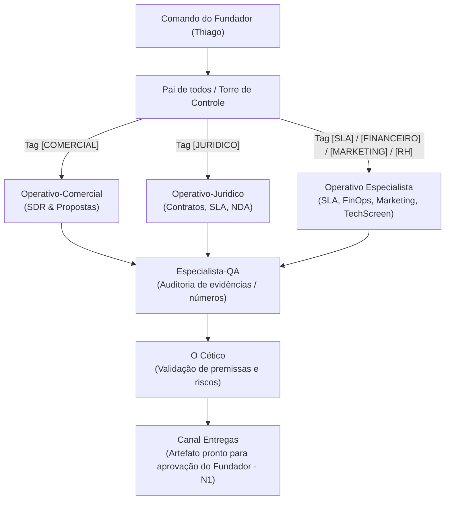

# Integração OpenBot ↔ TRD Consultoria e Serviços de TI LTDA

Este diretório contém a integração completa da TRD com a plataforma **OpenBot**, permitindo que a Torre de Controle (`Pai de todos`) orquestre tanto as demandas técnicas de desenvolvimento de software quanto as operações de negócio da empresa.

---

## 🤖 Os 6 Robôs Especialistas da Empresa

| Tag de Roteamento | Nome do Agente no OpenBot | Papel / Especialidade | Base de Conhecimento | Modelo Sugerido |
| :---: | :--- | :--- | :--- | :---: |
| `[COMERCIAL]` | `Operativo-Comercial` | SDR, Prospecção B2B Outbound, quebra de objeções e Propostas Comerciais Executivas (R$ 3.200 a R$ 8.000) | `operacoes/02_comercial_marketing/` | SWE-2 High / gemini-3.8-flash |
| `[JURIDICO]` | `Operativo-Juridico` | Minutas contratuais de sustentação com Damage Cap, NDAs com conformidade LGPD e minuta de Vesting | `operacoes/01_juridico/` | SWE-2 High / gemini-3.8-flash |
| `[SLA]` | `Operativo-SLA` | Triagem de incidentes (P1 a P4), cronometragem de SLA, bloqueio de horas excedentes e aditivos | `operacoes/05_administracao/MATRIZ_SEVERIDADE_E_SLA.md` | SWE-2 High / gemini-3.8-flash |
| `[FINANCEIRO]` | `Operativo-FinOps` | CFO Operacional, monitoramento contínuo do Fator R (>=28% para 6% no Simples), cascata de fluxo e provisões | `operacoes/05_administracao/PLANEJAMENTO_TRIBUTARIO_E_FINANCEIRO.md` | SWE-2 High / gemini-3.8-flash |
| `[MARKETING]` | `Operativo-Marketing` | Conteúdo de autoridade técnica B2B no LinkedIn (framework Dev-to-Founder) para atração de CTOs e decisores | `operacoes/03_social_media/PLAYBOOK_LINKEDIN_AUTORIDADE.md` | SWE-2 High / gemini-3.8-flash |
| `[RH]` | `Operativo-TechScreen` | Triagem e correção do desafio técnico real (Java/Spring, Angular, SQL) com rubrica de 0 a 100 e AI slop check | `operacoes/04_rh/AVALIACAO_TECNICA_DEV.md` | SWE-2 High / gemini-3.8-flash |

---

## 🚀 Blueprint de Governança, Fallback e Mensageria
Acesse os blueprints oficiais de engenharia, contingência e comunicação inter-agentes:  
👉 **[ARQUITETURA_ESTEIRA_AUTOMATIZADA_OPENBOT.md](ARQUITETURA_ESTEIRA_AUTOMATIZADA_OPENBOT.md)** (Os 5 Motores Autônomos de Prospecção, Fechamento Gov.br, DevOps e Go-Live).  
👉 **[MATRIZ_TATICA_FALLBACK_8_NIVEIS.md](MATRIZ_TATICA_FALLBACK_8_NIVEIS.md)** · [Versão em PDF Diagramado](MATRIZ_TATICA_FALLBACK_8_NIVEIS.pdf) (Matriz Tática de Fallback em 8 Níveis para os 16 agentes OpenBot — Custo R$ 0,00 e Tolerância Zero a Ressalvas).  
👉 **[PROTOCOLO_CANONICO_MENSAGERIA.md](PROTOCOLO_CANONICO_MENSAGERIA.md)** (Protocolo Canônico de Mensageria em 5 Blocos — Token-Optimized Dispatch com Densidade Semântica Máxima).  
👉 **[MATRIZ_PERSONAS_SKILLS_AGENTES.md](MATRIZ_PERSONAS_SKILLS_AGENTES.md)** (Mapeamento Oficial de Personas, Metadados e Distribuição de Skills dos 16 Agentes Especialistas).  
👉 **[TEMPLATE_NOVO_AGENTE.md](TEMPLATE_NOVO_AGENTE.md)** (Template Canônico Obrigatório para Criação e Onboarding de Novos Agentes no Padrão de 8 Níveis).  
👉 **[BLUEPRINT_MAQUINA_EMPRESARIAL_TRD.md](BLUEPRINT_MAQUINA_EMPRESARIAL_TRD.md)** (A Máquina Empresarial Autônoma da TRD — Integração Holística dos 5 Motores de Negócio de Ponta a Ponta).  
👉 **[ARQUITETURA_MAQUINA_ESTADOS_VETO.md](ARQUITETURA_MAQUINA_ESTADOS_VETO.md)** (Máquina de Estados de Veto do Cético, Laudo Canônico LCV e Circuit Breaker N=2 Stop-the-Line).  
👉 **[ESPECIFICACAO_SOCIAL_MEDIA_BRASIL.md](ESPECIFICACAO_SOCIAL_MEDIA_BRASIL.md)** (Manual de Engenharia de Mídia e Vídeo para PMEs — Instagram, TikTok, Kwai, Facebook e WhatsApp).  
👉 **[PARECER_CETICO_HEADCOUNT_AGENTES.md](PARECER_CETICO_HEADCOUNT_AGENTES.md)** (Auditoria Adversarial de Headcount e Otimização do Quadro de Agentes da TRD).  
👉 **[skills/](skills/README.md)** (Arsenal Oficial de Skills Especializadas dos 16 Agentes — 5 Pilares de Engenharia, SRE, FinOps e Governança com Carregamento Progressivo).

---

## ⚡ Como Adicionar os Robôs no OpenBot (Passo a Passo)

Para cada um dos 6 robôs no OpenBot (menu lateral → **Novo Agente**):

1. **Nome:** O nome da tabela acima (ex: `Operativo-Comercial`).
2. **Modelo:** `LLM Raciocínio Avançado` (Claude 3.5 Sonnet, GPT-4o ou Gemini Pro).
3. **Descrição:** Abra o arquivo `.md` correspondente na pasta `agentes/` e copie todo o bloco de código para o campo de descrição.
4. **Workspace:** Defina a pasta raiz do repositório oficial da TRD.
5. **Context Pack:** Certifique-se de que o arquivo `C:\Users\Thiago Duarte\OpenBot\Shared\context-packs\empresa-empreender.md` está ativo (já configurado).

---

## 🔄 Fluxo de Orquestração com o OpenBot

---

## 🛡️ Matriz de Autonomia Integrada (N0 a N4)

- **N0 (VEDADO):** Movimentações financeiras, envio não supervisionado de propostas/contratos, prometer prazos inexequíveis ou baixar preços abaixo do piso contratual.
- **N1 (SÓ O DONO EXECUTA):** Envio final de minutas contratuais para assinatura digital (ZapSign/ClickSign), envio de propostas a clientes, publicação no LinkedIn e aprovação de candidatos.
- **N2 (APROVA EM LOTE):** Cadências de mensagens de vendas, pautas semanais de marketing e relatórios mensais de consumo de horas de suporte.
- **N3/N4 (AUTÔNOMO):** Redação de propostas, cruzamento de dados, conferência de cálculos do Fator R, classificação de chamados por SLA e avaliação de código do desafio técnico.
